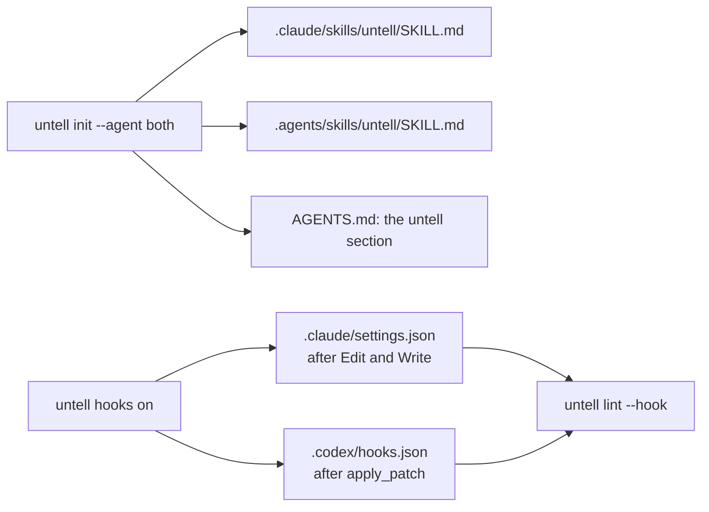

# Agents: Claude Code and Codex

`init` writes one skill text to the place where each harness reads it.



| Harness | Skill | Hook file |
| --- | --- | --- |
| Claude Code | `.claude/skills/untell/SKILL.md` | `.claude/settings.json` |
| Codex | `.agents/skills/untell/SKILL.md` | `.codex/hooks.json` |

Both harnesses read the untell section of `AGENTS.md`. That section stands alone: it holds the loop and its commands,
so an agent that never reads a skill still follows it. Give `--agent claude`, `--agent codex` or `--agent both`.
Without `--agent`, `init` uses the harness that the project shows (`.claude/` or `CLAUDE.md`; `.codex/` or
`.agents/`), then the one that the machine shows, and both when it is not clear. When the kit is already in the
project, `untell init --agent codex` adds only the agent files.

`untell check`, `untell snap`, `untell build` and `untell render` start Google Chrome. Codex in its `workspace-write`
sandbox does not let Chrome start: the error then says that the sandbox stopped Chrome. Run those commands outside the
sandbox (or give the agent full access for them). `untell lint` needs no browser and runs in any sandbox.

## untell hooks

```bash
npx untell hooks on       # the harness this project has; --agent claude|codex|both to choose
npx untell hooks status
npx untell hooks off
```

`hooks on` adds a PostToolUse hook that runs `untell lint --hook` after each file edit. The hook lints the edited file
when it is a film file. When it finds a tell, it writes the findings to stderr and exits with 2. Claude Code and Codex
then show the findings to the agent. For any other file, it prints nothing.

- Claude Code: the hook runs after `Edit` and `Write`, from `.claude/settings.json`.
- Codex: the hook runs after `apply_patch`, from `.codex/hooks.json`. Codex runs a project hook only after you trust
  it: type `/hooks` in Codex.

`on` and `off` change only untell's own entry. The hook runs `npx --no-install untell`, so add untell to the project:
`npm install --save-dev untell`.
