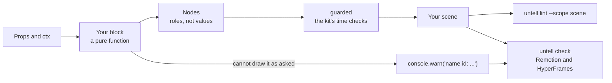

# A block of your own

A block is the unit that a scene builds a film from. The kit has more than 70. When none of them draws what a film
needs, write a block in your project. This guide gives the contract that every block keeps, one small worked
example, and the commands that check it.



## The contract

1. **A pure function.** A block takes its props and the scene context (`ctx`) and returns nodes. The same props and
   the same `ctx` give the same nodes. A block reads no clock, no random number, no file and no state.
2. **Nodes.** A block returns plain nodes: `text`, `rect`, `path`, `circle`, `image`, `audio`. Each node has an id
   that starts with the block's id (`tea-mark-3` for the block `tea`). Motion goes in the node's tracks: keys of
   `opacity`, `x`, `y`, `scale`, `rotate`, `draw` or `reveal` over time. Both renderers draw the same nodes.
3. **Roles, not values.** A colour is a role (`ink`, `inkMuted`, `accent`, `rule`, `surface` and the others). Type is
   a role (`display`, `headline`, `body`, `label`, `caption`). A size comes from `ctx.size(role)`,
   `ctx.lineHeight(role)`, `ctx.stroke` and `ctx.radius`. A time comes from `at`, `until` and `ctx.dur`. A curve is
   a name (`enter`, `move`, `exit`). The system then decides every value, and the block works in every system.
4. **Measure.** A scene must know the box a block takes before it places the next thing. Export a function that
   gives the size for the props, or measure the nodes with `boxOf(ctx, nodes)` from the kit's `scene/blocks`.
   Measure text with `ctx.measure(text, role)`. Never guess a height.
5. **Warnings.** When a block cannot draw what it was asked (a row too long for its box, text outside the text-safe
   area), it still draws, and it says so with `console.warn("<block> <id>: <what changed>")`. `untell check` turns
   that line into a `block-warning` finding on the block's nodes. A block throws only for props it cannot use at all.
6. **The guard.** Wrap the block in `guarded("<block>", draw)` from the kit's `scene/blocks`. The guard is the one
   that every kit block goes through: it checks each `at` and `until`, keeps every track in time order, and makes a
   block given `at` before 0 show at rest on frame 0 in both renderers.

Put the block in a `blocks` folder inside the films folder (`films/blocks/` in HyperFrames, `src/films/blocks/` in
Remotion). `untell lint` then reads it with the films.

## A worked example: tally

`tally` draws a count as a row of upright marks, with its label above: "Days with tea", five of seven marks
filled. It is about 60 lines. The file goes to `films/blocks/tally.ts` (Remotion: `src/films/blocks/tally.ts`).
The import paths are the same in both frameworks.

```ts
// films/blocks/tally.ts
// tally: a count drawn as a row of upright marks, one mark for each item, with its label above.
// A block of this project, not of the kit. It keeps the block contract: a pure function, nodes with ids that start
// with the block's id, colours and type as roles, sizes and times from ctx, a size function, and a warning when it
// cannot draw the row as asked.
import { appear, px, textSafe } from "../../untell/scene/context";
import { guarded } from "../../untell/scene/blocks";
import type { Ctx, Node } from "../../untell/scene/types";

export type TallyProps = {
  id?: string;
  /** The box of the block, px. The marks fill its width and the height under the label. */
  x: number; y: number; w: number; h: number;
  /** What the marks count: "Days with tea". */
  label: string;
  /** How many marks are filled. */
  count: number;
  /** How many marks the row holds. Default: count. */
  of?: number;
  at: number;
  until?: number;
};

/** The width of one mark, the gap between marks, the top of the marks under the label, and the box the block takes. */
export function tallySize(p: Pick<TallyProps, "w" | "h" | "count" | "of">, ctx: Ctx) {
  const n = Math.max(1, p.of ?? p.count);
  // The marks fill the width: n marks and n - 1 gaps of 0.6 of a mark.
  const side = p.w / (n + (n - 1) * 0.6);
  const gap = side * 0.6, top = ctx.lineHeight("label") + ctx.size("label") * 0.6;
  return { side, gap, top, w: n * side + (n - 1) * gap, h: p.h };
}

function drawTally(p: TallyProps, ctx: Ctx): Node[] {
  const id = p.id ?? "tally";
  const n = Math.max(1, p.of ?? p.count);
  const { side, gap, top } = tallySize(p, ctx);
  const tall = p.h - top;
  // A mark under the label size is too small to count on a phone: draw it, and say so.
  if (side < ctx.size("label")) console.warn(`tally ${id}: ${n} marks do not fit ${Math.round(p.w)} px at the label size, so each mark is ${Math.round(side)} px. Give it a wider box or fewer marks.`);
  const labelBox = { x: p.x, y: p.y, w: ctx.measure(p.label, "label"), h: ctx.lineHeight("label") };
  if (!textSafe(ctx, labelBox, "label")) console.warn(`tally ${id}: the label is outside the text-safe area. Move the block inside ctx.safe.`);
  // Tried text and shape: a block call cannot share one measured layout with the row, so tally draws its own nodes.
  const out: Node[] = [{ kind: "text", id: `${id}-label`, x: px(p.x), y: px(p.y), text: p.label, role: "label", color: "inkMuted", tracks: appear(ctx, p.at, p.until, 0) }];
  for (let i = 0; i < n; i++) {
    const filled = i < p.count;
    // The row is drawn at the block's time; each filled mark lands one stagger after the one before it.
    const at = filled ? p.at + (i + 1) * ctx.dur.stagger : p.at;
    out.push({ kind: "rect", id: `${id}-mark-${i}`, group: `${id}-marks`, x: px(p.x + i * (side + gap)), y: px(p.y + top), w: px(side), h: px(tall),
      radius: Math.min(ctx.radius, side / 4), fill: filled ? "accent" : "surface", stroke: filled ? undefined : "rule", strokeWidth: filled ? undefined : ctx.stroke,
      tracks: appear(ctx, at, p.until, 0) });
  }
  return out;
}

export const tally = guarded("tally", drawTally);
```

A scene uses it as it uses a kit block. `tallySize` gives the box before the scene places it:

```ts
// films/tally-film.ts
// A film with a block of the project: tally counts five days of seven, then the line under it says what it means.
import type { Ctx, Node } from "../untell/scene/types";
import type { BLOCKS } from "../untell/scene/blocks";
import { tally } from "./blocks/tally";

export const system = "riso";
export const seconds = 4;

export const scene = (ctx: Ctx, B: typeof BLOCKS): Node[] => {
  const S = ctx.safe, x = S.left, w = S.right - S.left;
  const titleH = (S.bottom - S.top) * 0.22;
  const title = B.title({ id: "claim", text: "5 of 7", x, y: S.top, w, h: titleH, maxLines: 1, at: -1 }, ctx);
  // The line goes under the title. The marks run from under the line down to the picture-safe foot: a graphic may
  // fill the lower band of a tall frame, and only text must stay in the text-safe area.
  const lineY = S.top + titleH;
  const line = B.text({ id: "line", text: "Two without.", role: "headline", x, y: lineY, w, at: 1.4 }, ctx);
  const y = lineY + ctx.lineHeight("headline") * 1.5;
  const foot = ctx.height - ctx.system.margin * Math.min(ctx.width, ctx.height);
  const row = tally({ id: "tea", x, y, w, h: foot - y, label: "Days with tea", count: 5, of: 7, at: 0 }, ctx);
  return [...title, ...row, ...line];
};
```

In Remotion, register the scene as the example film is registered (`sceneComposition` from the kit's `film.tsx`).
In HyperFrames, `untell build films/tally-film.ts` writes the page.

## Check it

```bash
npx untell lint --scope scene films/blocks/tally.ts   # roles, not values, in the block itself
npx untell lint films/tally-film.ts                   # the scene
npx untell check films/tally-film.ts                  # every frame, in your framework
```

- `untell lint --scope scene` reads a block file with the scene rules: a colour value, a font size or a literal
  curve is an error. A raw node asks for a comment above it that names the block tried and why it does not fit
  (`// Tried text and shape: ...`), as in `tally`. Without `--scope scene`, lint reads a file that exports no scene
  with the general rules only.
- `untell check` records the film and runs the detector. The block's nodes get the same checks as a kit block's:
  text that crosses text, the text-safe area, reading size, contrast, motion. A `console.warn` of the block is a
  `block-warning` finding on its nodes.
- Change the system id in the scene and check again. A block that keeps the contract draws in every system.

The package test `packages/untell/test/own-block.test.ts` takes the two files of this page, builds them with the kit
of each framework, and holds them to the contract. With `UNTELL_PROJECTS=<folder>` (a folder with an installed
`remotion` project and an installed `hyperframes` project), it also runs `untell check` on the film in both.
