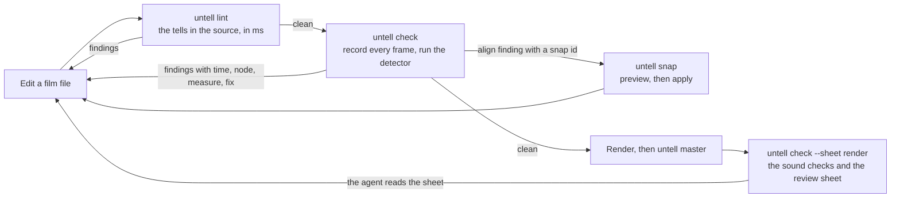
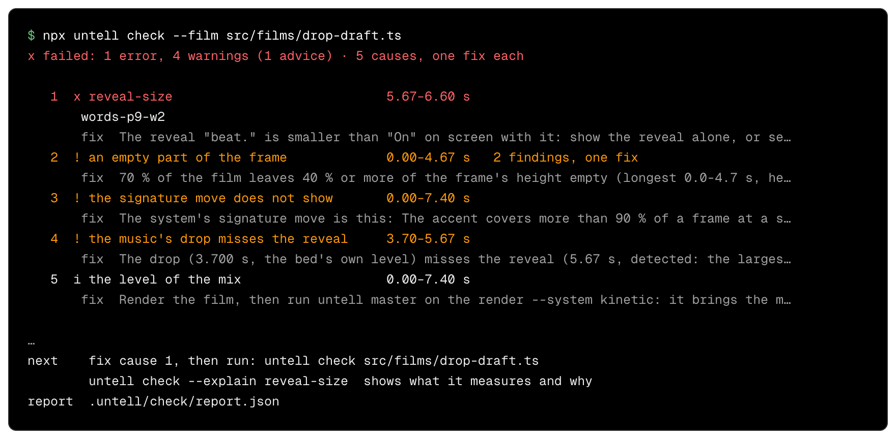
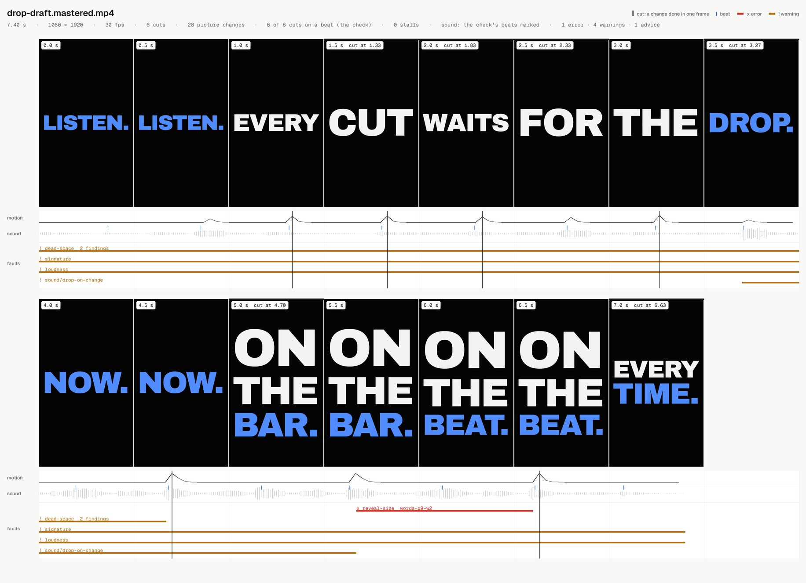
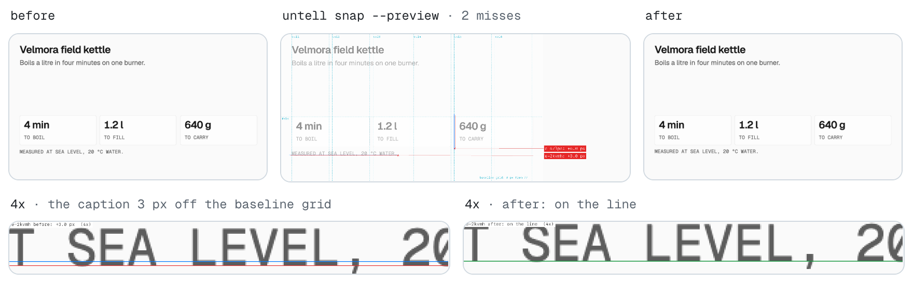

# The checks: lint, check, the sheet, snap

untell makes an agent find its own mistakes. The skill and `AGENTS.md` give the agent this loop.



1. After each edit to a film file, run `untell lint` on that file. Fix every error before the next edit.
2. Run `untell check`. Fix each finding.
3. Render the film. Master it.
4. Before you say that the film is done, run `untell check --sheet <render>`. Open the review sheet and read it.

## A film that untell did not make

```bash
npx untell check film.mp4 --sheet                 # any video: mp4, mov, webm, m4v or mkv
npx untell check film.mp4 --system riso           # the limits of a system, and the rules that need one
npx untell check out/other.mp4 --no-scene         # in a project with scene modules
```

With no scene, untell reads the file alone: the frames (at the file's own rate, at most 30 fps, and at its own size,
at most 1920 px on the long side) and its sound. It
runs each rule that needs only the file: `stall`, `a11y/flash`, `flash-frame`, `dead-space`, and on the
sound `sound/mix-loudness`, `sound/true-peak`, `sound/first-2s-level`, `sound/phone-loss` and
`sound/digital-silence`. With `--system <id>` it also runs `ending`, `accident` (a hold on one flat colour: a dip to
black is an edit in a film with no system) and the rules that take the music as the clock of the picture. Under the findings it lists every rule it did not run, grouped by the reason: most need the scene (its
nodes and the ink of each text); some need the scene's sound clips and the track's beat grid. The report goes to
`.untell/eyes/<file name>/report.json`. It applies when there is no Remotion or HyperFrames project in the folder,
when the project has no scene module of untell, or with `--no-scene`.

## untell lint

```bash
npx untell lint                      # the films folder (src/films or films)
npx untell lint src/films/my-film.ts # one file, or any files and folders
npx untell lint --rules              # every rule
npx untell lint --explain tell/gradient
```


`lint` reads source code and finds the tells: what makes a video read as AI-made (a navy ground, a glow, a default
curve, stock copy) and what breaks the scene contract (a raw colour, a raw font size, a literal curve). It renders
nothing, so it takes milliseconds. [TELLS.md](../../packages/untell/docs/TELLS.md) lists every rule with its reason
and its fix.

To silence one finding, write `// untell-ignore <rule>: <reason>` on its line or on the line above it. Other flags:
`--scope auto|any|scene`, `--max-warnings <n>` and `--json`.

## untell check

`check` runs `untell lint` on the films folder. In a HyperFrames project, it then runs `hyperframes check`. Then it
records every frame of the film and runs the detector on the recording. In the same pass, the recorder captures the
ink of every letter, every SVG shape and the scene's nodes, so the checks know what each pixel is.

- HyperFrames: the recorder records the built page (`index.html`).
- Remotion: untell builds a private page from the scene module and records it. Both renderers draw a scene the same
  way. Give `--film <scene.ts>`, or untell takes the scene that you changed last.

The detector finds what a director sees: an empty opening, a stall, an empty band, two elements that collide in
motion, a line through text, type that a phone cannot read, low contrast over a picture, a soft picture, the same
shot twice, a single-frame accident, an end that does not hold, motion craft, accessibility (contrast, flashes,
colour only, vestibular motion, captions) and type behind a cut-out. Each finding names the time, the node, what it
measured, the limit and the fix. `untell check --rules` lists every check.

| Command | What runs |
| --- | --- |
| `untell check` | lint, the recorder, every picture check |
| `untell check --full` | the same, and a mix of the scene's sound with the mix-based sound checks |
| `untell check --sheet <render>` | the same, the sound checks on the real render, and the review sheet |
| `untell check --no-detect` | lint, the recorder and the cover check only |

The sound checks on a render measure the cut on the beat, the drop on a picture change, each hit over the bed, the
first 2 s, the true peak, silence and the loudness against the system's target. Master the render first.

```bash
npx untell check                                   # after an edit: the picture checks
npx untell check --sheet out/my-film.mastered.mp4  # before done: the sound checks and the sheet
npx untell check --rules                           # every detector rule
npx untell check --explain stall                   # one rule: what it measures, its limit, the fix
```




A check that crashes fails the check: it never reads as a pass. A check that cannot run on the film (no cut-out, no
captions, no sound) is listed with its reason.

### Speed: the recording cache, frame reuse and the machine slots

`check` keeps each recording in `.untell/cache`, keyed by everything that draws it: the page and its bundle, the
fonts and grain, the media files (path, size and time), the HyperFrames runtime, Chrome and its flags, the samplers
and the recorder. A check of a film that did not change takes its recording from the cache. A frame that the scene
says cannot differ from the frame before is copied, not drawn again. `--no-cache` records every frame again.
`untell cache status` shows the cache size; `untell cache clear` empties it.

A recorder takes a machine slot first, so several agents on one machine do not start a Chrome each at once.
`UNTELL_SLOTS` sets the number of slots (the default is half the CPU cores, at least 2; `0` turns the pool off).

## untell sheet

```bash
npx untell sheet out/my-film.mp4 --beats bed
```

<picture>
  <source media="(prefers-color-scheme: dark)" srcset="../assets/sheet-faults-dark.jpg">
  
</picture>


The review sheet is a whole film in one image, for a model to read. Each row is a strip of time: frames every half
second with their times, the motion line (flat means a stall), the waveform with the beats or onsets, red cut marks
and the findings. Findings with a time show on the timeline. Findings without a time are listed under the header.
The sheet also writes `<sheet>.json` with the exact numbers: cuts, stalls, loudness for each second and the beat grid.

## untell snap: alignment as a diff

```bash
npx untell snap films/my-film.ts                      # the near misses at the moment of rest, as hunks
npx untell snap films/my-film.ts --preview c-2hite    # before and after: .untell/snap/my-film/preview.png
npx untell snap films/my-film.ts --apply c-2hite      # write the accepted hunk into the scene
npx untell snap films/my-film.ts --unapply all        # take every applied hunk out again
```


<picture>
  <source media="(prefers-color-scheme: dark)" srcset="../assets/align-dark.png">
  
</picture>


The `align/*` checks of `untell check` find what a designer sees in a still frame: text that is not centred in its
box, an edge 3 px off the line of its neighbour, baselines that differ in one row, uneven gaps, a hairline on half a
pixel. Each finding names the snap id that fixes it. `snap` lists each fix as a hunk: the node, the feature, from and
to in px, the line it joins, why and the confidence. `--preview` draws the frame before and after the moves with the
real renderer, an overlay of the lines and zoomed crops. `--apply` refuses a hunk that you did not preview. `--apply`
writes a snap table at the end of the scene module. Each entry is a relation to another node, so it holds when the
content changes. When many hunks share one cause, `snap` says so: fix the cause in the block instead.
