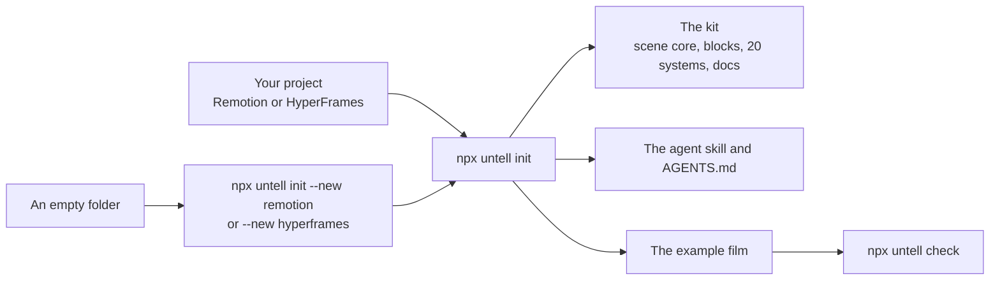

# Install untell

untell copies a kit into a Remotion project or a HyperFrames project. You own the copied code.



## Requirements

| Tool | Needed by | Notes |
| --- | --- | --- |
| Node 20 or later | every command | `npx untell` runs `dist/cli.js` with Node. |
| Google Chrome | `check`, `snap`, `build`, `render` | untell uses your installed Chrome. It does not download a browser. Set `UNTELL_CHROME` to use another Chrome program. |
| ffmpeg | `sheet`, `master`, `render`, `media`, `listen` | Install it with your package manager. |
| Python 3.10 or later | `check` (the detector), `sheet` | untell makes `.venv-media` when your `python3` lacks numpy, Pillow or scipy: with uv when uv is installed, else with `python3 -m venv`. |
| [uv](https://docs.astral.sh/uv/) | `listen setup`, `media setup` | uv makes `.venv-listen` (Python 3.12) and installs the cut-out tools. |

`untell doctor` shows what is installed and what is missing, with the one command that fixes each. It installs nothing.

## What installs on first use

`init` installs the framework packages that the kit needs, and prints their size on the disk. A command that needs
a media tool installs it the first time, and says what it fetches first.

| Command | What it installs | Size |
| --- | --- | --- |
| `untell init` | `three`, `@remotion/player` and the types (Remotion), or `three`, `gsap` and the HyperFrames CLI (HyperFrames), with your package manager | about 330 MB (Remotion) or about 190 MB (HyperFrames) in `node_modules`, measured in a new project; `init` prints the true size |
| `untell check` | numpy, Pillow and scipy in `.venv-media`, only when your `python3` does not have them | about 30 MB to download |
| `untell listen setup` | numpy, scipy, librosa, soundfile, pyloudnorm and matplotlib in `.venv-listen` | 337 MB on disk in one test |
| `untell listen setup --extras` | the stems (torch, torchaudio, demucs) and the character tags (torch, transformers) | the models download on first use: Demucs about 80 MB, CLAP about 600 MB |
| `untell media setup` | the cut-out tools: rembg and its model | about 300 MB |
| `untell render`, the first time the framework draws a film | the framework's own browser: Chrome Headless Shell in `node_modules/.remotion` (Remotion), or in `~/.cache/hyperframes` (HyperFrames) | 140 MB to download for Remotion in one test |

Set `UNTELL_NO_SETUP=1` to stop `check` from making `.venv-media`. `check` then names the command to run.

A check and a render need no network after these installs. The fonts, the scripts and the kit are files in the
project. The framework's browser is the one download that a render can still ask for. To render on a machine with no
network, install it once while you are online:

```bash
npx remotion browser ensure      # Remotion
npx hyperframes browser ensure   # HyperFrames
```

## Run init

Run this command in the root folder of a Remotion project or a HyperFrames project:

```bash
npx untell init
```


In an empty folder, give the framework. `init` makes a minimal project first (it runs `npm install`, a few hundred
MB for Remotion, less for HyperFrames):

```bash
npx untell init --new remotion
npx untell init --new hyperframes --agent codex
```

untell finds the framework. A `hyperframes.json` file marks a HyperFrames project. A `remotion` dependency marks a
Remotion project. When a project has both, give `--framework remotion` or `--framework hyperframes`.

`init` does these steps and prints each one:

1. It copies the kit: the scene core, the blocks, the 20 systems and their docs. The kit goes to `src/untell/`
   (Remotion) or `untell/` (HyperFrames), with the font files in its `fonts/` folder. The fonts load from these
   files: a check and a render make no network request for a font.
2. It adds the packages with the package manager of your project (bun, pnpm, yarn or npm, from the lock file).
   Remotion gets `three` and `@remotion/player` at exactly your `remotion` version, and `@types/three` when
   the project has a `tsconfig.json`. HyperFrames gets `three` and `gsap`: `untell build` copies GSAP's two files
   beside the page, so the page loads them with no network request.
3. It writes the example film `films/untell-example.ts` (in `src/` for Remotion). Remotion: it tells you how to
   register the film. HyperFrames: it builds the film.
4. It writes the agent skill and a section in `AGENTS.md`. See [Agents](agents.md).

Then check the example film. It must pass with no error and no warning:

```bash
npx untell check
```

`init` writes new files. It does not overwrite a file that is already there, unless you give `--force`. It changes
`AGENTS.md` only between its own markers. One exception: in a HyperFrames project, `init` builds the example, and the
build replaces `index.html` with the film page. The build keeps your page in `index.html.before-untell` first. Give
`--no-build` to keep `index.html` as it is. Give `--no-install` to print the package command instead of running it.

## Make a film

A film is a scene module. It exports `system` (a system id), `seconds` and `scene`, a function that returns nodes
from blocks. One scene module works in both frameworks. The systems are in
[systems/README.md](../../systems/README.md). The blocks are in [systems/BLOCKS.md](../../systems/BLOCKS.md).

**Remotion.** Make the module into a composition with `sceneComposition` from `src/untell/film.tsx`:

```tsx
import { sceneComposition } from "../untell/film";
import * as film from "./my-film";

export const MyFilm = sceneComposition("my-film", film);
// In your Root: <Composition {...MyFilm} />
```

**HyperFrames.** Build the module into the project:

```bash
npx untell build films/my-film.ts
npx hyperframes check
npx hyperframes render
```

`build` bundles the scene with the kit into `assets/vs-hyperframes.js`. It copies the fonts and the grain of the
system into `assets/`. It writes the film page `index.html` and the media clips of the scene into it. When
`index.html` is a page that untell did not write, `build` keeps a copy in `index.html.before-untell`. `build` also
sets the HeyGen credit limit of the project to 0.

**Both.** `untell render <film>` renders the final file and masters it. See [Commands](commands.md).
