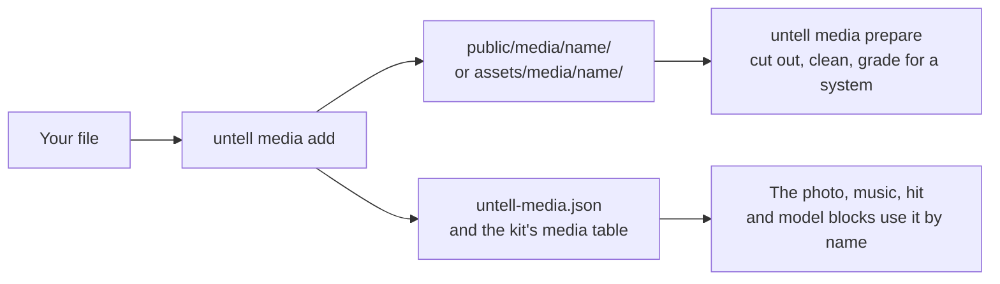

# Media

untell works on media that you bring: a photo, a cut-out, a clip, a track, a sound effect or a 3D model. untell does
not find media and does not check where a file comes from. You keep the responsibility for each file and its licence.



```bash
npx untell media add ~/Pictures/kettle.jpg --as kettle
npx untell media prepare kettle --system studio
npx untell media add ./bed.mp3 --as bed --source "my notes" --licence "my notes"
npx untell media beats bed
```

`add` copies the file into `public/media/<name>/` (Remotion) or `assets/media/<name>/` (HyperFrames) and lists it in
`untell-media.json`. `prepare` cuts out the subject of a photo and grades the photo or the clip for the system. `add`
measures a sound at once. Both write the media table (`media.gen.ts` in the kit), so the `photo`, `music` and `hit`
blocks can use the asset by its name. A lock keeps the manifest and the table correct when several agents work at the
same time.

`prepare` cleans each cut-out: it opens the gaps of backdrop that the subject encloses and removes the rim of backdrop
colour at the edge. It works only on a plain backdrop, and it prints each gap that it opens. When it opens a gap that
is part of the subject (a white or chrome part on a white backdrop), give `--keep-holes`.

`add` takes a 3D model too: a glTF binary (`.glb`), or a `.gltf` with its files beside it. It packs the model into
`model.glb` and writes its bounds in the media table (`MODELS`), so `model("<name>", { height })` in `three/models.ts`
can size and frame it.

`untell media formats` prints the formats and sizes that untell takes. `untell media setup` installs the cut-out
tools (uv, rembg and its model, about 300 MB); `media prepare` runs it when a cut-out needs it.

## Limits

- Footage gets no cut-out: the `photo` block cannot draw `over` with a clip.
- A 3D model with Draco, KTX2 or meshopt compression does not load: the renderer has no decoder for them.
