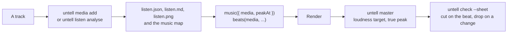

# Sound: listen and master

An agent cannot hear. `untell listen` measures what a sound engineer hears and writes it as data.



## untell listen

```bash
npx untell listen setup                       # once: .venv-listen with numpy, scipy, librosa, soundfile, pyloudnorm, matplotlib
npx untell listen setup --extras              # optional: stems (torch, torchaudio, demucs) and tags (torch, transformers)
npx untell listen analyse bed                 # a track: listen.json, listen.md, listen.png and its music map
npx untell listen analyse ~/Music/draft.mp3   # a file that is not in the project yet: results in .untell/listen/
npx untell listen compare "steady pulse, one clear drop, ends clean"
npx untell listen fx thud                     # an effect: its class, length and transients
npx untell listen mix out/my-film.mp4         # the final mix: loudness, each hit against the bed, the phone check
```


`analyse` gives the tempo, the beat grid, the bars with their loudness, the sections (intro, build, drop, break,
body, outro), the drops, the key and the loudness. For a track in the project, it also writes `music.json` beside
the track and the kit's music table (`music.gen.ts`). With the map, `music({ media, peakAt })` puts the drop (or the
loudest bar) on a film time, and `beats(media, ...)` gives the beat and bar times. `untell media add` of a track runs
the analysis at once when the listen tools are set up.

`mix` takes the film's system and its audio nodes from the last `untell check`. Give `--system <id>` and
`--nodes <capture.json>` to choose. Without nodes, it measures the loudness and the phone check, and it says that it
cannot judge each hit against the bed.

The extras download their models on first use (Demucs about 80 MB, CLAP about 600 MB). untell ships no model.

## untell master

```bash
npx untell master out/my-film.mp4 --system riso
```


`master` measures the render (EBU R128), applies one gain to reach the system's loudness target, and limits the true
peak to -1 dBTP at 4x oversampling. It copies the picture and writes `out/my-film.mastered.mp4`. When the limiter
takes more than 4 dB, the mix is crushed: lower the bed or the hits in the scene, render again and master again.
Without `--system`, it uses the system of the last `untell check`. `--lufs <n>` sets another target. It needs ffmpeg.

`untell render <film>` renders and masters in one command.

## Licences of the listen tools

untell ships no GPL or AGPL code. The listen tools are installed by you as ordinary packages: numpy, scipy, soundfile
(BSD), librosa (ISC), pyloudnorm (MIT), matplotlib (PSF-based); the extras torch and torchaudio (BSD), demucs (MIT)
and transformers (Apache-2.0). Two LGPL libraries come in as dependencies of others: soxr (librosa) and lameenc
(demucs; untell never calls it).
