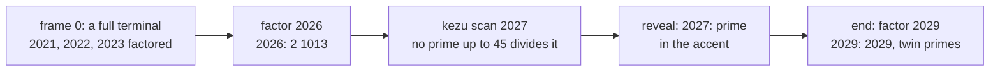

# Next year is prime

- Viewer: a developer on a phone feed.
- The one idea: 2027, next year, is a prime number.
- System: console, because the film is a terminal session and its result.
- Size and length: 1080 x 1920, 13 s.

The old reel's subject (a ping to the Moon) is on every system's list of subjects to avoid ("light's trip to the
Moon"), so the subject changed. Every number on screen is true and can be checked with `factor`.

## Contract

- Hook (by 0.5 s): a full terminal on frame 0 at the text-safe width, with its status bar and the factors of the last
  earlier years in muted ink; `factor 2026` starts to type at the prompt in headline.
- Question: what about next year?
- Answer (drawn as): a scan of every prime up to 45 (the square root of 2027 is 45.02), one remainder after another,
  printed one a row in real time ("2027 ÷ 31  r 12"). No remainder is 0.
- Reveal: "2027: prime" prints in the accent; the status bar says "prime".
- End: `factor 2029` prints "2029: 2029". The status bar names the pair: twin primes. The cursor blinks.

## Signature moves

- Characters type at a human rate; output prints line by line with real timing (`terminal`).
- The result prints in the accent; the rest is muted (`terminal` `result`, `tone: "muted"`).
- The screen scrolls as the rows pass the panel (`terminal` with `h`).

## Facts

- 2021 = 43 x 47; 2022 = 2 x 3 x 337; 2023 = 7 x 17 x 17; 2026 = 2 x 1013.
- 2027 mod 2, 3, 5, 7, 11, 13, 17, 19, 23, 29, 31, 37, 41, 43 = 1, 2, 2, 4, 3, 12, 4, 13, 3, 26, 12, 29, 18, 6.
- 2029 is prime too, so 2027 and 2029 are twin primes.

## Media and sound

- No pictures: Console asks for no photo, and the terminal is the picture.
- Track: `console-music-4`. Console's entry rule is `section`: `music({ align: { track: 36.6, film: 0 } })`, the first
  bar of the section where the bass comes in. Level: the block's gain for the -16 LUFS target.
- Effects: one click when the result prints (`console-click`, `hit({ on })`, the bed dips under it); the keys type in silence, as Console drops key ticks over strong music.
- Licences: the records of `console-music-4` and `console-tick` in `assets/media.json`.

## Checks

- Lint: no finding. Detector: "passed" on the picture and on the mastered render (`out/render/reel-console.mp4`).
- Declared: `ending` (Console ends on its last reply with the cursor blinking; the blink is the last change the check
  reads: a suspected false alarm), `sound/hit-on-beat` on the result click (it lands when the result prints; the
  check before the render reads it off the grid, the mastered check does not). The drop declaration is gone.
- The pane stops at the text-safe foot. `terminal` `foot` lays out every row with no scroll, and this session has 28
  rows; a version that fits 10 rows left the lower half of the pane empty, and the detector failed it on dead space.
- `untell listen mix`: -16.1 LUFS (target -16). Snap at 11 s: no proposal.
- `hf_check`: passed, with one `line_unread` warning on the last prompt "$" (1.93 s against 2 s): a suspected false
  alarm, since a prompt is not a line to read.

## Critique

| Part | Score | Evidence |
| --- | --- | --- |
| Story | 3 | Earlier years factored, 2026, the scan of every prime up to 45, the result in display, then the twin. |
| Type | 3 | One terminal voice in headline; the result in display in the accent; muted history. |
| Layout | 2 | The terminal fills the text-safe area; the lower band (below 1248 px) stays empty, as text may not go there. |
| Motion | 3 | Typing at a human pace, output at real timing, the session scrolls. |
| Media | 2 | No pictures; the terminal is the picture. |
| Sound | 3 | The bed opens on a section; one click on the result. |

- System: amber result, muted ink, monospace session and a status bar read as Console.
- Tell: none clear.

Moves, ranked:
1. Draw the scan as a row of 14 cells under the terminal that fill one by one (a figure in characters in the lower band).
2. A counter in the status bar that runs while the scan runs (`counter`).
3. A third command that scales the pair (the next twin primes), on the last bar.
