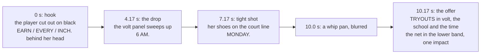

# Zeko Academy tryouts

- Viewer: a teenage player who scrolls a phone feed after practice.
- The one idea: the girls' team holds tryouts on Monday at 6 AM.
- System: courtside, because the film is a call to play, cut hard to a trap beat.
- Size and length: 1080 x 1920, 12.4 s. `sceneCodeOnly` is the same film without its pictures (the media test).

## Contract

- Hook (by 0.5 s): the player from behind fills the middle and lower frame on frame 0, and EARN in display sits
  behind her head. A slow camera push runs from frame 0, with the bed's kick under it.
- Question: earn what, and when?
- Answer (drawn as): the volt panel on the drop, then the day and the hour as one word a beat, and her shoes on the court
  line: the pictures say where; the words say when.
- Reveal (4.17 s): the volt panel covers the frame on the track's drop (`music({ peakAt })` from the panel's own
  full-cover frame, `revealedAt`).
- End (10.17 s, held 2.23 s): a whip pan lands on the offer: TRYOUTS at full width in volt, "Zeko Academy, Mon 6 AM"
  under it, the net footage in the lower band. One impact on the landing.

The old reel's sync (the drop 10 frames after the panel) is folded in from `courtside-sync.ts`: every time comes from
the track's map through `beats()`.

## Signature moves

- A huge condensed word over the subject, which the subject breaks (`kineticWords`, placed by `placeBehind`).
- The volt marks the one word that wins: INCH. (`kineticWords` `accent`), then the volt ground and the offer.
- The drop lands on the biggest change (`wipe` panel, `music({ peakAt })`).
- A whip pan with motion blur to the end card (`camera` `whips`).

## Beats

| Time (s) | On screen | Mover | Text (words) | Sound |
| --- | --- | --- | --- | --- |
| 0.00-1.18 | The player on black, EARN behind her head | a slow camera push | EARN (1) | the kick |
| 1.18-2.18 | The same, EVERY | a 6-frame push on the cut | EVERY (1) | beat |
| 2.18-4.17 | The same, INCH. in volt | a 6-frame push on the cut | INCH. (1) | beat, the build |
| 4.17-5.18 | The volt panel sweeps up; the volt ground stays | the panel, the camera pulls back | none | the drop |
| 5.18-7.17 | The player on volt, 6 AM. behind her head | a slow push | 6 AM. (2) | strongest onset |
| 7.17-10.00 | Her shoes on the court line, cut out on volt | the shoes' push | MONDAY. (1) | strongest onset |
| 10.00-10.17 | A whip pan to the right | the whip | none | the bed |
| 10.17-12.40 | The offer and the net footage | the footage's slow push | TRYOUTS. Zeko Academy, Mon 6 AM (5) | one impact on the landing |

## Media

| Name | Shows | Box and scale | Smallest size | Role |
| --- | --- | --- | --- | --- |
| `athlete-back` | a player from behind, a ball in her hands (no face) | 820 x 1230, cut out, up to 1.11x under the pushes | 853 x 1280 (it is) | subject cut-out |
| `courtside-shoes` | a pair of high-top shoes on a court line, from above | 1300 x 863, cut out, push 6 % (1.08x) | 1280 x 850 (it is) | tight shot cut-out |
| `hoop-net` | a worn net against clouds, from below (footage) | the lower band, 1080 x 1300 | 2560 x 1440 (it is) | end plate, top eased into the ground |

The player was drawn full bleed at 1.39 times its file before. Now it is a cut-out in a box under the file's size, on
black and on volt. Sources and licences: the records of these names in `assets/media.json`.

## Sound

- Track: `m-sparta` (Courtside's entry rule is `drop`): `music({ peakAt: <the panel's full-cover frame> })`. The word
  cuts sit on beats (`beats().onBeat`), the later words and the end on the strongest onset of their stretch
  (`beats().strongest`). Level: the block's gain for the -14 LUFS target.
- Hits: one stamp on the landing (`cutout-stamp`, one short attack); the bed dips under it (the `hit` block's duck). A whoosh
  on the whip, 3 frames earlier, would need its own dip, and two dips that close do not fit in the bed, so the whip is silent.
- Licences: the records of `m-sparta` and `cutout-stamp` in `assets/media.json`.

## Checks

- Lint: no finding. Detector: "passed" on the picture and on the mastered render (`out/render/reel-courtside.mp4`).
- Declared: `sound/cut-on-beat` @4.1-4.3 (the panel's full cover is where `music({ peakAt })` puts the drop),
  `sound/onset-unmatched` @7.3-7.5 (the cut to the shoes lands on the beat 0.2 s before this onset).
- `untell listen mix`: -14.3 LUFS (target -14); the stamp 21 dB over the dipped bed. The first impact file left the true
  peak at -0.8 dBTP after the master (the limiter did not hold -1 dBTP); the short stamp does.
- Snap at 1.5, 6, 8.5 and 11 s: no proposal. `hf_check`: passed, with 3 `escaped_container` warnings on the end card and
  the volt ground, which sit one frame to the right in the world for the whip (a suspected false alarm under a camera
  move).

## Critique

| Part | Score | Evidence |
| --- | --- | --- |
| Story | 3 | Hook, drop, when, where, the offer; the offer is now the largest type of the end (10.17 s). |
| Type | 3 | One word a beat; EARN, EVERY, INCH. share one band; TRYOUTS fills the width. |
| Layout | 3 | The player fills the lower frame; the shoes beat (7.17-10 s) leaves the lower right empty. |
| Motion | 3 | Pushes on the cuts, the panel on the drop, a real whip to the end card. |
| Media | 3 | Three distinct shots in one grade, all sharp. The shoes' cut-out keeps a strip of the court line. |
| Sound | 3 | The drop on the panel and one impact on the landing; the whip is silent. |

- System: volt, condensed type behind the subject and the whip read as Courtside.
- Tell: the shoes' cut-out with its strip of court line is the weakest frame.

Moves, ranked:
1. Make the shoes larger and lower, so they fill the lower half under MONDAY. (`photo` `box`, `focus`).
2. Let the player's head break INCH. a little more (`placeBehind` with a lower band).
3. A whoosh on the whip again, once the music block can dip the bed for two hits 3 frames apart.
