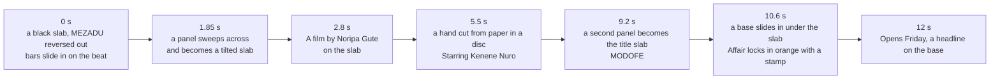

# The Modofe Affair: title sequence

- Viewer: someone on a phone feed who stops for a bold graphic.
- The one idea: a crime film's titles cut from black paper, each name carried on the shape that moves.
- System: cutout, because the film is cut paper: black slabs, one hot shape, type set on the slabs.
- Size and length: 1080 x 1920, 14.8 s.

## Contract

- Hook (by 1 s): a black slab across the frame on frame 0 with the studio's name fitted into it in display,
  reversed out; bars slide in from the edges on the beat.
- Question: whose film is this?
- Answer (drawn as): each credit rides the shape that carries it: the director on a slab, the star beside a hand cut
  from paper, the title on a slab.
- Reveal (10.15 s): "MODOFE" reversed out of the title slab, the largest type of the film (`B.reveal`).
- End (event, hold): a base slides in under the title slab, "Affair" locks in its orange tag with a stamp, "Opens
  Friday" lands on the base in headline, and the frame holds to the end. The base comes a beat before the lock, so the
  lower half is not bare paper while the title reads.

All names are random draws: Mezadu Pictures, Noripa Gute, Kenene Nuro, "The Modofe Affair".

## Signature moves

- A full-frame panel sweeps across and becomes the next shape (the panels become tilted slabs).
- Type set on the slabs at the slabs' angle; one hot shape at a time (the orange tag).
- Stepped motion at 12 frames a second, as cut paper shot on twos and threes.

## Beats

| Time (s) | On screen | Mover | Text (words) | Sound |
| --- | --- | --- | --- | --- |
| 0-1.85 | the studio slab; bars slide in | the bars | MEZADU / Pictures presents | the bed on a crash |
| 1.85-2.8 | panel 1 sweeps and settles as a slab | the panel | | whoosh |
| 2.8-5.5 | the director on the slab; bars in the lower half | the bars | A film by / Noripa Gute | |
| 5.5-9.2 | the hand in the disc; the star credit | the hand cuts in | Starring / Kenene Nuro | stamp |
| 9.2-11.1 | panel 2 becomes the title slab; MODOFE | the panel | The / Modofe | whoosh |
| 10.6-14.8 | the base; Affair locks; Opens Friday | the base, the tag stamps | Affair / Opens Friday | whoosh, stamp |

## Media

| Name | Shows | Box and scale | Smallest size | Role |
| --- | --- | --- | --- | --- |
| cutout-hand | a hand, cut as two-tone paper (source and licence in `assets/media.json`) | a disc 560 px across (`photo` `shape: "circle"`) | under the file's size | the star's shape |

## Sound

- Track: cutout-music-1, entered on its loud section's crash (`align`). Mix target -16 LUFS, set by the master.
- Hits: whooshes on the panels and the base, a stamp on the hand's cut (at the next 12 fps step) and on the title's
  lock. The stamp is a low thump and the bed is loud in its band: `hit` dips the bed under each stamp as deep as that
  band needs (about 10 dB under the hand's, 16 dB under the lock's, where the bed is at its loudest).

## Critique (after the rebuild)

| Part | Score | Evidence |
| --- | --- | --- |
| Story | 3 | A title sequence with a clear order; each credit has its shape. |
| Type | 3 | Display names reversed out of slabs; credits at the slab's angle. |
| Layout | 3 | Slabs cross the frame; the frame is used in each card. |
| Motion | 2 | The panels sweep and settle; the stepped motion is the system's; the bars move on the beat. |
| Media | 2 | One paper hand; it now cuts in on the beat. |
| Sound | 2 | Whooshes and stamps on causes; the beat checks read a sparse grid (see the report). |

- System: black slabs, one orange shape, angled type and stepped motion read as Cutout.
- Tell: none found.

What changed: the studio card opens on a slab with the name in display (the hook); the panels start to become slabs
before they cover the frame (no long black frames); the hand is a photo cropped to a circle (no `.map` patch), cut in on
the beat; the bed and the stamps take their levels from the blocks; positions come from the frame size.

Moves left (from the critics): the disc splitting or turning in 90-degree steps on the bars; the orange shape as one
diagonal through the title; the slabs built by a block (they are still raw nodes: no block turns a wipe into a shape).
