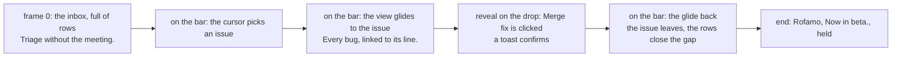

# Rofamo

- Viewer: an engineering lead on a phone feed.
- The one idea: Rofamo links every bug to the line that fixes it.
- System: graphite, because the film is a product UI at work, calm and exact.
- Size and length: 1080 x 1920, 15.6 s.

## Contract

- Hook (by 1 s): real, dense UI on frame 0: the inbox window full of rows to the foot of the text-safe area, the
  headline in its slot above it.
- Question: how does a bug get closed without a meeting?
- Answer (drawn as): the cursor picks the issue; the diff shows the bad line and the fix (a minus row and a plus row).
- Reveal (the track's drop): the click on "Merge fix" and the toast "Merged".
- End: the merged issue leaves the inbox and the rows close the gap; the name and its line take the headline slot
  over the inbox, held 3 s.

The old reel drew the app from 21 raw nodes and patched a codeBlock; this one uses only the ui kit (`uiWindow`,
`listRow`, `toast`, `cursor`), `codeBlock`, `camera` and `endCard`. All names and initials are a new random
draw.

The inbox is the system's window box (`uiWindow` with no box): it runs to the picture-safe foot. Five issues sit in
dense rows of one line each (title, priority, initials and age), sharing the room to the text-safe foot; under them
the list's rules run on at the same pitch to the window's foot, as an app's list does, so the pane is never empty.
The window's toolbar has the tabs Open and Closed, and a `counter` beside Closed: 12, and 13 from the beat the merged
issue leaves (the direction's end: a count ticks to its end state). The rows are built with `listRow`, not with the
window's `rows`, because the merged issue leaves while the window stays. The issue window has a toolbar with the "Merge fix" action, and its `codeBlock` runs to the window's foot
(`foot`). The earlier week's chart is gone: Graphite's direction avoids `barChart` (a product film shows the product
working), and its labels left the text-safe area.

The accent marks one thing at a time: the selected row, then the merge button and the toast, then the name's mark.

## Signature moves

- The camera glides to the next panel on the move curve (`camera` `moves`), the headline pinned in its slot.
- Dense rows with the selected one marked by the accent bar (`listRow` `selected`).
- A cursor that clicks real parts (`cursor` `to`, `clicks`), with a click sound only on a real click.

## Beats

| Time | On screen | Mover | Text | Sound |
| --- | --- | --- | --- | --- |
| 0 to bar 1 | The inbox, full | the cursor enters | Triage without the meeting. (4) | the bed |
| bar 1 | The cursor clicks the issue; the row is selected | the click | | a click |
| bar 2 | The glide to the issue; the diff's rows rise: the bad line and the fix | the glide, the rows | Every bug, linked to its line. (6) | bar |
| bar 3 (the drop) | The cursor clicks Merge fix; the toast | the click | Merged | the drop |
| bar 4 | The glide back; on the next beat the issue leaves, the rows close the gap, and Closed counts 13 | the glide, the rows, the count | Closed before standup. (3) | bar |
| the strongest accent of the last bars (13.7 s) | The name and the line in the headline slot | a cut, then a hold | Rofamo. Now in beta. (4) | the bed fades |

## Media and sound

- No pictures: the product UI is drawn by the ui kit from the system's tokens.
- Track: `graphite-music-8` (Graphite's entry rule is `drop`): `music({ peakAt: <the merge> })`; every step on a bar
  of the track's grid (`beats()`).
- Track entry: the merge lands on the drop's measured rise (7.5 s), one beat before the bar line the map guessed.
- Effects: a click on the first cursor click (`graphite-click`, `hit({ bed })`; the bed dips under it as deep as the
  click's band needs); the drop carries the click on Merge fix.
- Licences: the records of `graphite-music-8` and `graphite-click` in `assets/media.json`.

## Checks

- Detector: no finding and no declaration on the scene's pass. The rendered pass was not run after the rebuild.

## Critique

| Part | Score | Evidence |
| --- | --- | --- |
| Story | 3 | The inbox, the pick, the diff, the merge on the drop, the issue gone, the name. |
| Type | 3 | One headline slot that cuts on the bar; dense one-line rows; the code at a size a phone reads. |
| Layout | 3 | Five rows to the text-safe foot and the list running on to the window's foot; the diff pane runs to the window's foot. |
| Motion | 3 | A cursor that clicks real parts, two glides, a slow push while each view is read. |
| Media | 2 | No pictures; the UI is drawn by the kit. |
| Sound | 3 | The drop on the merge, one click on the first real click. |

- System: dark calm UI, one accent at a time, glides with the headline pinned.
- Tell: the diff's minus and plus lines share one colour.

Moves, ranked:
1. Mark the diff's two lines once the codeBlock has a diff colour that is not the accent.
2. A slight tilt on each glide (`camera` `tiltY` 4-6 degrees, back to 0).
