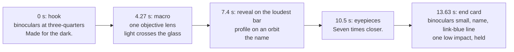

# Zodeno 7x50

- Viewer: a person who scrolls a phone feed and stops for a product lit on black.
- The one idea: these binoculars are made for the dark.
- System: keynote, because the film is one product that emerges from black and is lit, slowly.
- Size and length: 1080 x 1920, 16 s.

## Contract

- Hook (by 2 s): the binoculars lit on black on frame 0, at three-quarters, on a slow push. The line "Made for the
  dark." sits above them. A light band crosses the barrels at 1 s.
- Question: what makes binoculars made for the dark?
- Answer (drawn as): the camera goes into the objective lens: the wide glass and its brass rim fill the frame, and
  the light crosses the glass. Then the fact, true by the product's name: a 7x50 binocular magnifies 7 times.
- Reveal (7.4 s): the binoculars in profile on an orbit, and the name "Zodeno". It lands on the loudest bar of the
  track.
- End (13.63 s, held 2.37 s): a cut on the bar to the binoculars small and centred, with "Zodeno 7x50" in headline
  under them and "Made for the dark." in the link blue. One low impact lands on the cut.

## Signature moves

- The light sweep: in each shot a narrow band of light crosses the object once (`product` `sweep`).
- Slow push-ins, and no shot stops: push, detail push, orbit, turntable (`product` `shot`).
- One line of type per scene, revealed through a mask (`title`, line reveal), cut with the picture (`exit: "cut"`).

## Beats

| Time (s) | On screen | Mover | Text (words) | Sound |
| --- | --- | --- | --- | --- |
| 0.00-4.27 | The binoculars at three-quarters, large, under the line | the push, the sweep at 1 s | Made for the dark. (4) | the bed, audible from frame 0 |
| 4.27-7.40 | A macro: one objective lens and its brass rim fill the frame | the push, the sweep across the glass | none | the bed rises |
| 7.40-10.50 | The reveal: the binoculars in profile, the name above | the orbit | Zodeno (1) | the loudest bar of the track |
| 10.50-13.63 | The eyepieces toward the viewer, the fact above | the turntable | Seven times closer. (3) | a loud bar |
| 13.63-16.00 | The end card: the binoculars small, the name and the line under them | the cut, then a held finish | Zodeno 7x50. Made for the dark. (5) | one low impact on the cut, the bed fades |

## Media

| Name | Shows | Box and scale | Smallest size | Role |
| --- | --- | --- | --- | --- |
| `keynote-binocular` | a real 3D model of a pair of leather and brass binoculars | the whole frame (3D view), the object up to 86 % of the frame width | a model: no pixel size; its 2k textures stay sharp at this size | the subject, in five shots |

Source and licence: the record of `keynote-binocular` in `assets/media.json` (CC0 1.0). The model shows no maker's
mark. Code draws nothing of the object.

## Sound

- Track: `keynote-music-2` (the system's entry rule is `swell`): `music({ peakAt: 7.4, peak: "loudest" })` puts the
  track's loudest bar on the reveal. The bed is audible from frame 0. Level: the block's gain for the -18 LUFS target.
- Cuts: every cut is on a bar of the track's grid (`beats().onBar`): 4.27, 7.40, 10.50 and 13.63 s.
- Hits: one low impact (`mark-impact`, one attack) on the end card's cut (`hit({ on, bed })`). A swell effect on the
  reveal was masked by the bed at that bar, so the bed's own loudest bar carries the reveal.
- Licences: the records of `keynote-music-2` and `mark-impact` in `assets/media.json`.

## Checks

- `bun scripts/lint/cli.ts examples/reels/keynote.ts`: no finding.
- `bun scripts/detect.ts reel-keynote --films src/films/reels.tsx`: "passed" on the picture and "passed" on the
  mastered render (`out/render/reel-keynote.mp4`, rendered from the check's recording, then mastered).
- No declaration: the checks on the picture and on the mastered render find no fault.
- `untell listen mix`: -18.0 LUFS (target -18); the impact stands 29 dB over the ducked bed in its band.
- Snap at 2, 9, 12 and 15 s: no proposal. `hf_check` (HyperFrames): passed, no warning.
- Each shot ends on its cut, with no overlap. The renderer now draws a new 3D view on its first frame.

## Critique

Three passes on the review sheet, at full size and at 390 px wide.

| Part | Score | Evidence |
| --- | --- | --- |
| Story | 3 | A hook with the subject on frame 0, a macro that goes into the glass (4.3 s), the reveal on the loudest bar (7.4 s), a held end. The answer is half typed: "Seven times closer." names a fact that the picture does not draw. |
| Type | 3 | One line a scene, one voice, centred on the frame like the object. All lines read at 390 px. |
| Layout | 2 | The opening shot leaves the lower 45 % of the frame empty (0-4.3 s); the end card sits high because the name must stay above the low band. |
| Motion | 3 | Each shot moves (push, detail push, orbit, turntable) and each cut is on a bar. The light sweeps are faint on the dark leather. |
| Media | 3 | One real model in one light, four distinct angles. No maker's mark. |
| Sound | 3 | The bed is audible from frame 0 and its loudest bar is on the reveal; one low impact on the end card, the bed dipped under it. |

- System: the black ground, the one line a scene, the slow pushes and the link-blue line make it Keynote from three frames.
- Tell: none clear. The worn brass reads as a real object.

Moves, ranked:
1. Make the reveal the largest frame: a closer profile at 7.4 s (`product` `fill` up, `room` from the name's foot).
2. Move the opening pair onto the optical centre (`lineAndSubject`), so the lower band holds the object.
3. Draw the fact: a slow push into the eyepieces while "Seven times closer." reads (`product` `shot: "push"`).

What untell should do: the `product` block's first frame in the recorder is empty, so a cut between two shots needs a
one-frame overlap (see the scene); `render.ts` takes 20 min or more for a 3D reel through Remotion on a loaded machine,
so this render came from the check's recording (`--via recording`).
