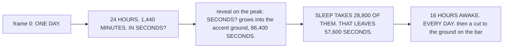

# One day

- Viewer: a person on a phone feed, sound on.
- The one idea: of the 86,400 seconds in a day, sleep leaves 57,600.
- System: kinetic, because the film is words cut on a beat, and the words are the subject.
- Size and length: 1080 x 1920, 11.4 s.

The old reel's subject (the speed of light, and its trip to the Moon) is on Kinetic's list of subjects to avoid, so
the subject changed. Every number is arithmetic.

## Contract

- Hook (frame 0): ONE DAY. in display, edge to edge.
- Question: how much of a day is yours?
- Answer (drawn as): the count steps down the units, one beat pair a step; the number that answers fills the frame.
- Reveal (on the track's peak): the accent word SECONDS? grows until it becomes the ground, and 86,400 lands on it.
- End: 16 HOURS AWAKE. EVERY DAY., then a hard cut to the ground on the bar.

## Signature moves

- Display type bleeds edge to edge (`kineticWords`).
- The accent word grows into the next ground on the reveal (`kineticWords` `exit: "toGround"`, then `onAccent`).
- Every phrase lands on a beat pair (`beats()`).

## Facts

- 24 x 60 = 1,440 minutes; 1,440 x 60 = 86,400 seconds.
- 8 hours of sleep: 8 x 3,600 = 28,800 seconds. 86,400 - 28,800 = 57,600 seconds = 16 hours.

## Media and sound

- No pictures: the words are the subject. (The old reel's one picture could not make the three distinct shots that a
  Kinetic film with pictures needs.)
- Track: `kinetic-music-3` (Kinetic's entry rule is `drop`): `music({ peakAt: <the reveal> })`; every phrase is on a
  beat pair of the track's grid. No effects: Kinetic's cuts land on the kick.
- Licence: the record of `kinetic-music-3` in `assets/media.json`.

## Checks

- Lint: no finding. Detector: passed, 0 errors, 0 warnings, on the picture and on the mastered render
  (`out/render/reel-kinetic.mp4`).
- `untell listen mix`: -14.1 LUFS (target -14); a phone speaker loses 5.0 dB of this house bed.
- Snap at 1, 4, 6 and 10 s: no proposal.
- `hf_check`: passed, with one warning: `line_unread` on "AWAKE." (0.97 s on screen, HyperFrames asks 2 s for a closing
  line). Kinetic's end is a hard cut on the bar with no hold and no restatement (`direction.ends`: kind cut, hold 0),
  so this is a conflict between HyperFrames' rule and the system's end, reported as a suspected false alarm.

## Critique

| Part | Score | Evidence |
| --- | --- | --- |
| Story | 3 | A question at 2.0 s ("In seconds?"), the answer on the peak (3.47 s), then a turn: what sleep takes and what is left. |
| Type | 4 | One phrase a beat pair, edge to edge, the accent on the one number or word that matters. |
| Layout | 3 | Two-line phrases fill the frame; one-word phrases ("AWAKE.") leave the lower half empty for a beat pair. |
| Motion | 3 | Every phrase pops on its beat; no word slides through another. The accent ground cuts on the peak. |
| Media | 2 | No pictures; the type carries the film. |
| Sound | 3 | On the grid; the peak on the reveal; the film cuts on the bar. |

- System: edge-to-edge condensed capitals, the blue ground on the peak and beat cuts read as Kinetic.
- Tell: none clear.

Moves, ranked:
1. Grow the accent word "86,400" until it fills the frame and becomes the ground (needs the word-to-ground block the
   system names as missing).
2. Carry "DAY." across beats as the stack grows (`carry`), so one word stays while the next enters.
3. Set the one-word phrases in a taller box so they fill the frame height.
