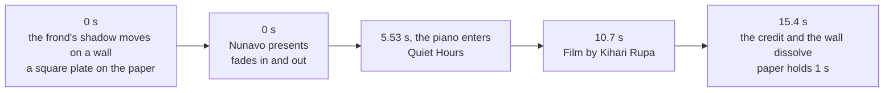

# Quiet Hours: opening titles

- Viewer: someone on a phone feed who stops for a quiet frame.
- The one idea: a short film opens in silence of paper, one name at a time.
- System: ma, because the film is one real image in a large field of paper and one line at a time.
- Size and length: 1080 x 1920, 16.4 s.

## Contract

- Hook (by 2 s): the shadow of a palm frond moves on a pale wall from frame 0, a square plate in the middle of
  the paper (about a quarter of the frame).
- Question: what film is this?
- Answer (drawn as): the credits, one at a time, on the paper over the wall.
- Reveal (5.53 s): the title, larger, in the same place, its fade starting on the piano's entrance, the track's drop
  at its measured rise in the sound (`B.reveal`).
- End (event, hold): the director's credit and the wall dissolve into the paper; 1 s of paper holds under the last
  decay.

All names are random draws: Nunavo, Kihari Rupa. The film "Quiet Hours" is fictional.

## Signature moves

- Every entrance and exit is a slow fade through the paper (`photo` `exit: "dissolve"`, `title` by the system's
  vocabulary).
- At least 70 % of the frame is empty paper; the one image and the one line sit in it.
- One credit per musical phrase, each in its own silence of paper (the next credit waits until the last has gone).

## Beats

| Time (s) | On screen | Mover | Text (words) | Sound |
| --- | --- | --- | --- | --- |
| 0-0.3 | the wall on the paper | the shadow | none | the first note |
| 0.3-4.9 | the wall; the first credit | the fade | Nunavo / presents (2) | the sparse opening |
| 5.53-9.5 | the wall; the title | the fade | Quiet Hours (2) | the piano enters (the track's drop) |
| 10.7-14.8 | the wall; the director's credit | the fade | Film by / Kihari Rupa (4) | |
| 14.8-15.4 | the credit and the wall dissolve | the fade | | |
| 15.4-16.4 | paper | none (held) | | the last decay |

## Media

| Name | Shows | Box and scale | Smallest size | Role |
| --- | --- | --- | --- | --- |
| ma-palm | footage: the shadow of a palm frond moving on a pale wall, no person (source and licence in `assets/media.json`) | a square of 648 px, the 2560 x 1440 file at 0.45x, played at 0.6 speed | any: no upscale | the one image |

The earlier cut drew a 172 px square of the clip and a flat square as a placeholder before it; the footage at a full
9:16 frame would have been drawn at 1.33x (soft).

## Sound

- Track: ma-music-3, entered at its start by the system's rule (`start`), on its first note (0.7 s into the file), so
  the first frame is not silent. Mix target -20 LUFS, set by the block and `untell master`.
- The drop: the map put it on a bar line (5.17 s in the film); the render shows the rise of the piano at 5.53 s. The
  map now keeps the drop pinned there (`untell-listen analyse ma-music-3 --drop 6.233`), and the title starts on it.
- Hits: none. Ma allows no effects.

## Critique (after the rebuild)

| Part | Score | Evidence |
| --- | --- | --- |
| Story | 2 | Opening titles: a calm order of credits, with the title as the reveal on the piano's entrance. |
| Type | 3 | One line at a time, centred over the wall, body for credits and display for the title; readable at 390 px. |
| Layout | 3 | The line at the top, the plate under it, three quarters paper. |
| Motion | 3 | Only fades and the shadow's own motion; one mover per beat. |
| Media | 3 | Real footage, sharp, in the system's muted grade. |
| Sound | 2 | Sparse piano from its first note, the credit on the piano's entrance; no room tone (no block for it). |

- System: paper, one muted moving image, slow fades and one centred line read as Ma.
- Tell: none found.

Moves left: room tone under the first note (Ma's block map names it as missing); a bilingual title, which needs a
vertical text block.
