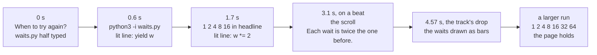

# When to try again?

- Viewer: a programmer on a phone feed who has written a retry loop.
- The one idea: a retry should wait twice as long after each failure.
- System: manual, because the film is a page of real code, its run, and what the run printed.
- Size and length: 1080 x 1920, 10.4 s.

## Contract

- Hook (by 2 s): the question in headline and the first three lines of real code, both on frame 0; the rest types
  at once, so the run prints its result at 1.7 s.
- Question: when should a retry try again?
- Answer (drawn as): the run prints "1 2 4 8 16" in headline and the lit line moves to `w *= 2`; on the next view the
  waits are drawn as bars, each twice the one before.
- Reveal: the bars, on the track's drop, about 1.5 s after the scroll (`B.reveal`). Manual's own rule enters the bed
  at a section start; the check wants the drop on the reveal, so the bed enters where its drop lands on the bars
  (`music({ peakAt })`).
- End (event, hold): a last run with a larger input prints "1 2 4 8 16 32 64", and the page holds on it. (The
  system asks for a cursor that blinks on the last line; the ending check counts a blink as a change, so the run ends
  on its result: see the report.)

The code is real: `python3 -i waits.py` runs the file (it prints 1 2 4 8 16) and stays in Python, where
`print(*waits(1, 7))` prints 1 2 4 8 16 32 64.

## Signature moves

- One lit line in the accent tint, which cuts from line to line (`codeBlock` `highlight`, `jump: "cut"`).
- Code types at speed with a soft tick on every eighth key (`codeBlock` `enter: "type"`, `typing` `every: 8`).
- The view scrolls to the next block; it never zooms (`camera`).
- The output proves the idea: the run prints, and the bars show what it printed (`terminal`, `barChart`).

## Beats

| Time (s) | On screen | Mover | Text (words) | Sound |
| --- | --- | --- | --- | --- |
| 0-0.6 | question, waits.py types its last rows, the run's prompt | the typing | When to try again? (4) | the bed; ticks |
| 0.6-1.7 | the command types; lit line on `yield w` | the command | (code) | |
| 1.7-3.1 | the result in headline; lit line on `w *= 2` | the result | (output) | |
| 3.1 | the scroll to view 2 | the camera | Each wait is twice the one before. (7) | |
| 4.57 (the drop) | five bars, try 2 to try 6 | the bars grow | (chart labels) | the drop |
| to 10.4 | the larger run prints; the page holds | the output | (output) | the bed fades over the last second |

## Media

No pictures: code, its output and a chart (Manual's pictures are rare).

## Sound

- Track: manual-music-6, entered so that its drop lands on the reveal: `music({ peakAt: <the reveal> })`. (The
  earlier cut entered at a section start, and its drop came 4 s before the reveal.) Mix target -18 LUFS.
- Ticks: `typing` on the keys typed after 0.3 s, every eighth key, with `console-tick` (one transient). The
  system's own `manual-tick` has three transients 40 ms apart, which the check reads as a double hit. `listen mix`:
  each tick 33 to 45 dB over the bed in the 8-16 kHz band.

## Critique (after the rebuild)

| Part | Score | Evidence |
| --- | --- | --- |
| Story | 3 | A question, real code, its run, the doubling drawn, a larger run. The subject is new (Fibonacci is on this system's list of subjects to avoid). |
| Type | 3 | One voice per beat; the result in headline; code and output at the code floor, readable at 390 px. |
| Layout | 2 | The run sits on the text-safe foot, so the result is as low as text may go; the lower band under it stays paper, and the chart is small. |
| Motion | 3 | One mover per beat; the lit line cuts; the scroll is the one camera move. |
| Media | 2 | None by design; the chart is the only picture. |
| Sound | 2 | On target; single ticks heard; the drop on the reveal. |

- System: the paper page, the teal lit line, mono code and a serif question read as Manual.
- Tell: the empty lower band of both views.

Moves left: draw the waits in the lower band as they print (a drawing under the run, outside the text-safe area, has
no block that keeps labels inside it); a larger chart; the bars land one a beat.
