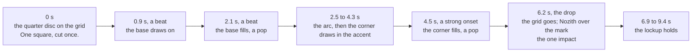

# Nozith: an identity sting

- Viewer: someone on a phone feed who stops for a clean mark.
- The one idea: a maker of survey instruments has a mark that is one square cut once by an arc; the film draws it.
- System: mark, because the film constructs a mark on its grid, then locks it up with the name.
- Size and length: 1080 x 1920, 9.4 s.

## Contract

- Hook (by 0.5 s): the quarter disc, the mark's unit module, large and centred on the frame grid and its own cell
  lines, with the line "One square, cut once." over it, on frame 0. The disc alone covers about a quarter of the
  frame (the hook asks for 15 %).
- Question: how does one cut make a mark?
- Answer (drawn as): the base draws on by its outline and fills; the construction arc draws; the corner draws on
  along it in the accent and fills.
- Reveal (6.2 s, the track's drop): the grid and the construction go, and the name and what it is take the line's
  place over the mark, with the system's one impact.
- End (lockup, hold): the mark keeps the size it was built at; the lockup holds 2.5 s.

Nozith is a random draw; the company is fictional. The mark is original geometry drawn for this reel.

## The mark

A file in the project's media, as a user's mark would be: `assets/media/nozith-mark/mark.svg` (viewBox 0 0 300 372,
three `path` elements), listed in `assets/media.json` as kind `mark` and parsed into `src/system/marks.gen.ts` by
`bun scripts/export_marks.ts` (in a project: `untell media add mark.svg --as nozith-mark`). The film paints it in
the system's roles: the quarter disc and the base in ink, the corner (path 2) in the accent.

## Signature moves

- The grid shows while the mark builds, and goes on the lockup (`frameGrid`, `rule`, `curve` for the arc).
- Each module draws on by its outline, then its fill lands on a beat or a strong onset (`drawnMark` `times`, `fills`).
- The mark and the name on one axis, centred, with one impact (`drawnMark` `lockup`).

## Beats

| Time (s) | On screen | Mover | Text (words) | Sound |
| --- | --- | --- | --- | --- |
| 0-0.9 | the quarter disc on the grid; the cell lines draw | the lines | One square, cut once. (4) | the bed's quiet opening |
| 0.9-2.1 | the base draws on, then fills | the base | | a pop on the fill |
| 2.5-4.5 | the arc, then the corner draws on in the accent and fills | the corner | | a pop on the fill |
| 6.2 | the grid goes; the name over the mark | the name | Nozith / Survey instruments | the drop; the impact (ducked bed) |
| 6.9-9.4 | the lockup holds | none (held) | | |

## Media

The mark file only: an identity film shows the mark, not a picture (Mark's Do-not-use list names `photo`).

## Sound

- Track: mark-music-117 (source and licence in `assets/media.json`). Entered by the system's rule (`drop`):
  `music({ peakAt: 6.2 })`. Its beat grid is low trust, and its first strong onset comes at 4.5 s: the draws and the
  base's fill go on beats, the corner's fill and the lockup on strong onsets (`beats().cuts`).
- Hits: a pop on each fill; the system's one impact on the lockup, which ducks the bed.

## Critique

| Part | Score | Evidence |
| --- | --- | --- |
| Story | 3 | A cut square under construction, its last part in the brand colour, the name on the drop. |
| Type | 3 | One headline line, then the name in headline and its line in body, over the mark. |
| Layout | 3 | The mark owns the frame from frame 0 to the end (a third of the frame); one axis for line, mark and name. |
| Motion | 3 | Each module draws on, then lands on the music; the grid falls away on the drop. |
| Media | 2 | The mark only, by the system's rule. |
| Sound | 2 | A track with a low-trust grid: the late landings follow its onsets. |

- System: the visible grid, ink modules, one accent part and a centred lockup read as Mark.
- Tell: none found.

Moves left: a clean percussion track at 100-120 BPM with strong onsets from its start (this one has none before
4.5 s, so 1.7 s before the drop hold the finished mark still).
