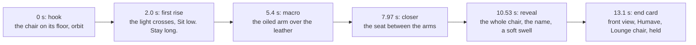

# Humave

- Viewer: a person on a phone feed who stops for a calm, well-lit object.
- The one idea: this chair is made for long, low sitting.
- System: matte, because the film is one physical object with mass, on a floor, in one light.
- Size and length: 1080 x 1920, 15.2 s.

## Contract

- Hook (by 2 s): the chair on its floor on frame 0, large (its box covers more than 30 % of the frame), on a slow
  orbit, with the bed already on its pulse.
- Question: what is this chair for?
- Answer (drawn as): two macros that show how it is made: the oiled wooden arm over the thick leather cushion, then the
  seat cushion between the two arms. The line says what the pictures show: "Sit low.
  Stay long."
- Reveal (10.53 s): the whole chair from the other side on a turntable, with the light crossing it, the name above it
  and a soft swell on the cut.
- End (13.1 s, held 2.1 s): a cut on the last bar to a clean front view, with the name and the kind of object above
  the chair.

The film used a code-drawn pepper mill before. A real model now takes the place of code-drawn 3D, so the
subject is now a real chair model.

## Signature moves

- A light passes across the surface once per shot (`product` `sweep`).
- The contact shadow and the matte reflection on the floor in the whole-chair shots (`product`).
- Macro shots that frame a detail that explains the object (`product` `frame: "detail"`).

## Beats

| Time (s) | On screen | Mover | Text (words) | Sound |
| --- | --- | --- | --- | --- |
| 0.00-5.40 | The chair at three-quarters on its floor | the orbit; at 2.0 s the light sweep and the line | Sit low. Stay long. (4), from 2.0 s | the section's first bar, the rise at 2.0 s |
| 5.40-7.97 | Macro: the oiled arm over the leather cushion | the push | none | bar |
| 7.97-10.53 | A closer view: the seat cushion between the two arms | the push, the light | none | bar |
| 10.53-13.10 | The reveal: the whole chair from the other side | the turntable, the light | Humave (1) | a soft swell peaks on the cut |
| 13.10-15.20 | The end card: front view, name and kind above | a cut, then a held finish | Humave. Lounge chair (3) | the bed fades |

## Media

| Name | Shows | Box and scale | Smallest size | Role |
| --- | --- | --- | --- | --- |
| `model-armchair` | a real 3D model of a lounge chair: oiled wooden frame, black leather cushions, the maker's own materials | the whole frame (3D view) | a model: no pixel size; 2k textures | the subject, in five shots |

Source and licence: the record of `model-armchair` in `assets/media.json` (CC0 1.0).

## Sound

- Track: `matte-music-3`. Matte's entry rule is `section`: `music({ align: { track: 202.7, film: 0 } })` opens on the
  first bar of the section where the drums and the bass come in. The bars fall at 0, 2.83, 5.40, 7.97, 10.53 and
  13.10 s; every cut is on one of them. The track rises at 2.0 s: the line and the first light sweep land there.
- Level: the block's gain for the -18 LUFS target.
- Hits: one soft swell (`matte-swell`, a reversed cymbal) peaks on the reveal's cut (`hit({ at, bed })`).
- Licences: the records of `matte-music-3` and `matte-swell` in `assets/media.json`.

## Checks

- `bun scripts/lint/cli.ts examples/reels/matte.ts`: no finding.
- `bun scripts/detect.ts reel-matte --films src/films/reels.tsx`: "passed" on the picture and "passed" on the mastered
  render (`out/render/reel-matte.mp4`).
- No declaration: the checks on the picture and on the mastered render find no fault.
- `untell listen mix`: -18.1 LUFS (target -18).
- Each shot ends on its cut, with no overlap. The renderer now draws a new 3D view on its first frame.

## Critique

| Part | Score | Evidence |
| --- | --- | --- |
| Story | 2 | The chair, two macros of how it is made, the reveal, the end. The answer is drawn, but no beat is a clear high point: the reveal at 10.53 s is the same size as the hook. |
| Type | 3 | One small line a beat at the top, one voice; the end card is centred over the chair. |
| Layout | 3 | The chair fills the middle and lower frame with its reflection; the macros fill the frame. |
| Motion | 3 | Orbit, two pushes, a turntable, a still end; every cut on a bar. The light passes are faint on oiled wood. |
| Media | 3 | One real model, one floor and one light, five angles. |
| Sound | 3 | The bed opens on a section with drums; one soft swell on the reveal's cut, the bed dipped under it. |

- System: the warm dark ground, the floor reflection, the macros and the small type read as Matte.
- Tell: none clear.

Moves, ranked:
1. Make the reveal larger than the hook: a lower, closer camera at 10.53 s (`product` `fill`, `room`).
2. A stronger light pass on the leather in the arm macro (`product` `sweep` at the macro's middle).
3. Name beside the chair at the end, aligned to its top line (needs an end card that sits beside an object).
