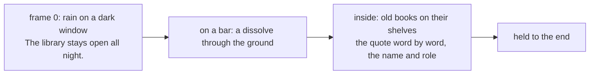

# All night

- Viewer: a student on a phone feed, late at night.
- The one idea: the Tuhu Library now stays open all night.
- System: nocturne, because the film is one considered statement, in the dark, at a slow pace.
- Size and length: 1080 x 1920, 13 s.

## Contract

- Hook (by 1 s): rain on a dark window at night fills the frame on frame 0; the news sits on its calm part in display,
  fitted to the width.
- Question: why open all night?
- Answer (drawn as): the dissolve from outside to inside the reading room; the librarian's quote says why.
- Reveal (on a bar): the reading room and the quote: "Good work keeps late hours."
- End: the quote card with the rule, the name and the role, held to the end.

The names (the Tuhu Library, Kasubu) are a new random draw: the old reel's names came from an earlier film.

## Signature moves

- Words arrive one by one (`quote` `enter: "word"`).
- A dissolve from one picture to the next through the ground (`photo` `enter: "dissolve"`).
- One statement fitted to the width (`fitText`).

## Media

| Name | Shows | Box and scale | Smallest size | Role |
| --- | --- | --- | --- | --- |
| `nocturne-window` | rain on a window at night, city lights out of focus (footage) | the full frame, 1.06x at the end of its push | 3414 x 1920 (it is) | outside, dimmed, a slow push |
| `nocturne-stacks` | old books and a ladder in a library (no people) | 600 x 900, 0.7x | 600 x 900 | inside, dimmed, framed low in the dark |

The stacks photo was full frame at 1.5 times its size before; now it is framed low in the dark, under its size. Sources and
licences: the records of these names in `assets/media.json`.

## Sound

- Track: `nocturne-music-1`. Nocturne's entry rule is `section`: `music({ align: { track: 24.9, film: 0 } })`, the first
  bar of a section with a pulse. Level: the block's gain for the -20 LUFS target. No effects.

## Checks

- Lint: no finding. Detector: "passed" on the picture and on the mastered render (`out/render/reel-nocturne.mp4`).
- Declared: `motion/orphan` on the window (the slow push the Direction asks for).
- The window clip is graded at its full 1920 px height (`scripts/media_video.py <dir> nocturne 1920`); `media.ts
  prepare` grades footage at 1440 px.
- Snap at 10 s: no proposal. `hf_check`: passed.

## Critique

| Part | Score | Evidence |
| --- | --- | --- |
| Story | 3 | The news over rain on the glass, then inside the room and the reason, word by word. |
| Type | 3 | The statement fitted to the width in the serif; the quote card with its rule, name and role. |
| Layout | 2 | The stacks photo is small and low, framed in the dark; the quote sits above it on the ground. |
| Motion | 3 | A slow push, a dissolve, words that arrive one by one. |
| Media | 2 | Two distinct shots in one place; the room is drawn small to stay sharp. |
| Sound | 3 | A bed from a section with a pulse, no effects, the room on the track's rise. |

- System: dark warm plates, the serif statement and the word-by-word quote read as Nocturne.
- Tell: none clear.

Moves, ranked:
1. A larger file of the reading room (a vertical clip), so the inside fills the frame like the outside.
2. Mark one word of the quote in italic at full ink (the system's signature).
3. Let the rain's sound fall away under the dissolve (needs a room-tone effect).
