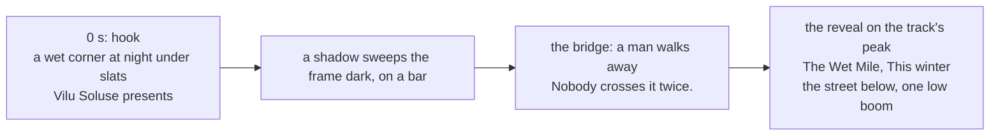

# The Wet Mile

- Viewer: a person on a phone feed late at night.
- The one idea: "The Wet Mile" is a film about a crossing that nobody makes twice.
- System: noir, because the film is a title sequence of hard light and shadow.
- Size and length: 1080 x 1920, 12.4 s.

## Contract

- Hook (by 1 s): the wet street corner fills the frame on frame 0, lit, with hard slats falling on the road; the credit
  sits in headline on the plate's calm part.
- Question: what is this crossing?
- Answer (drawn as): the man on the bridge, from behind, walking away under the slats; the tagline names it.
- Reveal (the track's peak, `music({ peakAt })`): the title in the light at full measure, the street in the lower band.
- End (held to the film's end): the title, "This winter" and the street under the slats; one low boom when the title
  is set.

## Signature moves

- Hard slats of shadow on the pictures, at one angle in every shot (`shadowBars`, `plane`).
- A shadow sweeps the frame dark, then the next scene is lit (`wipe` `style: "sweep"`, `fill: "ground"`).
- One hard light direction for the whole film.

## Beats

| Time | On screen | Mover | Text (words) | Sound |
| --- | --- | --- | --- | --- |
| 0 to the sweep bar | The wet corner, slats on the road | the clip, a 4 % push | Vilu Soluse presents (3) | the bed |
| the sweep bar | The shadow sweeps the frame | the sweep | none | a soft whoosh on the bar |
| to the reveal | The bridge, the tagline in the dark band above | a 4 % push | Nobody crosses it twice. (4) | bars |
| the reveal to the end | The title, This winter, the street below | the street clip | The Wet Mile. This winter (5) | the peak, one low boom |

## Media

| Name | Shows | Box and scale | Smallest size | Role |
| --- | --- | --- | --- | --- |
| `noir-corner` | a wet street corner at night, a crosswalk, no people (vertical footage) | full frame, 1.04x with its push | 1080 x 1920 (it is) | hook plate, dimmed |
| `noir-bridge` | a man walking away on a bridge (from behind, no face) | 1000 wide, 1.14x with its push | 910 x 1280 (it is) | plate, its top eased into the ground |
| `noir-lane` | a rainy lane at night (vertical footage) | 920 wide in the lower band, 0.85x | 1080 x 1920 (it is) | end plate |

The two clips were prepared at 1440 px tall before; they are graded again at their full 1920 px. Sources and
licences: the records of these names in `assets/media.json`.

## Sound

- Track: `noir-music-4` (Noir's entry rule is `drop`): `music({ peakAt: <the reveal> })`; the sweep is on a bar
  (`beats().onBar`), the line under the title on a beat.
- Hits: a soft whoosh on the sweep (`noir-whoosh`), one low boom when the title is fully set (`mark-impact`,
  `hit({ on })`).

## Checks

- Lint: no finding. Detector: "passed" on the picture and on the mastered render (`out/render/reel-noir.mp4`).
- Declared: `motion/easing` on the sweep (the shadow speeds into the cover on the wipe block's own curve: a transition,
  not an entrance).
- The dark frames at 5.40-5.77 s are the sweep's cover by design (Noir: "A shadow sweeps the frame dark, then the next
  scene is lit"): the shadow covers on the bar and speeds out over the bridge.
- The street clips are graded at their full 1920 px height (`scripts/media_video.py <dir> noir 1920`).
- `untell listen mix`: -17.1 LUFS (target -17). `hf_check`: passed.

## Critique

| Part | Score | Evidence |
| --- | --- | --- |
| Story | 3 | A credit on a wet corner, a shadow sweep, a man walking away under the tagline, the title on the peak. |
| Type | 3 | One serif voice in display; the tagline in three short lines on the dark band; the label under the title. |
| Layout | 3 | The bridge fills the frame under the tagline; the end card leaves the street in the lower band. |
| Motion | 3 | Slow pushes in every shot, the sweep on the bar; the slats hold still with the light. |
| Media | 3 | Three distinct shots in one grade, all drawn at or under 1.14 times their files. |
| Sound | 3 | The peak on the title; a whoosh on the sweep, a boom when the title is set. |

- System: hard slats at one angle, the serif title in the light, the shadow sweep read as Noir.
- Tell: the slats on the dark road of the hook barely show; the hook reads as a plain night street.

Moves, ranked:
1. Let the man's head break the tagline (`photo` `over`, `placeBehind`), the signature the old reel had.
2. Draw the slats on the lit building of the hook more strongly (a lower `depth`), so the light reads on frame 0.
3. Fade the slat light on the last beat instead of holding it (the system's end).
