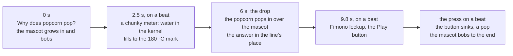

# Why popcorn pops

- Viewer: someone on a phone feed who stops for a quick, friendly fact.
- The one idea: the water inside a kernel turns to steam, and at about 180 °C the steam bursts the hull.
- System: pop, because the film is a fact card from a playful app, led by one round character.
- Size and length: 1080 x 1920, 12.5 s.

## Contract

- Hook (by 0.5 s): the question in headline and the green mascot, large in the middle (22 % of the frame), on frame 0;
  the mascot grows in with an overshoot and bobs on the beat at once.
- Question: why does popcorn pop?
- Answer (drawn as): a chunky bar meter, "Water in the kernel, °C", that fills to its "Pops at 180" mark.
- Reveal (6 s, the track's drop): the popcorn, a cut-out sticker on a disc, pops in over the mascot's head, and the
  line says "The steam bursts the hull at 180 °C."
- End (event, hold): the app's lockup (the green disc and the name) in the line's place, and a chunky Play button that
  sinks when it is pressed on a beat; the mascot keeps its idle bounce under them.

Fact: Virot and Ponomarenko, J. R. Soc. Interface (2015): the hull fails at about 180 °C. Fimono is a random draw; the
app is fictional.

## Signature moves

- Squash and stretch, with overshoot on arrival (`shape` with `enter: "grow"`).
- One character leads from the first frame to the last (the mascot, with the same `moves` on its face and its eyes).
- Buttons are chunky, with a darker bottom edge, and sink when pressed (`button` with `depth` and `press`).

The system's iris (`wipe`) was tried first and dropped: it filled the frame with one flat colour for 14 frames, grew
from under 0.2 scale and zoomed faster than the motion limit. No block draws a character with face states yet (a
block need), so the mascot is a circle with two eyes.

## Beats

| Time (s) | On screen | Mover | Text (words) | Sound |
| --- | --- | --- | --- | --- |
| 0-2.5 | the question, the mascot | the mascot grows, then bobs every second | Why does popcorn pop? (4) | a pop as it lands |
| 2.5-6 | the meter in the line's place; the mascot moves down | the fill, the bob | Water in the kernel, °C; Pops at 180 | the bed builds |
| 6-9.8 | the answer, the popcorn sticker over the mascot | the cut, the bob | The steam bursts the hull at 180 °C. (7) | the drop; a pop as the popcorn lands |
| 9.8-12.5 | the lockup, the Play button, the mascot | the button, the press, the bob | Fimono / One fact a day. | a pop on the press |

## Media

| Name | Shows | Box and scale | Smallest size | Role |
| --- | --- | --- | --- | --- |
| pop-popcorn | a heap of popcorn, cut out (source and licence in `assets/media.json`) | a disc of 321 px | no upscale | the answer's object |

## Sound

- Track: pop-music-823 (source and licence in `assets/media.json`), entered by the system's rule (`drop`):
  `music({ peakAt: 6 })`; every other time comes from its beats.
- Hits: pop-bubble as the mascot lands, as the popcorn lands and as the button sinks, with the bed ducked under the
  last one. Pop asks for a click on a press, but `listen mix` heard pop-click 11.6 dB under the bed in its band.
- The drop: the map had no drop for this track, so `peakAt` placed its loudest bar; the render showed a rise of
  6.5 dB 0.93 s later. The drop is now pinned at that rise (`untell-listen analyse pop-music-823 --drop 56.08`).
- Declared: `tiny-move` on the Play button: its face sinks onto its edge in one step and comes back 4 frames later.

## Critique (after the rebuild)

| Part | Score | Evidence |
| --- | --- | --- |
| Story | 3 | A question, a quantity that rises to a mark, the burst on the drop, the app. |
| Type | 3 | One headline line at a time, at most seven words, readable at 390 px. |
| Layout | 2 | The line and the mascot on the optical centre; the meter and the popcorn take the slot between them. |
| Motion | 2 | The mascot bobs on every other beat, so nothing holds still; the burst is a cut, not a shape that becomes the next scene. |
| Media | 2 | One cut-out sticker, sharp, on a disc. |
| Sound | 3 | The drop on the burst, a pop on each landing and on the press. |

- System: a flat green character, a chunky meter and a chunky button read as Pop.
- Tell: none found.

What changed: the character no longer gives its place to a picture (Pop's block map says a photo never replaces the
character); the meter has the room it needs and its mark label stays in the text-safe area; the iris and its flat
frames are gone; nothing holds still past 1.2 s.
