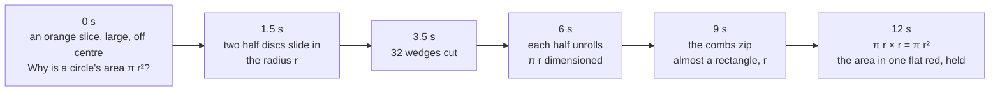

# Why a circle's area is π r²

- Viewer: someone on a phone feed who learned π r² by heart and never saw why.
- The one idea: cut a circle into wedges and unroll it, and it becomes a rectangle π r wide and r tall.
- System: primary, because the proof is built from flat primary shapes that turn and land on the beat.
- Size and length: 1080 x 1920, 14.5 s.

## Contract

- Hook (by 2 s): an orange slice cut into a circle 0.85 of the frame wide, off centre, its edge past the frame, on
  frame 0; the question "Why is a circle's area π r²?" by 0.5 s.
- Question: why π r²?
- Answer (drawn as): two half discs, 32 wedges, each half unrolled to a comb π r long, the combs zipped into a near
  rectangle r tall, the labels carried into the formula.
- Reveal (12 s): the zipped wedges become one flat red rectangle with "π r²" in it, as "= π r²" lands (`B.reveal`).
- End (event, hold): the rectangle and the formula hold 2.3 s from the bar line at 12.17 s.

## Signature moves

- Shapes enter opaque: the half discs slide in, the wedges and the area stamp in one frame (`shape` `enter: "cut"`).
- A shape sweeps across and becomes the next frame: the half discs slide over the photo and replace it.

## Beats

| Time (s) | On screen | Mover | Text (words) | Sound |
| --- | --- | --- | --- | --- |
| 0-1.5 | the orange slice, large, off centre | the question types in | Why is a circle's area π r²? | the bed on its downbeat |
| 1.5-3.5 | two half discs, the radius | the halves slide in (land on the beat at 1.5) | (labels) | pop as they land |
| 3.5-6.2 | 32 wedges | the knives (beat 3.5), then the split (lands 5.5) | Cut 32 wedges (3) | |
| 6.2-9.5 | the halves unroll into combs; π r dimensioned at 7.5 | the unroll (lands 6.87) | Unroll each half (3) | click on the turn |
| 9.5-12.2 | the combs zip (lock 8.87); r dimensioned at 9.53 | the zip | Almost a rectangle (3) | pop as they lock |
| 12.2-14.5 | the area in red with π r²; the formula (lands 11.53) | the area stamps on the bar | π r × r = π r² | |

Every time is a beat of the bed from `beats()` (90 BPM, a beat each 20 frames); the area stamps on a bar line.

## Media

| Name | Shows | Box and scale | Smallest size | Role |
| --- | --- | --- | --- | --- |
| primary-orange | an orange slice from above, graded through ink to ground (source and licence in `assets/media.json`) | a circle 918 px across, from the 1267 x 1280 file: 0.72x | no upscale | the hook's picture |

## Sound

- Track: primary-music-506, entered on its measured downbeat (`align`). Its map reads 90 BPM with the first beat at
  0.17 s; the scene takes every time from `beats()` of the bed. The track has no drop, so the system's drop rule falls
  back to a section start. Mix target -16 LUFS; the master measures -16.0 LUFS.
- Hits: a pop as the halves land, a click as the wedges finish their turn, a pop as the combs lock, each with the
  bed (`hit({ bed })`): the block dips the bed 6 dB under each, as deep as each hit's band needs.

## Critique (after the rebuild)

| Part | Score | Evidence |
| --- | --- | --- |
| Story | 3 | A question, a drawn proof in four steps, a reveal that fills one flat colour, an end. |
| Type | 2 | The headlines are clear; the formula is set from carried pieces and reads well, but the hook's question is a small label over a display "π r²?". |
| Layout | 2 | The proof now sits low and the formula high; the drawing is still small (a circle of 440 px) in the middle beats. |
| Motion | 3 | Each beat has one mover; the halves slide over the photo; the area stamps on the bar. |
| Media | 2 | One photo in the hook, sharp; it does not turn into the shapes in place. |
| Sound | 2 | On target; hits ducked; the track has no drop for the reveal. |

- System: flat red, blue and yellow shapes, uppercase headlines and stamped entrances read as Primary.
- Tell: none found.

Moves left: the orange's segments becoming the wedges in place (a morph block is missing); the wedges turning in
visible 90-degree steps with a click each; a larger circle with a camera zoom-out for the unroll; a 45-degree axis
for the question (a title `angle` prop exists now and was not tried).

No declared finding. The body-lines rule now counts lines by their ink spans, so the formula's carried pieces on one
line count as one line.
