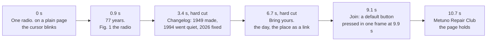

# One radio, 77 years

- Viewer: someone on a phone feed with a broken thing at home.
- The one idea: a radio from 1949 plays again after a repair club fixed it, so bring yours.
- System: raw, because the film is one plain web page written live, with no styling but the browser's own.
- Size and length: 1080 x 1920, 12.5 s.

## Contract

- Hook (by 0.5 s): a full page on frame 0: the header and its rule, "One radio." in display with its cursor, and the
  figure window's border; "77 years." and the radio come at 0.9 s.
- Question: what happened to the radio?
- Answer (drawn as): a bordered table that grows one row at a time, and the picture of the fix.
- Reveal (6.7 s): "Bring yours." with the day and the place as a link, over the picture of the fix.
- End (event, hold): a default form button ("Join", the `button` block) pressed in one frame at 9.9 s, then the
  club's name as a heading at 10.7 s; the page holds 1.8 s.

The changelog is fiction; 2026 - 1949 = 77 years. Metuno Repair Club is a random draw.

## Signature moves

- Hard cuts between page states; nothing eases (Raw is a one-frame system).
- Text written live with a blinking cursor after the last thing written.
- Pictures as they are, in a plain border, never cropped.

## Beats

| Time (s) | On screen | Mover | Text (words) | Sound |
| --- | --- | --- | --- | --- |
| 0-0.9 | the page, One radio. | the cursor | One radio. (2) | none |
| 0.9-3.4 | 77 years., the radio, its figure label at 2.2 s | the radio, the label | 77 years. (1) | click |
| 3.4-6.7 | Changelog, three rows, the fix | each row | Changelog, rows | three clicks |
| 6.7-9.1 | Bring yours., the day, the link, over the fix | each line | Bring yours. (2) | click on the link |
| 9.1-10.7 | the button, pressed at 9.9 s | the press | Join | click on the press |
| 10.7-12.5 | the club's name | none (held) | Metuno Repair Club | |

## Media

| Name | Shows | Box and scale | Smallest size | Role |
| --- | --- | --- | --- | --- |
| raw-radio | an old radio, front three-quarter (source and licence in `assets/media.json`) | the window, 868 x 578 px, from 1280 x 853 | no upscale | Fig. 1 |
| raw-solder | a hand that solders a wire, no face (source and licence in `assets/media.json`) | the same window | no upscale | Fig. 2 |

## Sound

- No music (Raw). One plain click when something appears or is pressed: six in the film.

## Critique (after the rebuild)

| Part | Score | Evidence |
| --- | --- | --- |
| Story | 3 | A thing, its history as a changelog, the call, a button, the name. |
| Type | 3 | The browser's serif and mono, display for the line, readable at 390 px. |
| Layout | 2 | One page grid across three states; the lower third is the window, then the form. |
| Motion | 3 | Hard cuts and one-frame changes at most 1.4 s apart; a cursor while text waits. |
| Media | 2 | Two plain pictures, sharp, in the page's own border. |
| Sound | 2 | Clicks on causes; no bed, by the system. |

- System: a default page, borders, a blue underlined link, a default button and a cursor read as Raw.
- Tell: none found.

What changed: the empty crossed image box (a broken image, on Raw's Never list) is gone; the end is the system's own
(a button pressed in one frame, then the name); nothing holds still past 1.5 s; the helpers come from the public
module.
