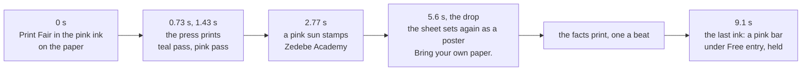

# Print Fair: the poster prints itself

- Viewer: a maker on a phone feed who likes printed things.
- The one idea: the poster for a print fair prints itself, ink by ink, and tells you to bring your own paper.
- System: riso, because the film is a two-ink print made pass by pass.
- Size and length: 1080 x 1920, 11 s.

## Contract

- Hook (by 0.5 s): "Print Fair" in display, in the pink ink, on frame 0; the press prints its first pass by 0.73 s.
- Question: what is this poster for?
- Answer (drawn as): two photos printed in halftone passes, one ink on each beat (`photo` `passes`).
- Reveal (5.6 s, the track's drop): the sheet sets again as a poster, "Bring your own paper." in display, the largest
  type of the film, over the hands that ink a brayer (`B.reveal`).
- End (event, hold): the last ink, a pink bar under "Free entry", stamps on a strong onset at 9.1 s; the full sheet
  holds 1.9 s. Never blank paper.

Zedebe Academy is a random draw; the fair is fictional. 14 March 2026 is a Saturday.

## Signature moves

- Each picture prints in two passes, teal then pink, a few px off register (`photo` `passes`).
- A flat pink shape stamps over the print (the sun) and the last ink stamps on a beat (`shape` `enter: "cut"`).
- A dull stamp sound as each ink layer prints (`hit`, at the next 12 fps step).

## Beats

| Time (s) | On screen | Mover | Text (words) | Sound |
| --- | --- | --- | --- | --- |
| 0-0.73 | Print Fair on the paper | none yet | Print / Fair (2) | the bed |
| 0.73-2.77 | the press prints in two passes | the passes | | stamp |
| 2.77-5.6 | the sun stamps; the academy's name; registration marks | the stamps | Zedebe Academy (label) | stamp |
| 5.6-9.1 | the poster: the name, the line, the facts, the hands printing | the passes, then the facts | Print Fair / Bring your own paper. (6) | the drop; stamp |
| 9.1-11 | the last ink under Free entry; held | the bar stamps | (labels) | stamp |

## Media

| Name | Shows | Box and scale | Smallest size | Role |
| --- | --- | --- | --- | --- |
| riso-press | a press feeding a printed sheet, close (new; source and licence in `assets/media.json`) | a window 938 x 1408 px, from 853 x 1280: 1.1x | no more than 1.1x | the first print |
| riso-brayer-hands | hands inking a brayer, no face (source and licence in `assets/media.json`) | a window 938 x 625 px, from 1280 x 853: 0.73x | no upscale | the second print |

## Sound

- Track: riso-music-2, entered by the system's rule (`drop`): the drop on the cut at 5.6 s (`music({ peakAt: 5.6 })`).
  Mix target -16 LUFS; the master measures -16.0 LUFS.
- Hits: four stamps (the system's limit), each at the next 12 fps step after its print, 17 to 29 dB over the bed in
  its band.

## Critique (after the rebuild)

| Part | Score | Evidence |
| --- | --- | --- |
| Story | 3 | Name, print, drop, message, facts, last ink; a poster that ends complete. |
| Type | 3 | One display voice per shot; facts as labels in rows; readable at 390 px. |
| Layout | 3 | Two poster layouts on one grid; the windows keep the pictures sharp. |
| Motion | 3 | Stepped stamps and passes on the beats; nothing slides. |
| Media | 3 | Two distinct shots in the two inks and the halftone screen. |
| Sound | 3 | Stamps heard, the drop on the cut. |

- System: halftone passes in pink and teal, overprint, a stamped sun and registration marks read as Riso.
- Tell: none found.

Moves left: the name overprinted in both inks a few px apart; the facts as a second ink pass; a sheet pulled off the
drum at the end.
