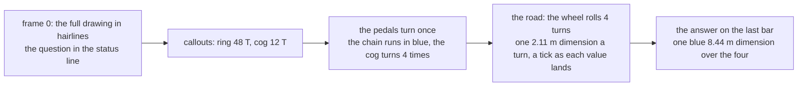

# One pedal turn

- Viewer: a curious person on a phone feed who rides a bicycle.
- The one idea: one turn of the pedals moves this bicycle 8.44 m.
- System: schematic, because the film is a drawing that explains a mechanism, with dimensions.
- Size and length: 1080 x 1920, 16 s.

## Contract

- Hook (by 1 s): the full drawing in hairlines on frame 0, with the question in headline: the road across the frame
  under the status line, and the drive upright under it (the chainring large at the picture-safe foot, the cog over
  it, the chain between). The drawing covers over 30 % of the frame.
- Question: how far does one pedal turn go?
- Answer (drawn as): the gears turn at their true ratio; then the wheel rolls four turns, one every two beats, and
  each turn lays down its own 2.11 m dimension, end to end.
- Reveal (the last bar): one blue dimension of 8.44 m over the four turns, its value on the bar, and 8.44 m in display.
- End: the answer held over the full drawing.

## Signature moves

- The active path lights in blue, one at a time: the chain, then the answer's dimension (`belt`, `dimension`).
- The answer is drawn: dimension lines and callout numbers (`dimension`, `callout`).
- A hairline grid under the drawing (`sheet`).

## Facts

- 48 / 12 = 4: the rear wheel turns 4 times for one turn of the pedals.
- A 700 x 25c tyre is about 622 + 2 x 25 = 672 mm across; one turn rolls pi x 672 mm = 2.111 m; four roll 8.445 m.
- The gears keep the ratio of their teeth (the cog's radius is a quarter of the ring's); the distance between them is
  shortened, as a schematic draws a drive. The road is at its own scale, so four turns fit inside the text-safe width
  with the last turn's value.

## Media and sound

- No pictures: the old reel's photo of a chainring is gone; the drawing is the subject.
- Track: `schematic-music-2`. Schematic's entry rule is `section`: `music({ align: { track: 15.0, film: 0 } })`, the first
  bar of the section where the drums come in. Every step is on a bar or a beat (`beats()`).
- Effects: a dry tick as each turn's value lands, 3 frames after its beat (`schematic-tick`, `hit({ bed })`), four in
  all. Schematic's hits follow the picture (its music is a bed): on the beat the hi-hat covers the tick's band and the
  bed had to dip 13 to 16 dB under each tick; 3 frames later a 6 dB dip is enough.
- Licences: the records of `schematic-music-2` and `schematic-tick` in `assets/media.json`.

## Checks

- Detector: no finding and no declaration on the scene's pass. The rendered pass was not run after the rebuild.

## Critique

| Part | Score | Evidence |
| --- | --- | --- |
| Story | 3 | Question, gears at the true ratio, four turns laid down, the answer drawn as a dimension (14 s). |
| Type | 3 | One status line that hands over, small labels in the label role, the answer in display. |
| Layout | 3 | The drive fills the frame under the road; the road's wheel is still small (its own scale). |
| Motion | 3 | The ring turns once and the cog four times on the same curve; the wheel rolls on beat pairs. |
| Media | 2 | No pictures; the drawing carries the film. |
| Sound | 3 | A dry tick as each dimension locks, well over the bed. |

- System: hairline grid, blue active path, callouts and dimensions read as Schematic.
- Tell: the ring's callout leader crosses the chain.

Moves, ranked:
1. Draw the road at a larger scale over a camera pan (`camera`, `withView`), so the wheel is large and the four turns
   run past.
2. A crank on the ring, so the pedal turn reads as a pedal.
