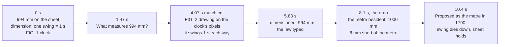

# 994 mm: the seconds pendulum

- Viewer: a curious engineer on a phone feed.
- The one idea: a pendulum that swings once a second is 994 mm long, 6 mm short of the metre it nearly defined.
- System: spec, because the film is a number explained by a drawing on a sheet.
- Size and length: 1080 x 1920, 14 s.

## Contract

- Hook (by 2 s): "994 mm" in display on frame 0, with its dimension line at rest under it ("ONE SWING = 1 s"); the FIG. 1 label types on in the first second,
  over FIG. 1, a wall clock in a figure window.
- Question: what measures 994 mm? (the line at 1.47 s).
- Answer (drawn as): a match cut at 4.07 s from the clock's pendulum to its drawing on the same pixels; the drawing
  swings one second each way on the sine of a real pendulum; its length is dimensioned (994 mm) and the law is typed.
- Reveal (8.1 s): the metre, 1000 mm, drawn beside the pendulum to the same scale with its own dimension, and the line
  "6 mm short of the metre." cut in on the track's drop (`music({ peakAt: 8.1 })`, `B.reveal({ at: 8.1 })`).
- End (event, hold): the history line lands on the bar at 10.4 s; the swing dies down (a damped pendulum keeps its
  period) and rests beside the metre at 12.67 s; the sheet holds 1.33 s on the final frame, after a last change.

Facts: one swing of a pendulum takes t = π √(L / g), so L = g t² / π². With t = 1 s and g = 9.80665 m/s²,
L = 0.99362 m, so 994 mm. In 1790 Talleyrand put the seconds pendulum to the French Assembly as the base of the
metre; in 1791 the Academy of Sciences chose the meridian.

## Signature moves

- The grid draws first: register marks at every crossing (`sheet`, `grid: "marks"`), from frame 0.
- Labels type on in mono at 40 characters a second, a tick as each one lands, on a beat (`typeOn` `pace: "write"`,
  `dimension`, `hit({ on })`).
- A bordered figure window with a FIG. label holds the one picture (`photo` with `box` inside a `box` border).
- A match cut: the picture cuts to the drawing on the same pixels, on the bar (pivot and bob measured on the photo).

## Beats

| Time (s) | On screen | Mover | Text (words) | Sound |
| --- | --- | --- | --- | --- |
| 0.0-1.47 | 994 mm, its dimension, FIG. 1 clock | the dimension draws | 994 mm (1) | the bed in its build |
| 1.47-4.07 | the question over the clock | the line rises | What measures 994 mm? (3) | tick on FIG. 1 at 1.27 |
| 4.07-5.83 | FIG. 2: mount, rod, bob on the clock's pixels | the swing (from 4.6) | One swing takes one second. (5) | tick on FIG. 2 |
| 5.83-7.8 | the length dimension, the law | the dimension draws | (labels) | tick on 994 mm |
| 8.1-10.4 | the metre beside the pendulum | the metre's dimension | 6 mm short of the metre. (5) | the drop; tick on 1000 mm |
| 10.4-14.0 | the history over the drawing; the swing dies down | the swing | Proposed as the metre in 1790. (6) | the bed fades over the last second |

## Media

| Name | Shows | Box and scale | Smallest size | Role |
| --- | --- | --- | --- | --- |
| spec-clock | a wall clock with a pendulum, front view, cut out (photo; source and licence in `assets/media.json`) | the window, 816 x 1166 px, cover at 0.96x | 853 x 1280 (the file): no upscale | the one picture, FIG. 1 |

## Sound

- Track: spec-music-1168 (new: a clean electronic track at 104 BPM, with a drop; source and licence in
  `assets/media.json`). The old bed (spec-music-7, a dense hip-hop track) masked every tick in its band and held the
  loudest bars on a still drawing. Entered by the system's rule (`drop`): the drop lands on the reveal at 8.1 s.
  Mix target -16 LUFS; the master measures -16.1 LUFS.
- Hits: `spec-tick` on four labels as each lands (FIG. 1, FIG. 2, 994 mm, 1000 mm), each label timed so that it lands
  on a beat. `listen mix`: each tick 11 to 23 dB over the bed in its band.

## Critique (after the rebuild)

| Part | Score | Evidence |
| --- | --- | --- |
| Story | 3 | Number, question, drawn answer, a reveal on the drop, history as the end. The number in the hook is smaller than the critics asked (the window takes the frame under it). |
| Type | 3 | One headline per beat, two lines at most; labels in mono; all readable at 390 px. "Proposed as the / metre in 1790." breaks a little early. |
| Layout | 3 | The sheet, the window and the drawing share the text column; the window's lower third is empty after the match cut. |
| Motion | 3 | A true pendulum (sine, 1 s each way), labels land on beats, no crossing; the swing dies down to rest for the end. |
| Media | 3 | The clock at its own size, cut out on the sheet, and its drawing on the same pixels. |
| Sound | 3 | On target; the drop on the reveal; every tick heard. |

- System: the grid of marks, mono labels with ticks, the figure window and the match cut read as Spec.
- Tell: none found.

Moves left: a detail view of the 6 mm at the foot (a magnified window, no block draws one yet); the hook number in a
larger fit; the drawn arc of the bob's path.

Declared finding: `sound/hold-on-loud-bar` at 8.1-10.4 s (spec.ts, whole film): the reveal is a line drawing, which
changes about 1.5 % of the frame in that bar against a 2 % limit.
