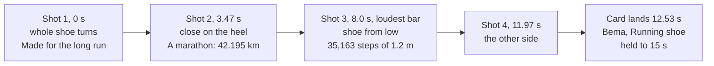

# Bema: made for the long run

- Viewer: a runner who scrolls a phone feed and stops on a clean product shot.
- The one idea: a marathon is about 35 000 steps, and this shoe is made for every one of them.
- System: studio, because the film is one product in near-white space, one sentence at a time.
- Size and length: 1080 x 1920, 15 s.

## Contract

- Hook (by 2 s): the shoe turns on its contact shadow from frame 0. The line "Made for the long run." rises out of
  its mask from 0.07 s and is complete by 1.07 s.
- Question: what does "the long run" mean for a shoe?
- Answer (drawn as): a close shot of the heel and its foam under the distance of a marathon, then the count of steps.
- Reveal (8.0 s): "35,163" in display, in the system blue, over the shoe seen from low. It lands on the track's
  loudest bar (`music({ peakAt: 8, peak: "loudest" })`), declared with `B.reveal({ at: 8 })`.
- End (event, hold): a cut to the other side of the shoe at 11.97 s; the name lands on the bar at 12.53 s and the turn
  ends with it; the frame holds 2.47 s to the end.

The fact is computed: a marathon is 42 195 m, and 42 195 / 1.2 = 35 162.5, so 35 163 steps of 1.2 m. The frame
states the step length, so a viewer can check the number.

## Signature moves

- A contact shadow under the product, in every shot, with `product`.
- Type rises out of a mask, one line at a time, with `title` (the default line reveal); at least 40 % of the frame
  stays empty.
- A slow move on every shot (turntable, push, orbit) with `product`, so no shot holds still.
- Not used: the cross-dissolve between shots. `product` has no `enter` or `exit`, so each shot cuts on a held frame,
  which the system also allows. This is a block need (see the report).

## Beats

| Time (s) | On screen | Mover | Text (words) | Sound |
| --- | --- | --- | --- | --- |
| 0.0-3.47 | The whole shoe, three-quarter view, under the line | the turntable; the line rises | Made for the long run. (5) | the bed enters with a 0.15 s rise |
| 3.47-8.0 | Close on the heel and its foam, low in the frame | the push in | A marathon: 42.195 km. (3) | bar 2 to the loudest bar |
| 8.0-11.97 | The shoe from low, the count above it | the orbit; the count, then its unit | 35,163 / steps of 1.2 m. (4) | the loudest bar |
| 11.97-12.53 | The other side of the shoe | the turntable | none | |
| 12.53-15.0 | The name and what it is over the still shoe | the card lands, then the hold | Bema / Running shoe. (3) | the bed fades over the last second |

## Media

| Name | Shows | Box and scale | Smallest size | Role |
| --- | --- | --- | --- | --- |
| studio-shoe | A running shoe, a real 3D model with its maker's own materials (CC BY 4.0, recorded in `assets/media.json`) | drawn by `product` at the frame's size | none: a model draws at any size | the subject in every shot |

The film draws no photo, so no picture is drawn past its size. The old photo (`studio-kettle`, 853 x 1280 drawn at
1.32x) is no longer used.

## Sound

- Track: studio-music-4, entered by the system's rule (`swell`): the loudest bar lands on the reveal at 8.0 s
  (`music({ peakAt: 8, peak: "loudest" })`). The bed level comes from the block (no `volume`); the mix target is
  -17 LUFS, true peak at most -1 dBTP, set by `untell master`.
- Hits: none. The system asks for a click on a real interaction and a swell into the reveal. A shoe on a turntable has
  no interaction, and the swell (`studio-swell`) was masked by the bed in its band with no room to rise under the
  music's peak, so the film uses the track's own rise into the loudest bar.

## Critique (after the rebuild)

Three passes on the mastered render, the review sheet and frames at 390 px wide.

| Part | Score | Evidence |
| --- | --- | --- |
| Story | 3 | A hook with the subject at 0 s, a question in the line ("the long run"), the distance at 3.47 s, the count at 8.0 s, the name at 12.53 s. The count is typed, not drawn; the shots carry the picture. |
| Type | 3 | One voice per beat; headline lines break on sense ("Made for / the long run."); the count in display and the system blue is the one accent. All text reads at 390 px. |
| Layout | 3 | The top composition of the system in every shot; at 11.97-12.53 s the frame shows only the shoe for one beat, and the end card leaves a gap of about 400 px between the line and the shoe. |
| Motion | 3 | One mover per shot (turntable, push, orbit), each text start on a beat, no crossing; the turn ends as the card lands. |
| Media | 3 | Four new angles of one object under one light, sharp at any size, on its contact shadow. One model, so the shots are alike in light by design. |
| Sound | 2 | The bed is on target (-17.0 LUFS) with the loudest bar on the reveal; no effect, so the reveal has no accent of its own. |

- System: the near-white field, one product on its contact shadow, one blue number and masked type read as Studio.
- Tell: none found; the closest is the end card's small body line under a display name.

Moves made after the first critique: the count in the accent instead of an accent underline (the underline's half-px
edge and its weak share of accent), the card under the safe top (HyperFrames reported the name outside the safe area).

Moves left (each needs a block change, in the report):
1. A cross-dissolve between shots, the system's own transition: `product` needs `enter` / `exit: "dissolve"`.
2. The card's line in headline, as the Direction asks: `lockup` sets its line in body, and `endCard` has no `role`.
3. A soft click under the reveal: the swell was masked by the bed and the hit could not rise under the music's peak.
