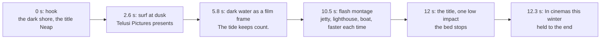

# Neap

- Viewer: a person on a phone feed who stops for a dark, quiet frame.
- The one idea: "Neap" is a film about the sea that keeps what it takes.
- System: title, because the film is a trailer's title sequence: cards, black, a montage and one impact.
- Size and length: 1080 x 1920, 14.6 s.

## Contract

- Hook (by 1 s): the dark shore fills the frame on frame 0, with the title in display on its calm sky.
- Question: what does the sea keep?
- Answer (drawn as): the pictures: surf at dusk, dark water, then the montage of what is left on the shore: a jetty, a
  lighthouse, a man alone in a boat.
- Reveal (12 s): the title card, on the track's loudest bar, with one low impact; the bed stops on it.
- End (12.3 s, held 2.3 s): "In cinemas this winter" in body, last, held over the impact's tail and then near silence.

## Signature moves

- Type cuts in and holds; nothing on the type animates (`text` `enter: "cut"`).
- Flash cuts at the climax, faster each time, black between (`photo` `enter`/`exit: "cut"`, a few frames each).
- One low impact on the title card, then near silence (`hit`, `music` `until` the title).

## Beats

| Time (s) | On screen | Mover | Text (words) | Sound |
| --- | --- | --- | --- | --- |
| 0.00-2.60 | The dark shore at night, the title in the sky | the clip's own motion | Neap (1) | the bed |
| 2.60-5.80 | Surf on the shore at dusk | the surf | Telusi Pictures presents (3) | beat |
| 5.80-10.50 | Dark water as a wide frame in the black | the water | The tide keeps count. (4) | beat |
| 10.50-12.00 | Three stills, 5, 4 and 3 frames, black between | the cuts | none | the swell rises |
| 12.00-12.30 | The title on black | none (held) | Neap (1) | the impact; the bed stops |
| 12.30-14.60 | The title and the release line | none (held) | In cinemas this winter (4) | the impact's tail, then near silence |

## Media

| Name | Shows | Box and scale | Smallest size | Role |
| --- | --- | --- | --- | --- |
| `title-shore` | a dark shore under storm clouds, a thin horizon (vertical footage) | the full frame, 1:1 | 1080 x 1920 (it is) | hook plate (not dimmed: the title sits on its dark sky) |
| `title-surf` | surf on a beach at dusk (vertical footage) | the full frame, 1:1 | 1080 x 1920 (it is) | plate, dimmed |
| `title-water` | dark water, close (footage) | 1080 x 608 in the black, 0.42x | 1080 x 608 | film frame |
| `title-jetty` | a jetty in fog | 840 x 1050, 0.82x | 840 x 1050 | flash |
| `title-beam` | a lighthouse beam at night | 1080 x 720, 0.84x | 1080 x 720 | flash |
| `title-boat` | a man alone in a boat, from far (no face) | 800 x 1200, 0.94x | 800 x 1200 | flash |

Every picture is drawn at or under its file's size. The old reel drew the stills full frame at 1.5 to 2.25 times their
size. Each picture is shown once. Sources and licences: the records of these names in `assets/media.json`.

## Sound

- Track: `title-music-3`. Title's entry rule is `swell`: `music({ peakAt: 12, peak: "loudest" })` puts the loudest bar
  on the title. The bed stops on the title with a 0.1 s fade. Every cut is on a beat (`beats().onBeat`).
- Hit: one low impact (`mark-impact`, one attack) on the title card.
- Licences: the records of `title-music-3` and `mark-impact` in `assets/media.json`.

## Checks

- Lint: no finding. Detector: "passed" on the picture and "passed" on the mastered render (`out/render/reel-title.mp4`).
- Declared: `sound/cut-on-beat` @10.5-12.0 for the check before the render (a flash's out-cut is off the beat by
  design; the last flash ends on the title); the mastered check lists it as unused.
- `untell listen mix`: -20.0 LUFS (target -20).
- Footage: the two vertical clips are graded at their full 1920 px height (`scripts/media_video.py <dir> title 1920`);
  `media.ts prepare` grades footage at 1440 px by default, which draws a 1920 px frame at 1.33x.
- The black between the flashes (10.6-11.9 s) is by design: Title's flash cuts hold black between stills, and the
  gaps get shorter. It is not a fault.
- A kit fault, not fixed here: each clip stops one frame before its picture is taken off (frames 82, 185 and 311),
  so that frame shows its line on black. The renderers play a clip from round(at x 30) to round(until x 30), and
  the blocks show a picture one frame later. An overlap in the reel would only hide it, and at the boxed shots it
  would show two pictures on one frame.

## Critique

| Part | Score | Evidence |
| --- | --- | --- |
| Story | 3 | The title over the dark shore on frame 0, the studio card over the surf, the tagline over a film frame of water, the montage, the title again with one impact. |
| Type | 3 | Small serif cards that cut in and hold, centred on the frame; every line reads at 390 px. |
| Layout | 2 | The water frame (5.8-10.5 s) leaves the lower 40 % black; the end card is small in a lot of black, as the system asks, but long. |
| Motion | 3 | The footage carries the motion; the cuts sit on beats; the flashes come faster each time (5, 4, 3 frames). |
| Media | 3 | Six distinct shots, each once, all drawn at or under their size; one grade. |
| Sound | 3 | The bed rises into the title and stops on it; one low impact; the impact's tail carries the end. |

- System: small serif cards, black holds and the accelerating flash cuts read as Title.
- Tell: the boxed stills read as film frames, but the black around the water frame is wide.

Moves, ranked:
1. A fourth and fifth still in the montage, so the acceleration reads as a run (two more pictures, each once).
2. The water frame larger and lower, so the tagline sits on the dark sky above it.
3. A room tone under the end card, once the music block can set a quiet second bed without the auto gain.
