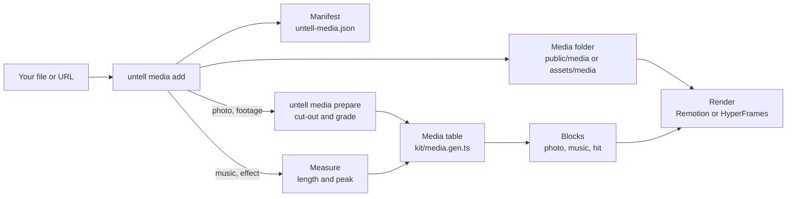

# Media: what untell takes

This document is the spec for the media that `untell media` takes: photos, cut-outs, footage, music and
sound effects. It gives the file formats, the sizes for each frame and placement, and what `prepare`
makes from each file. `untell media formats` prints a short form of it.

untell does not find media and does not say where to find it. You or your agent bring each file. untell
does not check where a file comes from. `--source` and `--licence` are notes that you can keep in the
manifest. The media and its licence are your responsibility.

## Where the files go

| What | Remotion | HyperFrames |
| --- | --- | --- |
| The asset folder | `public/media/<name>/` | `assets/media/<name>/` |
| The manifest | `untell-media.json` | `untell-media.json` |
| The media table | `src/untell/media.gen.ts` | `untell/media.gen.ts` |
| The write lock | `.untell/media.lock` | `.untell/media.lock` |

Remotion serves `public/` through `staticFile`. HyperFrames serves the project root. The blocks use the
asset name only, so one scene module works in both frameworks.

An asset name has lower-case letters, digits and hyphens, at most 64 characters (`athlete-back`, `m-bed`).

## The commands

| Command | What it does |
| --- | --- |
| `untell media add <file or URL> --as <name>` | Copies the file, or downloads the URL, to `<asset folder>/<name>/source.<ext>`. It adds an entry to the manifest. It measures a sound at once. Options: `--kind photo\|video\|music\|sfx\|mark`, `--source <text>`, `--licence <text>`, `--role lead-in` (an effect that leads into a motion, see Sound effects), `--force` (replace an asset with that name). |
| `untell media prepare <name> --system <id>` | Photos: the cut-out and the grade. Footage: the grade. Options: `--as-is` (no grade, for a screenshot or a screen recording), `--no-cutout`, `--height <px>` (footage). |
| `untell media beats <name>` | The tempo, the beat times, the energy of each bar of 4 beats, and entry points (drops and strong bars). It writes `beats.json` into the asset folder. |
| `untell media measure <name>` | Measures the length and the peak of a sound again. |
| `untell media remove <name>` | Deletes the asset folder, the manifest entry and the table row. |
| `untell media list` | Lists each asset, its kind and its state (prepared, measured). |
| `untell media table` | Writes the media table again from the prepared files. |
| `untell media setup` | Makes `.venv-media` (Python 3.12, rembg, Pillow, numpy) and downloads the cut-out model (about 200 MB). `untell init` runs it. |

`add` finds the kind from the file extension (or from the content type of a URL). A sound of 20 s or more
is music, and a shorter sound is an effect, unless you give `--kind`. `add` writes a note when a file is
smaller or slower than this spec, but it does not refuse the file.

## Photos

| Item | Value |
| --- | --- |
| Containers | JPEG (`.jpg`, `.jpeg`), PNG, WebP |
| Colour | sRGB, 8 bits for each channel. A photo in another profile shows its colours as sRGB. |
| Alpha | None for a photo. A photo with alpha is a cut-out (see below). |
| Content | One clear subject. The cut-out keeps the subject and what it holds (a ball, a cup). |

### Sizes

The `photo` block fills its box (cover) and keeps the subject at the centre of the crop. A push moves in
by 8 % (the default `amount`). Thus the crop that fills the box must be about 1.1 times the box in pixels
for a sharp last frame. The table gives the box for each placement, the best crop (1.1 times the box) and
the smallest crop that still looks sharp (the box divided by 1.4: below it the picture turns soft).

| Frame | Placement | Box (px) | Best crop (px) | Smallest crop (px) |
| --- | --- | --- | --- | --- |
| 9:16 (1080 x 1920) | full-bleed | 1080 x 1920 | 1188 x 2112 | 772 x 1372 |
| 9:16 | framed-low (the bottom 70 %) | 1080 x 1350 | 1188 x 1485 | 772 x 965 |
| 9:16 | window (a box in the safe area) | 900 x 900 | 990 x 990 | 643 x 643 |
| 9:16 | small (a card or an inset) | 480 x 480 | 528 x 528 | 343 x 343 |
| 16:9 (1920 x 1080) | full-bleed | 1920 x 1080 | 2112 x 1188 | 1372 x 772 |
| 16:9 | framed-low (the bottom 70 %) | 1920 x 760 | 2112 x 836 | 1372 x 543 |
| 16:9 | window (one half of a split) | 960 x 1080 | 1056 x 1188 | 686 x 772 |
| 16:9 | small | 480 x 480 | 528 x 528 | 343 x 343 |
| 1:1 (1080 x 1080) | full-bleed | 1080 x 1080 | 1188 x 1188 | 772 x 772 |
| 1:1 | framed-low (the bottom 70 %) | 1080 x 760 | 1188 x 836 | 772 x 543 |
| 1:1 | window | 720 x 720 | 792 x 792 | 515 x 515 |
| 1:1 | small | 360 x 360 | 396 x 396 | 258 x 258 |

The crop has the shape of the box. A photo of another shape needs more pixels. For example, a 3:2
landscape photo, full-bleed in 9:16, needs 2112 px of height for the best crop, thus 3168 x 2112 in all.
`zoom` (a tighter crop) multiplies the need: `zoom: 1.2` needs 1.2 times the crop.

### What prepare makes from a photo

| File | What it is | Which prop uses it |
| --- | --- | --- |
| `plate.jpg` | The whole photo, graded for the system | the default plate |
| `plate-top.jpg` | The plate, with its top 30 % eased into the system's ground | `fade: "top"` |
| `plate-dim.jpg` | The plate, dimmed to the system's `dim` level (only systems with a `dim` level) | `dim: true` |
| `cutout.png` | The subject with its alpha, before the grade | |
| `subject.png` | The cut-out subject, graded the same way | `over: true` |
| `meta.json` | The size, the subject box and centre (fractions of the photo), the grade and a mask of 64 columns | the media table |

The grade comes from the system's `media.grade` in `tokens.json`: `mono`, `tone`, `duotone`, `posterize`,
`phosphor` or `none`. Each grade maps the black and white of the picture onto colour roles, so the picture
stays on the palette. `--as-is` uses `none`. `--no-cutout` makes the plates only: there is no
`subject.png` and no mask, so the `photo` block cannot use `over` with that asset.

The cut-out runs on this computer with rembg and the BiRefNet general model (`birefnet-general-lite`). A
photo of 853 x 1280 px took about 30 s on an Apple laptop CPU, most of it to load the model.

A photo with an EXIF orientation (a phone photo) is turned upright before the cut-out and the grade.

## Cut-outs that you bring

| Item | Value |
| --- | --- |
| Containers | PNG or WebP with an alpha channel |
| Alpha | 0 where there is no subject, 255 on the subject. Soft edges are correct. |
| Size | The same as for photos. The size is the size of the whole canvas, not of the subject. |

When the source has alpha, `prepare` keeps that alpha as the cut-out and runs no model. It flattens the
source onto the system's ground colour to make the plate. Use `plate: false` with `over: true` to draw the
subject alone.

## Footage

| Item | Value |
| --- | --- |
| Containers | MP4 (best), MOV, WebM, M4V. ffmpeg reads them. |
| Video codecs | H.264 (best), HEVC, ProRes, VP9, AV1: any codec that your ffmpeg decodes |
| Frame rate | 24 to 60 fps. 30 or 60 fps is best: films render at 30 fps, and 24 or 25 fps footage repeats some frames. |
| Size | 1080 px or more on the short side. For full-bleed in 9:16, a vertical clip of 1080 x 1920 or more. |
| Length | At least the time on screen plus `from` (the start point in the clip). |
| Sound | Dropped. Footage plays muted. Add its sound as a separate asset if you need it. |
| Alpha | Not used. Footage gets no cut-out in this version: the `photo` block cannot use `over` with a clip. |

### What prepare makes from footage

| File | What it is |
| --- | --- |
| `plate.mp4` | The footage graded for the system: H.264, yuv420p, CRF 17, a keyframe every 0.5 s, no B-frames, no sound |
| `plate-top.mp4` | The same, with its top eased into the ground (`fade: "top"`) |
| `plate-dim.mp4` | The same, dimmed (`dim: true`; only systems with a `dim` level) |
| `meta.json` | The size, the length, the frame rate, the grade and the black and white levels |

`prepare` scales the footage to 1440 px of height by default. Give `--height 1920` for a vertical clip at
full-bleed in 9:16. The grade takes its black and white levels once, from about 12 frames across the clip,
so the picture does not flicker. A keyframe every 0.5 s lets each renderer find each frame quickly. The grade
runs frame by frame in Python: a 16 s clip at 1440 px took about 3 minutes on an Apple laptop. A clip with a
rotation (a phone clip) keeps its shape.

## Music

| Item | Value |
| --- | --- |
| Containers | MP3 (192 kbps or more), WAV, M4A (AAC), OGG, FLAC, Opus |
| Sample rate | 44.1 kHz or 48 kHz |
| Channels | Stereo (mono also plays) |
| Length | At least the film's length plus the entry point (`from`). The `music` block refuses a track that ends too early. |
| Loudness | The whole mix aims at the system's mix target: the Mix line in the Direction section of its `SYSTEM.md`. With no `volume`, the `music` block sets the bed's level for that target, and `hit` and `typing` set each effect against the bed (give them `bed`). `untell master` brings the render to the target and limits the true peak. |

`add` measures the length and the peak. `beats` gives the tempo, the beat times, the energy of each bar of 4
beats and entry points. The bars start on the first beat, so an entry point is correct to the nearest bar;
check the beat times in `beats.json` near it. Use an entry point as the `music` block's `from`, so a strong bar or a drop lands
where the film needs it.

A track that opens with digital silence gets a note from `add`. The music map records that silence (`lead`), and
the `music` block enters where the sound starts when `from` or `align` falls inside it (`skipSilence: false` keeps
the entry). With `peakAt`, the drop's place wins, and the build says how long the film is silent.

## Sound effects

| Item | Value |
| --- | --- |
| Containers | The same as music |
| Sample rate | 44.1 kHz or 48 kHz |
| Length | Short: under about 6 s |
| Shape | One clear peak, with little silence before it. A long silence before the peak makes the `hit` block start the file early. |

`add` measures the length and the time of the peak. The `hit` block starts the file so that its peak plays
one frame after the picture's moment (light arrives before sound).

`add` also measures two facts that the `hit` block and the checks read from the media table:

- The bands: the energy of each octave band (60 Hz to 16 kHz) in the 0.1 s at the peak. The music map holds the
  same bands for the track. With both, `hit` dips the bed under an effect as deep as the band needs where the bed
  covers the effect (a low stamp on a bed loud in its bass), up to 18 dB, at full depth only for the 0.13 s around the effect's peak, and back up over 0.2 s, so a deep dip
  reads as the effect's weight, not as the bed cutting out. Run `untell media measure` and
  `untell listen analyse` again for media added before these tables.
- The rise: the time from the start of the attack to the peak. An effect that takes 0.15 s or more (a swell, a
  riser) is a lead-in: the beat rule follows the motion it leads into, not a beat. A short whoosh that carries a
  motion rises fast; name it with `--role lead-in`.

## Measuring tools

untell uses HyperFrames' `audio` and `beats` commands when it finds a local HyperFrames CLI:
`--hyperframes <path>`, the `UNTELL_HYPERFRAMES` variable, or `node_modules/.bin/hyperframes` in the
project. It never downloads one. Without it, untell measures with ffmpeg and numpy in `.venv-media`: the
length and the peak (the loudest 10 ms) of a sound, and the tempo from the autocorrelation of an onset
envelope. Only HyperFrames gives the loudness in LUFS.

## Marks (SVG)

A brand mark comes as SVG path data. `untell media add <file>.svg --as <name>` reads the file once, keeps it as
`<asset folder>/<name>/mark.svg`, and writes its paths into the marks table (`src/untell/marks.gen.ts` or
`untell/marks.gen.ts`). The `drawnMark` block takes the name as `mark` and draws the mark on by its strokes, then
fills it. A scene can also give the paths inline: `mark: { viewBox, paths }` or `mark: { svg: "<svg ...>" }`.

| Item | Value |
| --- | --- |
| Container | SVG (`.svg`) |
| Size | A `viewBox`, or a `width` and a `height` in px (read as a viewBox from 0 0) |
| Shapes | `path`, `rect`, `circle`, `ellipse`, `polygon`, `polyline`, `line`, inside `g` groups or not; at most 64 |
| Paint | One flat paint for each shape: a fill, or `fill="none"` with a stroke and a `stroke-width`. `fill-rule="evenodd"` is kept. Attributes or a `style` attribute; a `<style>` sheet and class names are not read |
| Colour | Not kept. The film paints the mark in the system's roles: `ink` (or `color`), and one path in the accent (`accent`) |
| Refused | `transform`, `use`, `text`, `image`, gradients and patterns (`url(...)`), `clip-path`, `mask`. Apply them in the editor first (flatten, outline the text) |

The order of the shapes in the file is the order in which they draw. Give each part of the mark its own shape, at
most five parts for a film in Mark.

## 3D models

The kit cannot load a 3D model yet. Its 3D scenes use built-in shapes only (box, sphere, cylinder,
torus, lathe and extruded SVG paths). `add` refuses `.glb` and `.gltf` files.

## What untell needs on the computer

| Tool | For |
| --- | --- |
| uv | `untell media setup` (it makes `.venv-media`) |
| `.venv-media` (Python 3.12, rembg, Pillow, numpy) | `prepare`, `beats`, measuring without HyperFrames |
| ffmpeg and ffprobe | footage, `beats`, measuring without HyperFrames, the notes that `add` writes |
| a local HyperFrames CLI (optional) | measuring with LUFS, beat times from HyperFrames |
