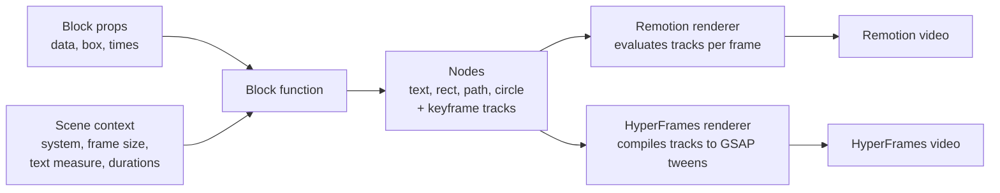

# Building blocks: the contract

A block is one explanation device: a line chart, a flow diagram, a counter, a captioned quote. An agent
calls blocks to make a video. The design system decides how the block looks and moves. The block decides
what the device means and how its parts are laid out.

## Read these first

| File | What it is |
| --- | --- |
| `src/system/scene/types.ts` | The node model: kinds, tracks, the context type. |
| `src/system/scene/context.ts` | `go`, `appear`, `present`, `lines`, `seq`, `px`, `textSafe`. Use them; do not invent timing. |
| `src/system/scene/time.ts` | How tracks evaluate. |
| `src/system/scene/layout.ts` | What both renderers agree on (text CSS, masks, layers, blends, holds, grain, origins). |
| `src/system/scene/blocks/lineChart.ts` | The reference block. Copy its structure and its care. |
| `src/system/scene/blocks/util.ts` | `fmt`, `niceScale`, `placeLabels`, `twoLines`, `samplePolyline`. |
| `examples/scenes/lineChart.ts` | A scene: data plus block calls. Shared by both frameworks. |
| `src/films/blocks/film.tsx` | `filmsFor`: turns a scene into demo films. |
| `systems/README.md` and `systems/{spec,graphite,pop,kinetic,console}/SYSTEM.md` | The systems your block must serve. |

## The model

- A block is a pure function: `(props, ctx) => Node[]`. No React, no DOM, no GSAP, no randomness, no `Date`.
- Every node has a unique `id`. Prefix every id with the block's `id` prop, so two copies of a block can share a scene.
- Positions are px in the frame. The caller gives the block a box (`x`, `y`, `w`, `h`). Everything the block draws stays inside that box.
- Times are seconds. `at` is when the block starts. `until`, when given, is when it starts to leave. A block hides its nodes after it leaves.
- Motion comes only from tracks: `opacity`, `x`, `y`, `scale`, `scaleX`, `scaleY`, `rotate`, `draw` (stroke reveal 0-1), `reveal` (masked text). Do not use `scale` together with `scaleX` or `scaleY` on one node.
- Durations and curves come only from the context: `go(ctx, at, from, to, "enter" | "move" | "exit")`, `appear`, `ctx.dur`, `ctx.noOvershoot`.
- Colours are roles (`ink`, `inkMuted`, `accent`, `series1`, ...). Type is a role (`display`, `headline`, `body`, `label`, `caption`). Never a value.
- Measure every string with `ctx.measure(text, role)` before you place it. Line height is `ctx.lineHeight(role)`.
  A text node with `keepCase` keeps its case in a role the system sets in capitals; measure it with
  `ctx.measure(text, role, { keepCase: true })` (or `caseCtx(ctx, true)` from `blocks/text.ts`).
- **Draw order uses layers.** A node sets `layer`: -1 backdrop, 0 content (default), 1 overlay. A higher layer
  draws above everything in a lower one. Inside a layer, lines and circles draw first, then boxes, then text, then
  by `z`. Use a layer, not a large `z`, to put a thing behind or above content. `rule` and `wipe` take `layer` too.
- **Overprint.** A node may set `blend: "multiply"`. Both renderers apply CSS `mix-blend-mode`, so inks darken where
  they overlap, as in print (Riso). A line or circle with a blend gets its own SVG.
- **Grain.** Do not draw grain. Both renderers draw it over every frame for a system whose `allows` has "grain"
  (8 fixed noise tiles in `src/system/grain`, one a frame, at the system's `texture.grain` strength).
- **The frame of a change.** A change made at time t first shows on the first frame after t (`frameOf` in
  context.ts). A tween that starts at t shows its start value on t's own frame, so this is the one rule that a cut and
  a tween both keep: two blocks given one time change on one frame. A block given `until` is gone, or starts to
  leave, on the frame that a block given that time as `at` shows. Make every cut with `cut`, `windows`, `steps` or
  `present` from context.ts, never with a hand-written step key.
- **Frame 0.** A block enters from nothing at its `at`. Every block with `at` before 0 by its entrance (`at: -1`) is
  at rest on frame 0: the block guard folds its keys before 0. `lines`, `text`, `title` (line reveal),
  `kineticWords`, `codeBlock` and `terminal` also show at rest from frame 0 when `at` is 0. Keep this rule in a new
  text block.
- **The guard.** Every block in `BLOCKS` runs behind `blocks/guard.ts`: a time that is not a number, an `until` that is
  not after its `at` and a list of timed items out of order throw with what to give; a track with keys out of time
  order throws as a bug in the block (the two renderers read such keys differently).
- **Fit.** A block that sets text in a smaller role than asked says so (`blocks/fit.ts`, `fit: "shrink" | "wrap" |
  "throw"`). Never shrink type in silence.
- **Measure.** `B.measure(name, props, ctx)` returns the box a block draws. Export a height helper when a scene stacks
  under the block (`terminalHeight`).
- **Holds.** When a frame holds still for more than 3 s on purpose, add `B.hold({ at, until })`. It draws nothing;
  it tells the HyperFrames check that the stillness is deliberate (`data-hold`).
- **Type behind a subject.** A cut-out (`photo` with `over`) may cover type on purpose, but every letter must still
  read: no letter more than 30 % hidden, no word more than 15 %. `scripts/inspect/cover.py` measures this on the
  recorded frames, and `hf_check` runs it. Plan the layout with `placeBehind` from `scene/cover.ts`: give it the
  photo's nodes, candidate layouts and a build function, and it keeps the largest type that stays readable. It
  reads the nodes in the world and does not apply the camera: a push or a pan, and pinned text that the camera does
  not move, are not in its plan. The recorded check reads them, so run `untell check` after it. It tries only the
  candidates you give: step them by 20 px or less (candidates 100 px apart missed the one place that passes).
- **Bleed.** Text in a role in `system.bleed` (Kinetic, Courtside: display) carries HyperFrames' safe-zone and canvas
  opt-outs (`data-layout-allow-safe-zone`, `data-layout-allow-overflow`): the frame crops it on purpose. The renderers
  add them. No other text may leave the safe area.

## Hard rules

1. **No overlap.** No text overlaps other text, a line or a mark, at rest, in any system, at 9:16 and at 16:9. Use `placeLabels` or explicit geometry with a check. If something cannot fit, the block must make room (shrink, wrap to two lines, reserve a gutter), and only then drop it. Never draw text over text.
2. **Text stays safe.** Every text box passes `textSafe(ctx, box)`. The only exception is a system with `bleed` (Kinetic, Courtside) and only for `display` text. With a role, `textSafe(ctx, box, role)` checks the glyph box (about 1.4 times the font size tall), which reaches past the line box when the leading is tight. So a line at `y: ctx.safe.top` can fail by the glyph's overflow: start it `(ctx.size(role) * 1.4 - ctx.lineHeight(role)) / 2` px lower when that is above 0, or let a block place it.
   Graphics are not text: at 9:16 a shape, a chart mark or a panel may and should use the lower band below the
   safe area. Only text must stay in the safe area. Do not leave the bottom third empty by habit.
3. **Data never lies on the way.** A bar, a line, a count or a fill that shows a data value grows on `ctx.noOvershoot(...)`. Pop, Mark and Riso have overshooting curves; a bar must not pass its value and come back.
4. **One-frame systems.** When `ctx.instant` is true (Raw, Console, Title), nothing tweens: things appear in one frame. `go` already does this. Check your block in `console`.
5. **Meaning never rides on colour alone.** In Spec, Noir and Title the accent equals the ink. Mark the key thing with weight, size, position or a label as well. Series 4 and 5 are under 2:1 against the ground: dash them or label them; never use them alone for meaning.
6. **Chart rules.** A chart has a title that names the measure and the unit. Bars start at zero, or the axis shows a break. A bar too small to see gets a minimum visible size and its value printed. Prefer direct labels to a legend.
7. **Counters only for quantities that grow.** Never count an angle, a ratio or a label.
8. **Effects.** No gradient, glow, shadow or soft coloured cloud. Ever. No blur, with one exception: a whip pan (`camera` `whips`, `screen.whip`) blurs the whole view along its travel while it moves, and only in a system whose `allows` lists "motion-blur" (Courtside, Kinetic). The renderers support nothing else on purpose.
9. **Restraint.** Simple is polished. One idea per block. Vox and Pentagram level, not a dashboard.
10. **Content.** Scene text uses verifiable facts (math, physics, computed values) or fictional names. Generate each name at random, with a new draw for each scene. Do not reuse a placeholder set (a stock cast, a placeholder company, Jane Doe). No real brands or people.
11. **Content never leaves to make a move possible.** Do not remove text or UI before a camera move or a pan, and do not bring it back after. Keep a sentence on screen through every move. Two reels emptied their frame for 1.2-2.6 s at each move to pass a check.
12. **The answer is drawn, not only typed.** When the film answers a question, the picture shows the answer: a dimension line that measures it, a bar that reaches it, four arches for four turns. A number alone in a caption is not an answer.
13. **The busiest picture goes on the busiest music.** Put the most change on screen over the loudest bars and the strongest onsets. Do not hold still over a peak. Four reels held a still frame over their track's strongest onset.
14. **Name the block before you build by hand.** Read the system's block map (the Direction section of its `SYSTEM.md`) and `systems/BLOCKS.md` first. Before you build a device from raw nodes, or patch a block's output with `.map`, write a comment that names the block you tried and the prop it lacks. Then ask for the prop. `untell lint` flags a `.map` over a block's output and a deep import from `scene/blocks/*` in a film (`scene/patched-block`).

<!-- untell:pack end: a project's copy of this file stops here; the rest is for the authors of this repository. -->
