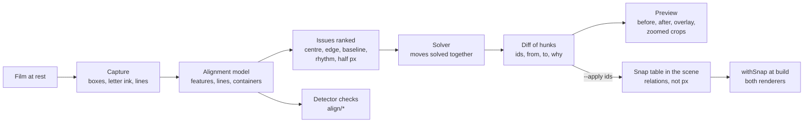

# Alignment: snap, previews and the align checks

A model cannot see a 4 px error in a frame. It can read "the ink of `row1-badge-text` is 5.7 px above the centre of
`row1-badge-pill`". untell snap finds the lines a designer sees, reports each near miss as a hunk of a diff, shows
each hunk before and after, and writes only the hunks you accept. It works like snapping in a design tool and
staging hunks in git: nothing moves until you apply.



## The loop for an agent

1. List the proposals: `bun scripts/snap/cli.ts <film id> --films <module> [--at <seconds>]`.
   Without `--at`, snap reads the frame where the most elements show and rest. A check finding gives its own `--at`
   and the hunk id: use both. Snap reads the same frame from the same capture as the check, so the id is there.
2. Read the summary first (it comes before the hunks). When many hunks share one cause ("14 hunks: text rides high by
   4-6 px", or "3 hunks in the block that draws row#-badge-text"), fix the cause in the block: its prop, or where it
   places the text (centre the cap band with `layout.centreInk`). Then run snap again. Do not accept 14 snaps for one
   fault.
3. Look at the preview: `--preview all`, or `--preview <ids>` for some hunks. Ids go by commas or by spaces
   (`--preview e-omogd,c-2hite` or `--preview e-omogd c-2hite`). Open the pages it prints, `out/snap/<film>/preview-1.png`
   (before | after), `preview-2.png` (the overlay, with the scene's guides in cyan) and `preview-3.png` on (each hunk,
   before | after, at 4x or more). Each page is at most 2000 px on its long side, so the 4x crops stay 4x when a model
   opens it. The after frame is drawn by the real renderer with the moves applied. A hunk that builds on another (its
   `needs:` line) brings that one with it, in preview and in apply. The last line says how many issues are left after
   the moves and which are new. An unknown id prints the ids that exist at that time.
4. Accept: `--apply <ids>` or `--apply all`. Remove: `--unapply <ids|all>`. Pass `--scene <file>` when snap cannot
   tell which scene file the film uses.
5. Run snap again. An accepted hunk is gone from the list. Run `untell check` (the detector) for the align checks.

## What the model sees

Each element at rest (fully visible, not moved from the frame before, as the check reads it) gives features:

| Element | x features | y features |
| --- | --- | --- |
| Box, picture, circle | left, right, centre | top, bottom, centre |
| Hairline (a rule) | ends | its line |
| Text | box left, box right, ink centre | baseline, ink top, ink centre |

The ink of a text is its band: from the baseline up to the cap line when a letter stands taller than the x height (a
capital, a figure or an ascender), else up to the x line. Descenders do not count. So "cone 10" centres the band
from its baseline to the top of its figures, as a designer centres it.

Relations:

- **Containers.** The smallest visible box that holds an element is its container. A child whose two insets on an axis
  are close (their difference is under half their sum) is meant to be centred on that axis, unless a sibling stands
  beside it in the same container (then it is one of a row).
- **Lines.** Features within 0.5 px of each other share a line (1 px for text ink centres, 1.5 px between a text's box
  edge and a box edge, because a letter's side bearing sits inside its box).
- **Groups.** A block prefixes the ids of its nodes with its own id, so `row1-badge-text` belongs to `row1-badge` and
  to `row1`. A group is the unit that moves: a block call, or part of one.
- **Rows and columns.** Top against bottom, and a line against an edge, compare only for two elements side by side
  that share most of their range. Centres compare for elements side by side, or stacked in one container.

## What a designer reads as related (judged on 304 films)

The first version of the model treated a quarter to a third of its errors wrongly. On a survey of 304 films (the
reels, every block film at 9:16 and 16:9 in its systems, the align films and an agent's film), every finding was
judged by eye: `out/snap/survey/JUDGED.md`. 124 more films were held out: out of sample, 73 % of their errors were
real (16 of 22); four rules came from them (below), so they are not held out any more. The model now uses these relations, and the level of each finding comes
from its class's judged precision:

- **Only the edge a text is set on is a line.** A text with a width and an align says how it is set; else a text whose
  left edge shares a line is set left, one whose centre sits on another centre (or on its container's centre) is
  centred, one whose right edge shares a line is set right. The other edge is ragged, and the centre of a text set left
  is where its width ends (27 false "centre" misses of texts set left; an agent's headline).
- **Words of running text** (a caption, a line split into word nodes) and the highlight that holds one word follow
  the line, not a grid (112 false or designed findings).
- **An inset is designed:** an element inside a container, inset by its padding (over 2.5 px), against an element on
  that container's edge. A box that hangs its padding so its text meets the line above is designed too.
- **Two sizes on one centre line** differ at their edges by design (a large and a small dot). Far ends (right, bottom)
  of two boxes that start apart follow their content.
- **A box the painter rounds does not blur.** Chrome puts a box's layout position on whole px: 289 of 296 box edges
  at .5 were crisp. Only a box under a transform at rest (a scale, a fractional translate) has a half-px finding; a
  turned element has none; an edge under another shape has none.
- **A child laid out with two siblings or more** is centred only when one of them is centred too (a git graph in a
  window is not "nearly centred"); a short bar of a list icon set left with the others is not either.
- **Parts of a drawing** (shapes of one block that overlap: the bars of a drawn pi) have no lines for anything outside it.
- **A rhythm** is a run of one role (tile0 to tile3), like sizes; texts within 1.15 times (table columns follow content).
- **A centre that another line already fixes** is not a line: a button whose bottom sits on the tab rule beside it (as
  a review asked) cannot also centre on the tab labels.
- **Data marks** (a tick, a dot) sit at their values; a label in a bar is not a data mark and is centred.
- **Optical alignment beside a small mark:** a text beside a mark under 1.2 times its cap height (priority bars, a
  status ring, a dot) is set by eye; 1.5 px (or 6 % of the text's size) between the text's band and the mark is within
  it (nine Graphite reel errors judged false on frames).
- **Placed by a picture:** a line or a drawing whose box lies inside a photo and that shows from when the photo shows
  (a tower traced over the photo's tower) is placed by the picture: never a near miss, never moved. A node the scene
  tags as traced (`traceOn`) counts too.
- **An accent that spans a group** (a rank mark beside a label and the track under it) centres on the group, not on
  the label.
- **Seen in the frame:** an element mostly out of the frame (a panel the view has panned away from) has no alignment.
  A text that fills the frame is never a backdrop (kinetic words fill it on purpose).
- **At rest:** an element counts when it moved at most 0.5 px from the frame before: a phrase held under a slow push,
  or a line held while a product turns, is what the viewer reads.
- **Far from the centre on purpose:** a text 0.17 of its size or more off its container's centre is set there (a label
  at the top of a plate); a text over a picture is set by the layout, not centred on the picture; a text's ink may pass
  its highlight by 5 % of its size and still sit in it; a letter typed as its own node has no centre of its own.

Each finding names its class (`relation` in a check finding, `cls` in snap's JSON):

| Class | Level | Judged precision |
| --- | --- | --- |
| centre contain: a child centred in what holds it | error | 97 % (38 of 39); held out: 2 of 6 before four rules, 3 of 3 after |
| edge block: parts of one block call | error | 100 % (7 of 7; 6 on the frozen kiln frame, so few scenes) |
| edge sibling: side by side in one container | error | 100 % (12 of 12) |
| edge tag, edge guide: the scene says so (tags, guides) | error | no finding yet: the scene's own word |
| edge frame-centre: the frame's centre line only | warning | no finding |
| edge repeat: a line of three or more | advice | 75 % (6 of 8) |
| edge near: nearness only | advice | 0 % (0 of 2) |
| edge hairline-end: the end of a rule or an arrow's line | advice | 31 % (4 of 13) |
| baseline row: one block or one container | error | 100 % (2 of 2), no false one on 304 films |
| baseline row-apart: two blocks side by side | advice | 0 % (0 of 1) |
| rhythm run | error | 100 % (1 of 1), no false one on 304 films |
| half-px hairline | error | 100 % (105 of 105) |
| half-px box: under a transform | advice | 6 of 13 real on the current tree (a popped cell ends crisp) |
| half-px text | advice | Chrome sets glyphs on whole px rows |

Error: 95 % or more. Warning: 80 % to 95 %. Advice: below. Only errors and warnings get hunks, and a hunk is shown only
when the frame has strictly fewer issues after it (with the hunks it needs), by the same model: each hunk says "issues
before N, after M", and the preview says it again for the frame the renderer drew. A 1 px move that fixes a pair and
breaks a row is never offered. Hunks of one cause (text that rides high in a pill and in the row beside it) can each
trade one issue for another and still fix the frame together: such a group is shown when, all applied, the frame has
fewer issues, and each of its hunks needs the others (a preview or an apply takes the whole group). The table is `LEVELS`
in `src/system/scene/align.ts`; tune it only with a new judged survey (`scripts/snap/judge.ts`, below).

## How a near miss is ranked

The tolerance is 2 % of the frame's short side (21.6 px at 1080), smaller for small elements (down to a third for an
element under 8 % of the short side), and at most a quarter of a container for a centring. The confidence that a
designer would call it a mistake is the product of:

- **Relation.** 1 when one element holds the other, or they share a block, or they are siblings in one container
  with nothing between them; 0.85 for neighbours with nothing between them; then falling with the distance (half
  at about 8 % of the short side). Children of two separate containers (a toast and a window) get 0.6 of that.
- **Offset.** 1 up to 3 px, falling to 0.4 at the tolerance: a 2 px miss is surely a mistake, a 20 px one may be a
  different line on purpose.
- **Kind and support.** A centre line counts 0.85 of an edge; each other element on the target line adds 5 %.
- **Parallel parts.** Two copies of one part of a repeated block (`row0-badge-pill`, `row1-badge-pill`) differ by
  their content, by the block's own rule: advice at most.

An issue at 0.6 or more is an error, at 0.35 or more a warning, else advice, and never above its class's level (the
table above). Only errors and warnings get proposals.

Left out on purpose: a curve, an arc or an outline drawn as a path (its box is not a line), a pattern of twelve or
more like marks (halftone dots, hatching, waffle cells), a text of one or two letters (a terminal cell), a word of a
line split into word nodes (its centre), the right edge of a text set left (it is ragged), a text cursor or caret,
marks under 2 % of the short side, the parts of one chart among themselves, and half-px under a moving camera.

## How the solver chooses a move

Issues go in order of confidence. For each, the solver tries every group that can move: the element alone, the
element with the children it holds, each larger block group that does not hold the partner, the members of a group
that share the element's line (with their other states: a tab's "on" label moves with its "off" label), and the
same for the partner. It keeps the cheapest move that passes every rule.

- Cost: each exact relation the move breaks (a shared line, an equal inset), double inside one block; 2 for
  splitting a block call (moving some of its parts and not the others); the moved area's share of the frame; half
  the move over the tolerance; 0.6 for each new near miss it makes.
- Never: a guide moves (the frame's centre lines are guides), a data mark moves (a chart's block: any of its nodes
  grows from scale 0, or is an axis, a tick, a grid line or a plotted point), an overlay moves (a cursor), a group
  leaves the frame, text leaves the safe area, a move makes an overlap, a child leaves its container, or a move undoes
  a line an earlier proposal made.
- Text and boxes move by whole px. A half-px fix moves by the fraction.
- A new near miss that a move makes goes back into the queue. When no later proposal fixes it, the move is
  withdrawn. So two proposals do not fight.

On the kiln queue frame the button case shows this: moving the button up 18 px breaks its equal insets (34 px top
and right), so the tab block moves down 18 px instead; that leaves the tab labels 10 px off the button's centre line,
so a second hunk moves the labels (both states) onto it.

## Guides a scene names

A scene can name its guides: columns with gutters, rows, a baseline unit and named lines. Snap pulls edges to them
first (a guide never moves), reports an edge or a baseline that sits near a guide and not on it, and draws them in
cyan in the overlay and on the review sheet. The scene places on the same lines:

```ts
import { guideHelpers, resolveGuides, withGuides } from "../../src/system/scene/align";
const GUIDES = (f) => ({ cols: { count: 6, gutter: 24 }, baseline: { unit: 8 }, lines: { fold: { y: Math.round(f.height * 0.56) } } });
export const scene = withGuides((ctx, B) => {
  const g = guideHelpers(resolveGuides(GUIDES, ctx));
  // g.col(2).x0, g.span(1, 2) -> { x, w }, g.line("fold"), g.baseline(y): the grid line at or after y
  ...
}, GUIDES);
```

Columns and rows fill the safe area unless `left`/`right` (`top`/`bottom`) say otherwise. The spec needs only the frame's
size and safe area, so Bun, the browser and `withSnap` read the same lines; `withSnap` keeps them. An accepted hunk to a
guide is a relation to it (`"to": "guide:scene.col5.left.line"`), so it holds when the grid changes. The example film is
`align-guides` (`scripts/snap/fixtures/guidesDemo.ts`): a card 6 px off its column and a caption 3 px off the baseline grid.

## Tags a block can give

When a block knows how it lays its nodes out, it can say so on each node: `group`, `row` and `col` (string ids). The
model reads them before it guesses from geometry: two nodes of one row (for y), one column (for x) or one group make a
near miss an error ("tag"); two rows of one group (or two columns) are apart by design and give no near miss. The
fields wait on the node type (`src/system/scene/types.ts`); the model reads them from any node that has them.

## The check and snap name the same hunks

A check finding gives a snap id and its time. The align pass of the check (`scripts/snap/detect_align.ts`) and snap read
the same frame: snap reads the check's own capture of the film when it is newer than every source file, with the
same rest rule (an element counts when it did not move from the frame before). An id is a hash of the issue (kind,
node, feature, target, axis), not of the run. `bun scripts/snap/parity.ts --films <module> <ids>` proves it for a film.
When a block changed after the check recorded, the check's capture no longer shows what the renderer draws (a box
the two share differs by over 0.5 px): snap then reads its own capture and says so on its scene line ("the check's
capture is older ... run the check again"). Run the check again before you trust its ids.

## The solver never makes a frame worse

`bun scripts/snap/safety.ts --films <module> <ids>` applies every proposal at once, has the real renderer draw the moved
nodes, and checks the after frame: no new issue at warning or error (any kind: a move that leaves a rhythm uneven
counts), no new overlap, nothing out of the frame or the safe area, no data mark moved. The solver checks every kind
of issue it may create before it keeps a move, and refuses a move that leaves the pair missing (two panes of two
widths: aligning the lefts leaves the rights apart; that needs a resize). On the survey and the held-out films:
114 frames, 274 proposals, none made worse.

## The diff

```
@@ e-omogd  edge  error 0.64  move block tabs (8 nodes) y +18 px @@
- tabs-rule  line  y 279
+ tabs-rule  line  y 297   joins start-face bottom
  why: The bottom edge of start-face is 18 px below the line of tabs-rule ... tabs-rule moves: start-face has more relations on its line.
  alt: move start-face+children y -18 px instead; it costs 1.5 against 0.5: the relations it breaks, its size and its distance.
```

An id is a hash of the issue (kind, element, feature, target and its feature, axis): the same film gives the same ids.
A `note:` line names undrawn nodes in the moved box (a cursor's aim) that do not follow a snap.

## The snap table: what --apply writes

`--apply` writes a table at the end of the scene module and wraps its `scene` export (a half-px fix is a move by the
fraction, `"to": "d:0.3"`, because a transform at rest makes the fraction, and the scene's numbers do not show it):

```ts
const sceneBeforeSnap = (ctx: Ctx, B: typeof BLOCKS): Node[] => { ... };

// untell snap: accepted alignment moves (bun scripts/snap/cli.ts --apply). ...
export const SNAPS: SnapRel[] = [
  {"id":"c-2hite","move":["row1-badge-text"],"axis":"y","of":"row1-badge-text","feature":"bandCy","to":"row1-badge-pill.cy","kind":"centre"},
  {"id":"e-omogd","move":["tabs-*"],"axis":"y","of":"tabs-rule","feature":"line","to":"start-face.bottom","kind":"edge"},
];
export const scene = withSnap(sceneBeforeSnap, SNAPS);
// end untell snap
```

Each entry is a relation to another node, not a number. `withSnap` (src/system/scene/align.ts) resolves it each time
the scene builds: it measures the feature from the nodes (text ink from the font's ink table, with Chrome's rounding of
the line), and moves the listed nodes by the whole px that put it on the target. Both renderers call the scene, so both
draw the snapped nodes; no renderer change is needed. When the content changes, the relation still holds. When the
move it asks for grows past 3 % of the short side, or a node is gone, it warns and does nothing: run snap again.

Why a table and not a rewrite of the scene's numbers: in the kiln queue frame no number in the scene places "cone 10";
the badge block computes it. A rewrite could only touch literals a scene writes by hand, and it would freeze a px
value that the next content change makes wrong. The table names the relation, shows in the scene's diff as one
block, and comes out with `--unapply` or by deleting the block. Fix the cause in a block when many hunks share it.

## Designed near misses

Declare a near miss that is on purpose (an optical overhang, a hanging quote, a bleed, a deliberate offset) in the scene
source, the same way the detector reads every rule. The reason is required; the id and the span are optional:

```ts
// untell-ignore align/near-miss quote-mark: a hanging quote, set into the margin on purpose
// untell-ignore align/centre hero-title @3.4-5: optical centre of the display face, while the title holds
// untell-ignore align/baseline: binds to the block call on the next line
const row = B.listRow({ id: "row2", ... }, ctx);
// untell-ignore align: the frame is a deliberate collage
```

`// untell-ignore <rule> <node or block id> @<from>-<to>: <reason>`. An id in square brackets (`[quote-mark]`, as old
docs showed it) is read as the id. A block id covers every node of the block (`quote` covers `quote-mark`). A span
(seconds; `@3.4` for one time) covers the frames in it. With no id and no span, the comment binds to the block call on
the next code line (its `id: "..."`); with neither and no block call, it covers the whole film. A covered issue shows
as ignored with its reason and gets no proposal. The check pass prints each declaration and what it did
("declared align/centre hero-title (named nodes @3.4-5 s, scene.ts:12): ...: suppresses 2 finding(s)"), and for one that
matches nothing, the nearest finding of its rule and the selector that would match it. The same lines are in
`align.json` (`declarations`) and in the check's notes.

The model already leaves out what the system's own rules make: insets of a child in its container, a label's edges when
it is centred in its own pill, parts of repeated blocks that differ by content, text side bearings, and a baseline
difference between two sizes whose ink centres share a line.

## The checks

The detector (`untell check`, `bun scripts/detect.ts`) runs the same model on the film's rest frames every 0.5 s
(`scripts/snap/detect_align.ts` writes `out/detector/<id>/align.json`). Each finding carries the snap id that fixes
it and the command that previews it.

| Check | Catches |
| --- | --- |
| `align/centre` | a child's ink off its container's centre by more than 1 px |
| `align/baseline` | texts side by side in one row on different baselines |
| `align/near-miss` | two related edges, lines or centres 0.5 px to the tolerance apart |
| `align/rhythm` | a run of like siblings whose gaps differ by a few px |
| `align/half-px` | a hairline or a box edge on a fraction of a px |
| `panel-near-miss` | box edges and text left edges 1 to 8 px apart (now read from the same model) |

## The review sheet

`python3 scripts/review_sheet.py <video> --align out/detector/<id>/align.json` draws, on each frame, the scene's guides
(cyan, when it names any), the line each element should join (blue) and where it is (red) with its offset, and adds a strip of the worst misses cut from the
full-size frames at 5x.

## Files

| File | What it is |
| --- | --- |
| `src/system/scene/align.ts` | The model, the solver, `applyMoves`, `withSnap`. Pure. Tests: `align.test.ts`. |
| `scripts/snap/cli.ts` | The CLI: diff, `--preview`, `--apply`, `--unapply`, `--json`. |
| `scripts/snap/capture.ts`, `frame.ts` | The capture (real renderer, moves applied) and the model's input. |
| `scripts/snap/preview.py` | The preview and strip images. |
| `scripts/snap/detect_align.ts`, `scripts/inspect/checks/align_*.py` | The detector's pass and checks. |
| `scripts/snap/judge.ts`, `score.ts` | The judging bench: capture films once, run the model on the stored frames, and score it against a person's verdicts (precision and recall). |
| `scripts/snap/safety.ts`, `parity.ts` | The solver's safety test and the check-snap id parity. |
| `scripts/snap/fixtures/` | The kiln queue frame frozen (bad), with its snap table (good), and the planted fixtures. |
