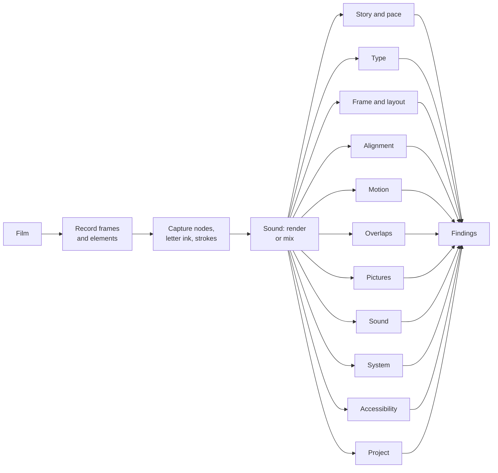

# The checks

Generated by `bun scripts/detect.ts --docs`. Do not edit.

`untell check` (the detector) records a film, captures its nodes, letter ink and shape strokes, measures its sound, and runs every check below. Each finding names the time, the node, what it measured, the limit and the fix. Errors fail the film. A warning does not fail it, but the verdict says "passed with N warnings: fix or declare each before delivery": only "passed" is clean. Advice never counts. Advice marks a check whose findings need an ear to judge, or that has no confirmed case on the reels yet: it shows, but never fails a film.

A finding the scene means (a whip's blur in a system that whips, a loud impact the system asks for) is declared, not hidden: `// untell-ignore <rule> <node or block id> @<from>-<to>: <reason>` (the id and the span are optional; with neither, the comment binds to the block call on the next line). It leaves the findings and never fails the film, and the report lists it with its reason and its line, and every declaration that matched nothing. align/* rules read the same comment through the alignment pass.

## Story and pace

| Rule | Level | Catches | Measures | Limit from | Fix | What an agent can do |
| --- | --- | --- | --- | --- | --- | --- |
| `hook` | error | Nothing moves, or the hook's subject is not on screen, by its time, or an empty pane stands in for it. Where the hook names a drawing or a UI, the drawing counts by the cells its parts cover (a thin line covers one cell along its length), not by the outer box of all its parts. An open drawing (a lever) needs its plate (sheet `plate: true`): the plate with its drawing counts as one picture. | First visible change against 0.2 s before; first picture, shape (SVG shapes by painted box) or line of the hook's role; text alone before the picture; panels of 10 % of the frame or more with nothing inside, on frame 0 or for 0.3 s in the hook's time. | direction.hook (show, by, role, area); 1.0 s for the first move; density.minHoldBase for text alone. | Open on the subject the system's hook names, moving, by its time. | Change the scene: Open on the subject the system's hook names, moving, by its time. |
| `stall` | error | No visible change for longer than the system allows, outside a hold block. | Share of the frame changed against 0.2 s before, every frame. | direction.maxStill. | Give the stretch a change on the beat, or mark the stillness with a hold block. | Change the scene: Give the stretch a change on the beat, or mark the stillness with a hold block. |
| `message-gap` | error | No sentence or headline on screen while no picture leads (a paper end's closing hold is the ending check's). | Visible headline or display text, or 3 words or more, every frame; a picture over 20 % of the frame leads. | max(1.5 s, density.minHoldBase). | Keep the line through the move, or show the picture that carries the message. | Change the scene: Keep the line through the move, or show the picture that carries the message. |
| `ending` | error | The end does not match the system's end: no hold, too long a hold, a paper end with content, the music cut. A part that moves in every second of the film to its last frame (a pendulum, a wheel that steps) is periodic: it is not counted as a change at the end. | Closing hold from the last change (pictures under 60 % of the frame masked); in a system whose maxStill is under its end's hold, from the last entrance, exit or cut (a push may go on under the complete card); last-frame entrances; the music's last 0.1 s against 1.5 s before. | direction.ends (kind, hold); max hold hold + 1.5 s (2.5 to 4 s) with 0.25 s tolerance. | End on the system's end: a held card, paper, or a cut on the bar. | Change the scene: End on the system's end: a held card, paper, or a cut on the bar. |
| `reveal-energy` | advice | The key reveal sits on a quiet bar of the track. | The reveal (an anchor node "reveal", a terminal's result line, else the largest entrance in the last third, by area) against the level of its bar and the loudest bar played. | 3 dB. | Move the reveal onto one of the loudest bars. A reveal on the measured drop (within a frame, plus one frame step in a stepped system) passes in a system whose entry rule is the drop. | Change the scene: Move the reveal onto one of the loudest bars. A reveal on the measured drop (within a frame, plus one frame step in a stepped system) passes in a system whose entry rule is the drop. |
| `spoiler` | error | The answer shows before its reveal: faint placeholders in the places the reveal fills. | The reveal (an anchor node "reveal", a terminal's result line, else the largest entrance in the last third); boxes of what cuts in there against earlier nodes with the same box (and text), drawn fainter (contrast to the ground, opacity). | 3 placeholders and half of the revealed items, shown 0.3 s or more, up to 0.5 s before the reveal; IoU 0.8; under 0.6 of the revealed item's contrast or opacity 0.6. | Remove the placeholders, or show them only from the reveal. | Change the scene: Remove the placeholders, or show them only from the reveal. |
| `reveal-size` | advice | The reveal is not the largest moment: a larger text beside it, smaller than most of the film's type, or too short. With B.reveal declared: what enters or changes at that time (within half a second after it), largest first; the hold asked is never longer than direction.ends.hold when the reveal is the last event; a declared reveal with no change on screen at its time is a warning; a declared reveal whose named block (of) shows in the rendered frame more than the system's step after its time (under a panel, or late) or before it (early) is a warning. | The declared reveal (B.reveal) or the detected one; its line (the largest text that enters within 4 frames); over its hold: the cap height of every other text on screen, the median of each frame's largest cap outside the hold, and the hold. | Largest on screen (5 % slack); at least the film's median largest cap; the hold at least density.minHoldBase + minHoldPerWord per word. An error where the type is the subject (direction.compose.kind fill: Kinetic); advice elsewhere. | Show the reveal alone and largest: a larger role, fewer letters on its line, a push; hold it for its reading time. | Change the scene: Show the reveal alone and largest: a larger role, fewer letters on its line, a push; hold it for its reading time. |
| `reveal-gap` | warning | The text before a declared reveal leaves some frames before the reveal's text shows, so the reveal lands on a frame with no text (an end card that cuts in after the words cleared one enter duration early). | From the first frame the reveal's text (the block B.reveal names with `of`, else any text) is on screen, back to the last frame with any text on screen (opacity 0.02 or more), outside declared holds. Not judged: a reveal whose named block has no text, a reveal that fades in (a dissolve), and a gap that a box or a shape of a quarter of the frame fills as it enters or moves (a flood, a wipe, a slab). | More than the system's step (1 frame; ceil(30 / step) frames in a stepped system), and up to the longer of motion.frames enter and exit plus the step, under half a second: a longer gap is a pause. | Keep the earlier text on screen until the reveal's time (until: the reveal's at). A block that cuts in (enter: "cut") has no entrance lead. | Change the scene: Keep the earlier text on screen until the reveal's time (until: the reveal's at). A block that cuts in (enter: "cut") has no entrance lead. |

## Type

| Rule | Level | Catches | Measures | Limit from | Fix | What an agent can do |
| --- | --- | --- | --- | --- | --- | --- |
| `main-line` | error | The main line of a moment is too small for a phone: caption-size type lost in the frame. | The largest prose text on screen at rest, its cap height on a 390 px wide phone, for 1 s or more; not while a drawn picture covers half the frame or more (it leads), nor while a number at the headline size or larger shows (a big stat is the main line). | 0.75 of the cap height the system's headline role gives in that face, at least 12 px. | Set the main line in the headline role or larger. | Change the scene: Set the main line in the headline role or larger. |
| `density` | warning | More words of prose on screen at once than the system allows. | Words with a letter in visible text that is not code or terminal text (a monospace face or a mono role) and not a label; numbers alone do not count. | tokens density.maxWords, for 0.5 s. | Split the text across beats, or cut words. | Change the scene: Split the text across beats, or cut words. |
| `reading-time` | warning | A text leaves before it can be read at the system's pace. | Each text's longest run on screen (opacity 0.5); a colour change of the same text at the same place, a mark of 3 characters, and text held to the end are not runs. | tokens density.minHoldBase + density.minHoldPerWord for each word. | Hold the text longer, or cut words. | Change the scene: Hold the text longer, or cut words. |
| `text-clipped` | error | Text cut by the frame edge or by a mask or box while it rests. | Letter ink boxes past the frame; the capture's raw ink (before clips) past the visible ink, at rest for 0.3 s. Text wholly outside the frame (a camera move took it out) is not on screen and not cut. | 1 px past the frame; 2 px cut by a mask; tokens bleed roles exempt. | Move it inside the frame or box, or finish the wipe before the text holds. | Change the scene: Move it inside the frame or box, or finish the wipe before the text holds. |
| `text-overlap` | error | Two texts whose letters overlap on any frame, at rest or in a hand-over (a title leaving while the next enters in its place). | Letter ink boxes of each pair of visible texts (opacity 0.25 or more) from different blocks, every frame; the parts of one block are one text. | 2 px each way; any frame. | End the first before the next enters in that place, or move one; declare a replacement you mean. | Change the scene: End the first before the next enters in that place, or move one; declare a replacement you mean. |
| `block-warning` | warning | A block warned while the scene built: a role that shrank to fit, a line that wraps, a label cut or left out. | The console warnings of the blocks, kept by the capture (version 5), that name a node of the film; a size probe's warnings go to the notes. | No warning. | Change the block's text, box or role until it draws as asked. | Change the scene: Change the block's text, box or role until it draws as asked. |
| `orphan-line` | warning | A headline whose last line is one short word (advice on kineticWords, which takes no line breaks yet). | Lines of a headline or display text at rest for 0.5 s: the last line one word of 4 letters or fewer, or under 40 % of the widest line, after a line of two words or more. | 4 letters; 40 % of the widest line. | Break so the last line holds two words or more. | With text or title: move the break (a box width, a line break). With kineticWords: change the words; it takes no line breaks yet (the finding is advice there). |
| `truncated` | warning | Text that ends in an ellipsis at rest: a block cut it. | Text ending in … or ..., or CSS text-overflow cutting it, at rest for 0.5 s. | No ellipsis at rest. | Shorten the text, widen its box, or use a smaller role. | Change the scene: Shorten the text, widen its box, or use a smaller role. |
| `reading-size` | error | Letters too small on a 390 px wide phone. | Cap height of the real font at the drawn size, scaled to 390 px. Code and terminal text (a monospace face) is read line by line, as body text. | Per role (display 12, headline 9, body 8, label 7 px); 11 px for a main-text line of 16 characters; code: 11 px or the system's body size in the code's face, whichever is larger. | Use a larger role, or fewer words. | Change the scene: Use a larger role, or fewer words. |
| `contrast-over-picture` | error | Text over a picture under 4.5:1 (3:1 large) on the real pixels. | Each letter's backdrop on the lossless key frames. | WCAG 2.x. | Dim or grade the picture, move the text, or use a plate. | Change the scene: Dim or grade the picture, move the text, or use a plate. |
| `type-over-media` | error | Type that cannot be read over footage or its backdrop. | Worst-frame contrast over pictures; busy backdrop (gradient share); line length; body lines at once; light weights. (Reading time is reading-time.) | 4.5:1; 18 % busy; 45 characters; 3 lines; weight 300 under 24 px. | Plate, calmer region, fewer words. | Change the scene: Plate, calmer region, fewer words. |

## Frame and layout

| Rule | Level | Catches | Measures | Limit from | Fix | What an agent can do |
| --- | --- | --- | --- | --- | --- | --- |
| `ui-state` | error | Two parts of one UI group show the selected look at once (a list with two selected rows). | Each frame: the nodes the UI kit marks data-state "selected", by block; without the mark, the kit's selection plates (<row>-sel<n>) and rows of one block whose fill is the odd one. | One selected part per group; runs of 0.3 s or more. | End the first selection on the frame the next one starts. | Change the scene: End the first selection on the frame the next one starts. |
| `subject-size` | error | The subject is small in the frame at a hero moment (the hook, the reveal, the end). | At the hook, the reveal and the last frame: where a picture (photo, clip, 3D canvas) is on screen, its silhouette (the pixels it draws off the ground inside its element, without text); else the box of what the frame draws off the ground (1st to 99th percentile). | Every system whose hook shows a subject with an area (direction.hook show picture or both): a silhouette of 0.3 x direction.hook.area at the hook (0.6 of that at the reveal and the end); a drawn subject's box of the full area in a picture hook; a small-in-field system (Keynote, Studio, Ma) is not held at its end. | Draw the subject larger at that moment: a closer shot, a larger fill. | Change the scene: Draw the subject larger at that moment: a closer shot, a larger fill. |
| `dead-space` | warning | A large part of the frame stays empty for too much of the film, or for one long stretch. A flat block of one colour with nothing on it (not the ground, a pane, a plate under text or one of a chart's marks) is not content, and one on screen for 1 s or more is a warning of its own. On a drawing sheet, content is the drawing's lines, labels and dimensions; the sheet's grid and an empty plate are the sheet, not content. | Per frame, the largest run of rows (at 16:9 also of columns) with no content: pixels off the ground colour without grain, grid marks, straight hairlines and ground-tone panels, or a visible text's ink. A frame counts when the run reaches a third of the frame (0.40 of the height at 9:16: the 35 % under the text-safe foot is the platform's). Over the film: the share of frames that count, outside a designed end card and declared holds; and each run of such frames. | direction.space (emptyShare, emptyRun) when stated; else 0.15 of the film for a system that fills the frame (compose fill or behind; Kinetic, Courtside, Graphite), 0.75 for one that may breathe (small-in-field; Ma, Title, Nocturne), 0.35 for the rest; a run over density.minHoldBase (1.5 to 2.4 s; x3 for a system that may breathe). | Fill the empty part: larger words or more lines, the picture or panel moved into it, or the next block given that space. A drawing: stand it where its system's compose puts it (figureBox; fitDrawing with no area). | Change the scene: Fill the empty part: larger words or more lines, the picture or panel moved into it, or the next block given that space. A drawing: stand it where its system's compose puts it (figureBox; fitDrawing with no area). |
| `panel-near-miss` | error | Box edges or text left edges miss alignment by 1 to 8 px (align/near-miss covers every other pair). | At rest every 0.5 s: edges of boxes and pictures (not nested), left edges of text. | 1 to 8 px. | Give the edges one shared value, or set them clearly apart. | Change the scene: Give the edges one shared value, or set them clearly apart. |
| `edge-cut` | error | A graphic cut by the frame edge by more than 25 % at rest. | Box or SVG outside the frame at rest for 0.3 s; pictures exempt (text is text-clipped). | 25 %. | Bring it inside, or make the bleed deliberate. | Change the scene: Bring it inside, or make the bleed deliberate. |
| `edge-sliver` | error | A shape left a few px inside the frame edge at rest: the edge of a panel that a move did not take far enough out. | Box or SVG elements at rest for 0.3 s that show 16 px or less of themselves inside one frame edge while 4 times that or more lies past it; the frame must draw the strip (18 grey levels from the strip inside it). | 16 px; 0.3 s. | Move it out of the frame by its visible width or more, or bring it in clearly. | Change the scene: Move it out of the frame by its visible width or more, or bring it in clearly. |
| `off-safe` | error | Text outside the platform-safe area at rest. | Text ink against ctx.safe (and lowBandRight below lowBandTop) at rest for 0.3 s; captions, bleed roles and text past the frame are other rules. | 2 px; the safe area of the scene context. | Move the text inside ctx.safe. | Change the scene: Move the text inside ctx.safe. |

## Alignment

| Rule | Level | Catches | Measures | Limit from | Fix | What an agent can do |
| --- | --- | --- | --- | --- | --- | --- |
| `align/centre` | error | A child's ink is off its container's centre by more than 1 px (the cone 10 pill). | Rest frames every 0.5 s: text by its band (baseline to cap line when a letter is tall, else to x line), boxes by their box; the child's two insets on the axis differ by under half their sum; a child laid out with two siblings or more counts only when one of them is centred too; not a word in its highlight, not a data mark. | 1 px (x: 1.5 px or 4 % of the font size) to the tolerance: 2 % of the short side, at most a quarter of the container. | Centre the cap band (baseline to cap line) in the block that places the text, or accept the snap proposal that the finding names (its fix prints the preview command). | Accept the snap proposal (untell snap --apply <id>) or declare it: // untell-ignore align/centre <node>: <reason>. |
| `align/baseline` | error | Texts side by side in one row whose baselines differ. | Baselines of texts that share a row and stand apart across it; two sizes whose bands share a centre are centre-aligned cells, not a miss. | 0.5 px to 35 % of the smaller font size. | Put the texts on one baseline (layout.onBaseline), or accept the snap proposal. | Change the scene: Put the texts on one baseline (layout.onBaseline), or accept the snap proposal. |
| `align/near-miss` | error | Two related edges, lines or centres 0.5 px to the tolerance apart (the button under the tab rule). | All features at rest (box edges, hairlines, centres, ink centres); ranked by relation (one container or block, neighbours, distance) and offset. Pairs panel-near-miss reports are left to it. | 0.5 px to 2 % of the short side (less for small elements). The level comes from the relation that supports the miss (align.ts LEVELS, judged on 304 films): error for one block, side-by-side siblings in one container, a scene tag or a scene guide; advice for a line of three, nearness only, or a rule's end. | Put both on one line (move the element with fewer relations), set them clearly apart, or declare it: // untell-ignore align/near-miss <node>: <reason>. | Accept the snap proposal, set the edges clearly apart, or declare it: // untell-ignore align/near-miss <node>: <reason>. |
| `align/rhythm` | error | A run of three or more like siblings whose gaps differ by a few px. | Gaps along the run between like elements (one kind, one container, one role, like sizes: texts within 1.15 times) that share a line across it. | 1 px to max(4 px, 15 % of the gap). | Give every gap of the run one value, or accept the snap proposal. | Change the scene: Give every gap of the run one value, or accept the snap proposal. |
| `align/half-px` | error | A hairline or a box edge at rest on a fraction of a px: it blurs. | Hairline centres (an odd width wants .5, an even width a whole px); box edges only under a transform at rest (Chrome rounds a box's layout position: 289 of 296 such edges were crisp); text baselines are advice only. | 0.25 px. | Round the position, or accept the snap proposal (it moves by the fraction). | Change the scene: Round the position, or accept the snap proposal (it moves by the fraction). |

## Motion

| Rule | Level | Catches | Measures | Limit from | Fix | What an agent can do |
| --- | --- | --- | --- | --- | --- | --- |
| `change-offset` | error | Two parts of one change land a frame apart: a band that cuts one frame after the shape it explains. | Steps (a node's box, opacity or fill changes in one frame and holds 2 frames on each side) of the elements and the SVG shapes, grouped by the frames they step on; pairs of groups that step together 2 times or more, with 2 or more one frame apart and none in the other order; a one-frame cascade of 3 groups is a sweep, not a fault. | 0 frames apart; 2 times. | Give both changes one time, so they land on one frame. | Change the scene: Give both changes one time, so they land on one frame. |
| `tiny-move` | warning | A move that reads as jitter: under 2 px, or a jump of 6 px or more in 1-2 frames. | Element boxes at rest for 3 frames before and after; camera moves, fades, size changes, block state changes and steppers (3 steps or more) excluded. | 0.5-2 px; 6 px in 2 frames. | Remove it, or make it a real move with the system's curve. | Change the scene: Remove it, or make it a real move with the system's curve. |
| `motion/easing` | warning | An entrance that eases in (starts slow). | Share of travel in the first and last quarter of the move. | First quarter under 10 %, last over 40 %. | Ease the entrance out (Kowalski). | Change the scene: Ease the entrance out (Kowalski). |
| `motion/scale-from-zero` | warning | An entrance that grows from scale 0. | Start scale of entrances. | 0.2. | Start at 0.9-0.97 with a fade (Kowalski). | Change the scene: Start at 0.9-0.97 with a fade (Kowalski). |
| `motion/consistency` | warning | Elements of one kind and size enter at different speeds. | Entrance durations by kind and size. | 1.6x. | One duration and curve (Kowalski: cohesion). | Change the scene: One duration and curve (Kowalski: cohesion). |
| `motion/stagger` | warning | Four or more of one kind enter on one frame. | Entrance starts; the parts of one line of text (a code row in syntax colours, its line number) count as one. | tokens motion.frames.stagger over 1. | Stagger them (Kowalski). | Change the scene: Stagger them (Kowalski). |
| `motion/too-much` | warning | Too many groups move at once. | Moving groups and area every frame (camera pans count once). | 6 groups (3 for calm systems), 60 % of the frame, 0.5 s. | Let one element lead. | Change the scene: Let one element lead. |
| `motion/orphan` | warning | One element moves alone, off the beat, with no cause. | Move starts against other moves, beats and hits. | 0.3 s window; 2 frames. | Give it a cause or remove it. | Change the scene: Give it a cause or remove it. |
| `motion/unsynced` | advice | Moves start with no shared rhythm. | Starts near a beat (not on a grid of low trust), a hit or another start. | Half the starts; 6 starts or more. | Start moves on the beat or in a regular stagger. | Change the scene: Start moves on the beat or in a regular stagger. |
| `motion/no-focus` | advice | While things move, no move leads: two gestures of near equal weight far apart, or the lead hops across the frame. | Moves every frame from element boxes (travel, size and fade, weighted by size), merged into gestures (one step, one way and near, one node). | Second gesture 50 % of the first and 25 % of the diagonal apart for 0.4 s; 3 hops over half the diagonal within 0.6 s. | Let one move lead; move the rest as one gesture or after it. | Change the scene: Let one move lead; move the rest as one gesture or after it. |

## Overlaps

| Rule | Level | Catches | Measures | Limit from | Fix | What an agent can do |
| --- | --- | --- | --- | --- | --- | --- |
| `transit-collision` | error | Two elements cross while one moves, though they never overlap at rest. | Text ink and painted boxes every frame; moving = changed from the frame before and to the frame after. | 3 px each way for 2 frames. | Move it out the other way, fade it before they meet, or move both together. | Change the scene: Move it out the other way, fade it before they meet, or move both together. |
| `text-crossed` | error | A line, outline or small mark runs through letters while both rest. | Stroke points every 4 px (screen px) against each letter's ink box, every frame, at rest for 0.2 s. Remotion films and HyperFrames pages (hf:<index.html>) alike. | 2 letters or 20 % of the text's width; marks under 1 % of the frame. | Move the label clear of the line (the callout block places a label with a leader), or break the line under the label. | Change the scene: Move the label clear of the line (the callout block places a label with a leader), or break the line under the label. |
| `shape-crossed` | error | A stroke goes through a closed outline it should wrap, or two leaders cross. | Stroke points inside a closed outline deeper than its relief; leader segments that intersect. At rest, every 0.5 s. | Outline relief (tooth depth) + 3 stroke widths, 3 points. | Route the line on the outline (tangent), or route the leaders apart. | Change the scene: Route the line on the outline (tangent), or route the leaders apart. |
| `joint` | error | A shape that rests on another part (shape `on`) leaves it while the parts move. | The joint point the scene declares (anchor <id>-on), mapped through each shape's screen matrix on every frame of the render. | 3 px. | Give the shape `on: { part, at }` and no hand-computed moves; a part that turns on another turns about the point it rests on. | Change the scene: Give the shape `on: { part, at }` and no hand-computed moves; a part that turns on another turns about the point it rests on. |

## Pictures

| Rule | Level | Catches | Measures | Limit from | Fix | What an agent can do |
| --- | --- | --- | --- | --- | --- | --- |
| `softness` | error | A picture drawn larger than its file. | Upscale from the drawn box and the file size (clips from media.gen.ts). | Warning over 1.15, error over 1.25 (the photo block's limits). | Use a larger file or draw it smaller. | Change the scene: Use a larger file or draw it smaller. |
| `cutout-fringe` | error | A cut-out keeps its source backdrop: an enclosed patch, a band of backdrop that shows as a line round the silhouette, or (warning) backdrop kept along one side of the outline. | Plain backdrop: media_cut.clean's gaps (dry run) and the edge pixels nearer the backdrop. Any backdrop: the depth of the band whose colour is nearer the local (graded) source backdrop than the subject (rimPx), then, as drawn, the share of silhouette points where that band differs from both the subject and the ground. | 0 gaps; plain rim 30 % over a ground 40 off the backdrop; a band of 3 px or more (1.5 px drawn) that shows on 30 % of the silhouette. | Run prepare again, cut with a tighter matte, or draw it over its own source plate. | Change the scene: Run prepare again, cut with a tighter matte, or draw it over its own source plate. |
| `repeat-shot` | warning | The same picture at a near-identical framing twice, or a photo's cut-out subject and then its plate as the next shot (the same subject again). | Crop and box IoU of image shots; montage cuts under 0.4 s skipped; for a cut-out and its own plate (one media folder), the share of the smaller crop inside the other, up to 0.3 s of overlap for a whip. | Crop IoU 0.85 and box IoU 0.75; 60 % of the smaller crop. | Show it again only with a new framing; give the next shot another photo. | Change the scene: Show it again only with a new framing; give the next shot another photo. |
| `accident` | error | A one-frame flash, a run of flat frames, an element on screen for 1-2 frames, 1-2 empty frames inside a move, or a subject that vanishes for 1-2 frames. | Grey difference to both neighbours, flatness, element lifetimes; the empty share of the frame (ground or black) against both neighbours, also in a camera move or a whip; the subject by region (8 x 4) against both neighbours. | Flat std 6; 3 frames; black between two flashes exempt in a system that declares flash cuts. | Remove the glitch frame or element. | Remove the stray frame or element in the scene; when frames go empty inside a camera move, look at the frames: it can be a renderer fault, not the scene. |
| `flash-frame` | warning | One or two frames of another colour, also at a cut. | Mean colour of the frame(s) against the frame before and after (small RGB copy); not a dissolve frame. | 30 levels; a system whose pictures flash or whose direction names flash cuts is exempt when a picture shows. | Remove the stray frame(s) at the cut. | Change the scene: Remove the stray frame(s) at the cut. |
| `ghost` | warning | An element held at 2-30 % opacity: a fade that did not finish; or a text stuck part-way through its entrance or exit (a move that stops and holds, then goes on). | Element opacity and box, every frame, for 0.3 s; the node's opacity track may declare the value (a held key). | 0.02-0.3 for 0.3 s. | Finish the fade, or hold the low opacity in the node's track. | Change the scene: Finish the fade, or hold the low opacity in the node's track. |
| `z-fight` | warning | A patch that flickers between two states every frame. | Pixels of the 1/5 grey copy that jump over 30 levels and come back, two frames in a row, twice in 1 s, in a patch of 30 px or more; moving elements, frames where the view moves (a camera move or pan), elements that show or go once within 3 frames (an entrance, a cut) and full-frame strobes excluded. | 1 flicker a second. | Give the two a fixed order or a depth offset, or drop the blinking one. | Change the scene: Give the two a fixed order or a depth offset, or drop the blinking one. |
| `late-load` | warning | A picture or text that changes size by a step after its first frame (a font swap, a late image). | Box size, top left and the image's natural size, in the first 0.5 s on screen: a step over 2 % that then holds. | 2 %. | Load the font or picture before the film starts. | Change the scene: Load the font or picture before the film starts. |
| `cover` | error | Type behind a cut-out, or under a picture, 3D canvas or panel drawn above it, loses too much of its letters (with the cause when the recording shows it: the text stays a frame over the next shot). | Cut-out alpha over each letter's ink box, every frame; checks/cover_rule.py holds the verdict the kit's placeBehind should share. | Letter 30 %, word 15 %. | Set the words with placeBehind, or shift the cut-out. | Move the words with placeBehind, end a text one frame before a cut, or shift the cut-out. |

## Sound

| Rule | Level | Catches | Measures | Limit from | Fix | What an agent can do |
| --- | --- | --- | --- | --- | --- | --- |
| `sound/true-peak` | error | True peak over -1 dBTP on a mastered render (advice on a render before untell master). | scripts/inspect/sound_checks.py on the real render (out/render/<id>.mastered.mp4 or <id>.mp4, current against the film's source); mastered = the untell_master tag that untell master writes, or a .mastered name; masking and effect levels from the files at their volumes (one function with untell listen mix). | direction.mix; the music map (assets/media/<track>/music.json). A grid with gridTrust low (the cross-check counts another pulse) gives warnings at most. | See the finding's fix. | Run untell master on the render; on a mastered file, lower the bed or the loudest hit and master again. |
| `sound/mix-loudness` | error | Integrated loudness off the system's mix target on a mastered render (advice before untell master). | scripts/inspect/sound_checks.py on the real render (out/render/<id>.mastered.mp4 or <id>.mp4, current against the film's source); mastered = the untell_master tag that untell master writes, or a .mastered name; masking and effect levels from the files at their volumes (one function with untell listen mix). | direction.mix; the music map (assets/media/<track>/music.json). A grid with gridTrust low (the cross-check counts another pulse) gives warnings at most. | See the finding's fix. | Run untell master on the render; on a mastered file, master again. |
| `sound/effect-too-loud` | error | An effect too loud for the music: a run of ticks over the music's loudest moment, an accent over it by 6 dB or more, or any effect over 0 dBFS (errors); an accent 0-6 dB over it, or 6 dB over the bed near it (warnings). | scripts/inspect/sound_checks.py on the real render (out/render/<id>.mastered.mp4 or <id>.mp4, current against the film's source); mastered = the untell_master tag that untell master writes, or a .mastered name; masking and effect levels from the files at their volumes (one function with untell listen mix). | direction.mix; the music map (assets/media/<track>/music.json). A grid with gridTrust low (the cross-check counts another pulse) gives warnings at most. | See the finding's fix. | Lower the effect's volume in its hit or typing block. |
| `sound/cut-on-beat` | warning | A cut off the track's beat grid (before a render: on the scene's mix; not judged on a grid the music map marks low trust). | scripts/inspect/sound_checks.py on the real render (out/render/<id>.mastered.mp4 or <id>.mp4, current against the film's source); mastered = the untell_master tag that untell master writes, or a .mastered name; masking and effect levels from the files at their volumes (one function with untell listen mix). | direction.mix; the music map (assets/media/<track>/music.json). A grid with gridTrust low (the cross-check counts another pulse) gives warnings at most. | See the finding's fix. | Change the scene: See the finding's fix. |
| `sound/drop-on-change` | warning | The drop (measured on the bed's own file through its node; rises within 1 dB are ties) misses the reveal (declared or detected) by more than one frame, or with no reveal lands on no cut, large change or entrance; before a render too, from the scene's audio nodes; the music map's drop is reported beside it. | scripts/inspect/sound_checks.py on the real render (out/render/<id>.mastered.mp4 or <id>.mp4, current against the film's source); mastered = the untell_master tag that untell master writes, or a .mastered name; masking and effect levels from the files at their volumes (one function with untell listen mix). | direction.mix; the music map (assets/media/<track>/music.json). A grid with gridTrust low (the cross-check counts another pulse) gives warnings at most. | See the finding's fix. | Move the track with music({ peakAt }) or move the change onto the drop. |
| `sound/hit-on-beat` | warning | Before a render: a hit off the beat grid (dense runs of ticks are exempt; not judged on a low-trust grid). | scripts/inspect/sound_checks.py on the real render (out/render/<id>.mastered.mp4 or <id>.mp4, current against the film's source); mastered = the untell_master tag that untell master writes, or a .mastered name; masking and effect levels from the files at their volumes (one function with untell listen mix). | direction.mix; the music map (assets/media/<track>/music.json). A grid with gridTrust low (the cross-check counts another pulse) gives warnings at most. | See the finding's fix. | Change the scene: See the finding's fix. |
| `sound/hit-over-bed` | warning | A hit (or a run of ticks, by its median) under 6 dB over the bed in the bands that carry it. | scripts/inspect/sound_checks.py on the real render (out/render/<id>.mastered.mp4 or <id>.mp4, current against the film's source); mastered = the untell_master tag that untell master writes, or a .mastered name; masking and effect levels from the files at their volumes (one function with untell listen mix). | direction.mix; the music map (assets/media/<track>/music.json). A grid with gridTrust low (the cross-check counts another pulse) gives warnings at most. | See the finding's fix. | Raise the hit's volume, pick a sharper effect, or duck the bed. |
| `sound/hit-double` | warning | A hit with two transients. | scripts/inspect/sound_checks.py on the real render (out/render/<id>.mastered.mp4 or <id>.mp4, current against the film's source); mastered = the untell_master tag that untell master writes, or a .mastered name; masking and effect levels from the files at their volumes (one function with untell listen mix). | direction.mix; the music map (assets/media/<track>/music.json). A grid with gridTrust low (the cross-check counts another pulse) gives warnings at most. | See the finding's fix. | Change the scene: See the finding's fix. |
| `sound/onset-unmatched` | warning | A strong onset with no picture change (on the render, and on the scene's own mix before a render; one frame step of slack in a stepped system). | scripts/inspect/sound_checks.py on the real render (out/render/<id>.mastered.mp4 or <id>.mp4, current against the film's source); mastered = the untell_master tag that untell master writes, or a .mastered name; masking and effect levels from the files at their volumes (one function with untell listen mix). | direction.mix; the music map (assets/media/<track>/music.json). A grid with gridTrust low (the cross-check counts another pulse) gives warnings at most. | See the finding's fix. | Change the scene: See the finding's fix. |
| `sound/hold-on-loud-bar` | warning | A still picture on a loud bar. | scripts/inspect/sound_checks.py on the real render (out/render/<id>.mastered.mp4 or <id>.mp4, current against the film's source); mastered = the untell_master tag that untell master writes, or a .mastered name; masking and effect levels from the files at their volumes (one function with untell listen mix). | direction.mix; the music map (assets/media/<track>/music.json). A grid with gridTrust low (the cross-check counts another pulse) gives warnings at most. | See the finding's fix. | Change the scene: See the finding's fix. |
| `sound/first-2s-level` | warning | The first 2 s are near silent. | scripts/inspect/sound_checks.py on the real render (out/render/<id>.mastered.mp4 or <id>.mp4, current against the film's source); mastered = the untell_master tag that untell master writes, or a .mastered name; masking and effect levels from the files at their volumes (one function with untell listen mix). | direction.mix; the music map (assets/media/<track>/music.json). A grid with gridTrust low (the cross-check counts another pulse) gives warnings at most. | See the finding's fix. | Change the scene: See the finding's fix. |
| `sound/phone-loss` | warning | Most of the mix is under 200 Hz: a phone speaker loses over 8 dB of it. | scripts/inspect/sound_checks.py on the real render (out/render/<id>.mastered.mp4 or <id>.mp4, current against the film's source); mastered = the untell_master tag that untell master writes, or a .mastered name; masking and effect levels from the files at their volumes (one function with untell listen mix). | direction.mix; the music map (assets/media/<track>/music.json). A grid with gridTrust low (the cross-check counts another pulse) gives warnings at most. | See the finding's fix. | Choose a track with mid-range content, or lift 1-4 kHz in the bed. A scene cannot change a track's EQ yet. |
| `sound/digital-silence` | warning | Exact silence of 0.5 s or more. | scripts/inspect/sound_checks.py on the real render (out/render/<id>.mastered.mp4 or <id>.mp4, current against the film's source); mastered = the untell_master tag that untell master writes, or a .mastered name; masking and effect levels from the files at their volumes (one function with untell listen mix). | direction.mix; the music map (assets/media/<track>/music.json). A grid with gridTrust low (the cross-check counts another pulse) gives warnings at most. | See the finding's fix. | Change the scene: See the finding's fix. |
| `sound/hard-start` | warning | The bed enters above its track's mean level on frame 0 with no rise (the music block's rule). | Loudness of the track's first 1 s from the entry against music.json lufs; the node's fadeIn. | One-frame systems and fadeIn: 0 are exempt. | Give the bed a fadeIn (the music block adds 0.15 s), enter on a build, or set fadeIn: 0. | Change the scene: Give the bed a fadeIn (the music block adds 0.15 s), enter on a build, or set fadeIn: 0. |
| `loudness` | error | Without a current render: the mix's loudness and true peak as advice (untell master sets them); always: a hit's peak 0-2 frames after its picture. | hyperframes audio on the ffmpeg mix; visible change before each hit: 0.02 % of the frame, or a text (a label, a dimension's value) that appears. | direction.mix (lufs, range); -1 dBTP. | Set the bed's volume; move the hit. | The level of a scene mix is advice: render, then untell master. A hit off its picture: move the hit. |

## System

| Rule | Level | Catches | Measures | Limit from | Fix | What an agent can do |
| --- | --- | --- | --- | --- | --- | --- |
| `signature` | error | The system's accent never shows (an error); more accent elements in a frame than the system allows (a warning); a measurable signature move of the system that does not show (a warning). | Accent share on the lossless key frames: the accent and accentText, and tints of the accent over the ground or surface in flat areas off the pictures; accent parts of the frame (grown 48 px) for a system that states accentElements; the direction's other measurable moves are listed in notes. | 0.05 % of the frame, or, in a system that draws in hairlines (stroke 2 px or less), accent lines that add up to a quarter of the frame's width; accentElements.max for 1 s. | Put the accent where the film makes its point, on one point at a time. | Change the scene: Put the accent where the film makes its point, on one point at a time. |

## Accessibility

| Rule | Level | Catches | Measures | Limit from | Fix | What an agent can do |
| --- | --- | --- | --- | --- | --- | --- |
| `a11y/contrast` | error | Text under WCAG 4.5:1 (3:1 large) on its own backdrop. | Letter backdrops on the key frames, text at rest only (not moving, the view not moving, no blur track: film.text_at_rest, shared by every text check); APCA Lc as information. | WCAG 2.x; large = 24 px regular or 18.7 px bold on a 390 px phone. | Use a colour with more contrast (ink, not a muted tone) or a plate; text whose colour passes but draws fainter (thin strokes at a small size) needs a larger or heavier role. | Change the scene: Use a colour with more contrast (ink, not a muted tone) or a plate; text whose colour passes but draws fainter (thin strokes at a small size) needs a larger or heavier role. |
| `a11y/flash` | error | More than 3 general flashes in 1 s. | Opposing luminance transitions of 10 % over a quarter of the frame. | WCAG 2.3.1. | Slow the light-dark cuts. | Change the scene: Slow the light-dark cuts. |
| `a11y/colour-only` | warning | Boxes that differ only by hue merge for colour-blind viewers. | Deuteranopia and protanopia simulation of box fills. | 1.5:1 and 0.08 OKLab; labelled pairs exempt. | Add a label or pattern, or differ in lightness. | Change the scene: Add a label or pattern, or differ in lightness. |
| `a11y/motion` | warning | A fast full-frame zoom or spin. | Scale and rotation of the camera and of elements over half the frame. | 1.3x or 45 degrees in 0.5 s. | Slow it or make it smaller. | Change the scene: Slow it or make it smaller. |
| `a11y/captions` | error | Captions outside the safe area, small, over 2 lines or under 1 s. | Text from caption nodes, by page (the captions block's node without its word part). | Safe area; caption role size; 2 lines; 1 s. | Fix the caption block's place, size or timing. | Change the captions block's place, size or timing. |

## Project

| Rule | Level | Catches | Measures | Limit from | Fix | What an agent can do |
| --- | --- | --- | --- | --- | --- | --- |
| `sameness` | error | Films in one project share a track, a picture or near-identical key frames (detect.ts --sameness). | Music and picture media names; 36 x 64 thumbnails and normalised layouts every 0.5 s. | Mean difference 8 and layout correlation 0.9; a shared picture is a warning. | Give each film its own track, picture and layout. | Give each film its own track, picture and layout (a project rule: no single scene fixes it). |
