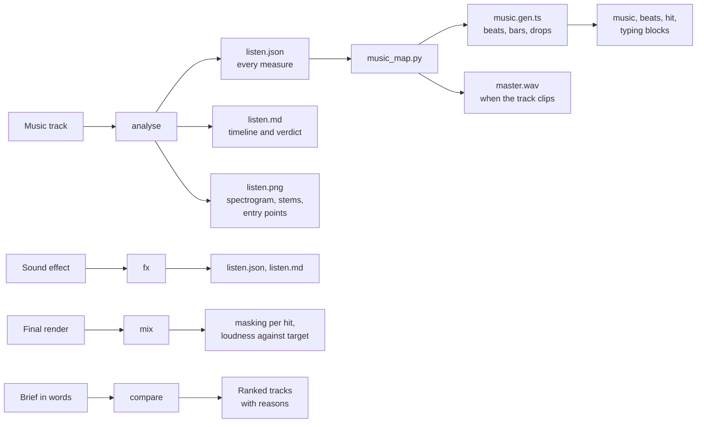

# untell listen: what a sound sounds like

An agent cannot hear. `untell listen` measures what a mix engineer hears in a music track or a sound effect and
writes it as data and as plain notes. Read the notes before you choose a track, before you place a cut, and
after you render.



## The commands

Run them with `scripts/listen/untell-listen` (it uses the `.venv-audio` environment).

| Command | Input | Output | Use it to |
| --- | --- | --- | --- |
| `analyse <name> ... [--all] [--force]` | a prepared music track | `listen.json`, `listen.md`, `listen.png` beside the track | know the track before you choose it and before you cut to it |
| `fx <name> ...` | a prepared sound effect | `listen.json`, `listen.md` | know the attack, the peak, the tail and any double hit |
| `mix <render.mp4> <nodes.json> <system>` | a final render and its audio nodes | Markdown, and `<render>.mix.json` | find masked hits, and the gain or duck that fixes each |
| `compare "<brief>" [<name> ...]` | a brief in words | a ranked list with the reasons for and against each track | choose a track by what it does, not by its tempo |

After `analyse`, run `python3 scripts/music_map.py`. It writes `music.json` beside each track and
`src/system/music.gen.ts`, which the blocks read. A track whose true peak is over -1 dBTP also gets `master.wav`:
the same audio, true-peak limited to -1 dBTP at 4x oversampling, with no other change. `music` plays it.

## How to read listen.md

1. **In one paragraph.** The mood, the genre, the tempo, the key, the count of sections and drops, and the repeat share.
2. **Timeline.** One line a section, with its bars, its role (intro, build, drop, break, body, outro), its
   loudness, the stems that play and the drum hits per bar. Under it: what enters or leaves, the builds, the drop,
   new material and transposed repeats, each with its time in seconds into the file.
3. **Rhythm, structure, harmony, loudness, spectrum, sources, character.** The measures, each with a trust note.
4. **Entry points.** The best places to enter the track for a 15 s and a 38 s film, ranked, each with why.
5. **Verdict.** What it feels like, what film it suits, what it does well and what it does badly. Read "does
   badly" first: a loop-based track, a quiet intro, clipping or vocals under on-screen words are reasons to pass.

`listen.png` shows the same on one time axis: the spectrogram with the bar lines, the sections and the drops; the
loudness and the tension; the stem lanes; the energy per band; and the entry points.

## What to trust

| Measure | Trust | Why |
| --- | --- | --- |
| Loudness (integrated, short-term, range), true peak, clipping, silence | high | ITU-R BS.1770-4 and 4x oversampling; within 0.1 LU and 0.1 dB of a second meter on all 22 lab tracks |
| Bar loudness (the music map's `barLufs`, which sets the `music` block's level) | high | K-weighted along time in each channel; the 14 s window of a test track reads -15.5 LUFS, as ffmpeg's meter does. Before this fix the bars read 3-5 dB too loud, and every bed came out under its target |
| Tempo | high when the confidence says high or medium | agrees within 1.5 BPM with a second tracker on 16 of 19 tracks; ambient and rubato tracks can be off by an octave or 3:4 |
| Beat grid | medium | corrected for the onset lag; a grid can sit on the off-beat in house music without stems |
| Downbeats (bar starts) | medium with stems, low without | read `downbeatMargin`: under 0.3 the bar's first beat is a guess; without stems it matched the stems on 15 of 22 tracks |
| Drops, builds | medium | a drop is a 6 dB rise on a bar (or 3 dB with the low end up 6 dB); check the time on listen.png |
| Sections and repetition | medium | from harmony and timbre per 4-bar block; a new lead line over the same loop can count as the same loop |
| Key | medium | profile fit plus the home chord and the bass at bar starts; it matched the most common bar chord on 20 of 22 tracks |
| Chords per bar | low | triad templates on chroma: a guide, not a transcription |
| Stems, vocals | medium | stem separation leaks lead synths into the vocal stem |
| Character tags (mood, genre, use) | medium | zero-shot audio-text scores; trust the top words, not small gaps between them |
| Danceability | low | a fluctuation measure of the level; for cutting, use pulse clarity and the share of kicks on the beat |
| Effect class | medium | rules on the envelope and the spectrum, with the tag model as a second opinion |

## Install

The core gives bars, beats, sections, the drop, loudness and the key:

```
uv venv .venv-audio --python 3.12
uv pip install --python .venv-audio/bin/python numpy scipy librosa soundfile pyloudnorm
```

Each extra is found at run time. Without one, `listen` prints the part it skips and the command that adds it, and
every report names the part as not measured: `listen.md` says "Playing: not measured" with no stems, and `compare`
says it has no sound match with no character tags. A missing part is never shown as a quiet or a zero result.

`compare` reads a tempo in the brief ("118-142 BPM" or "about 120 BPM") and ranks a track outside it lower.

```
uv pip install --python .venv-audio/bin/python matplotlib                          # listen.png
uv pip install --python .venv-audio/bin/python torch torchaudio demucs             # stems
uv pip install --python .venv-audio/bin/python torch "transformers==4.46.3"        # character tags
```

Use transformers 4.46.3: a later version gave flat tag scores in our test.

| Package | Licence | Part |
| --- | --- | --- |
| numpy, scipy | BSD-3-Clause | core |
| librosa | ISC | core |
| soundfile | BSD-3-Clause (it loads libsndfile, LGPL-2.1, as a shared library) | core |
| soxr | LGPL-2.1-or-later (librosa needs it to resample) | core, through librosa |
| scikit-learn, numba | BSD-3-Clause, BSD-2-Clause | core, through librosa |
| pyloudnorm | MIT | core |
| matplotlib | matplotlib licence (PSF-based) | picture |
| torch | BSD-3-Clause | stems, tags |
| torchaudio | BSD-2-Clause | stems |
| demucs, julius, einops | MIT | stems |
| lameenc | LGPL-3.0-or-later (installed with demucs for its MP3 export; untell never calls it) | stems, through demucs |
| transformers, tokenizers | Apache-2.0 | tags |

Model weights download on first use and never ship with untell:

| Model | Licence | Size |
| --- | --- | --- |
| Demucs htdemucs | MIT | about 80 MB |
| CLAP laion/clap-htsat-unfused | Apache-2.0 | about 600 MB |

untell vendors none of these packages and links none statically. It uses no GPL or AGPL code.

## One drop time, one effect rule

The sound blocks are called like every block, with the props first and the context second. The bed, then a hit on it:

```ts
const bed = B.music({ id: "bed", media: "<track>", peakAt: 4.2 }, ctx);
const thud = B.hit({ id: "thud", media: "<effect>", on: { nodes: answer, id: "answer" }, bed }, ctx);
```

Below, `music({ ... })` and `hit({ ... })` are short for these calls.

- **The drop.** `listen analyse` measures each drop's rise in the sound (`at` in listen.json and music.json): the step
  in level from the beat before to the beat after, at an onset or a beat near the bar line the grid found. The bar line
  (`t`) can sit a beat late when the grid guessed the bar start (three agents' films). `listen.md`, `listen compare`,
  `music({ peakAt })` and the checks all read `at`. When a render shows the drop elsewhere, pin it:
  `untell listen analyse <track> --drop <seconds>` (track time); the map then says it was set by hand.
- **The tempo range.** `listen compare` counts a tempo inside a brief's range only when it is inside: 117 BPM is outside
  118-128, and the reason says by how much. It ranks every analysed track: the prepared ones and the files analysed by
  their path.
- **The effect rule** (the one statement is the header of `src/system/scene/blocks/sound.ts`): an effect's peak plus the
  bed's peak at that moment stay at or under -1 dBTP; an effect plays at volume 1 at most; its peak stays under the
  music's loudest peak; within that it stands 8 dB (hits) or 6 dB (ticks) over the bed. When it cannot, duck the bed:
  `hit({ duck: true, bed })`, or `music({ duck: [{ at, depth, length }] })`. `listen mix` gives the same fix.
- **A low-trust grid.** `beats()` warns at build and gives `cuts`: the strong onsets, measured in the sound. Cut on them.

