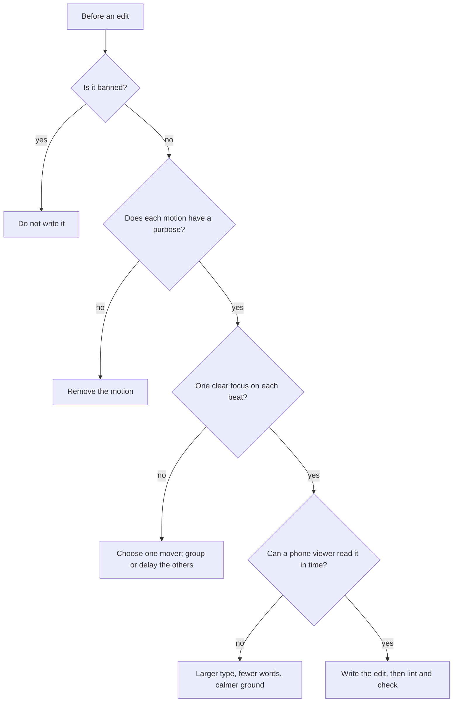

# The craft floor

Read this once before you start a film, and again when a check or a sheet shows a fault that it names. It holds the bans, and the reflexes that no check can measure. The checks
find what can be counted. This file is for what must be judged.

The tools hold the full lists. Do not work from memory:

- `untell lint --rules` lists each source rule. `untell lint --explain <rule>` gives its reason and its fix.
- `untell check` runs the detector on the recorded film. Each finding names the time, the node and the fix.
- The system's `SYSTEM.md` holds its Direction, its Never list and its block map.

## 1. Bans

Never write these. No system allows them.

- A dark blue or ink-blue ground, a purple accent, a gradient behind content, gradient text, a glow, a soft blob, a
  frosted panel.
- A slideshow: text that fades in, holds and fades out, scene after scene, with no picture that changes.
- A dead second: a stretch where nothing moves and nothing new can be read, outside a hold that you planned.
- An opening that makes the viewer wait: small text alone on an empty ground, a logo sting in front of the film's
  subject, a slow fade from black. A film whose subject is the mark (a logo film in Mark) is not that sting: it opens
  on the mark, drawn on frame 0, as the system's hook asks.
- An end that just stops: the last frame is the same as the frame 2 s before it, with no last event.
- Text the viewer cannot read: smaller than the system's label role on a phone, on a busy picture with no plate, or
  gone before its reading time.
- A colour, font, size, weight or curve that is not a role of the system.
- A random value or the clock in a frame.
- A real brand or a real person that you invent or borrow, or a name copied from an example. A brand that the user's
  own brief names (their product, their company) is the subject: use it as the brief gives it.
- A patch on a block's output (a `.map` over its nodes). Use the block's props. If a prop is missing, add it to the block.

## 2. Motion

Each rule here comes from one question: does this motion help the viewer understand the frame?

**Purpose.** A motion must do one of four jobs. If it does none, remove it.

1. It points the eye at the next thing to read.
2. It shows where a thing came from or where it goes (space).
3. It shows that a value or a state changed.
4. It explains how a thing works.

"It looks good" is not a job.

**One focus.** On each beat, one thing leads. The eye must know where to go without a search.

- Name the mover of each beat. It is the largest motion on screen at that time.
- Things that belong together move together: the same start, the same curve, the same direction.
- Things that do not belong together move one after the other, not at the same time.
- A second motion during the mover's travel must be much smaller (a drift, a cursor) or wait.
- A thing that moves with no relation to the beat, the mover or the music is an orphan. Give it a cause or remove it.

**Amount.** Count what moves in one second. More than three unrelated motions at once is noise in any system. A calm
system has fewer. When all things move, nothing has weight: keep still what must be read.

**Curves.** Use the system's three curves by their names.

- A thing that enters starts fast and settles (`enter`). A slow start makes the viewer wait at the moment they look.
- A thing that moves on screen eases at both ends (`move`).
- A thing that leaves goes faster than it came (`exit`). An exit is not the event; do not make the viewer watch it.
- A constant motion (a drift, a count, a belt) is linear.

**Physical sense.**

- Nothing grows from nothing. A thing appears from a mask, from an edge, from another thing, or at near full size
  with a fade. Never from scale 0.
- A thing grows from where it came: the point it was called from, the edge it entered, the mark it labels.
- A thing leaves the way that space allows: back to where it came from, or off the nearest edge.
- Data never passes its value. A bar or a count stops on its number (`ctx.noOvershoot`).
- Bounce is rare. Use it only where the system's motion section allows it.

**Stagger.** A group enters with a short, even offset between items, from the system. A long offset makes the last
item late for its own beat. The whole group must be in before its reading time starts.

**Transit.** Two things that are clear at rest must also be clear while they move.

- A thing never slides through a thing that stays. Text does not leave through a bar, a rule or a picture edge.
- When two things would cross, choose one: they leave together, the fixed thing leaves first, the mover leaves in
  the other direction, or a mask hides the mover at the edge of its own box.
- Check the middle of each move, not only its two ends.

**Camera.** A camera move is a motion with the largest cost: it moves all things. Use it to follow the subject or to
show scale. Text that must be read during a move is pinned to the screen, or it waits for the move to end.

**Comfort.** A viewer can be sensitive to motion.

- No flash more than three times in one second. No large area that changes between light and dark at speed.
- No fast zoom, spin or parallax across the full frame for longer than a short accent.
- No meaning by colour alone: a state also has a shape, a position or a word.

## 3. Type

- Measure each string before you place it. Never guess a width.
- Size for a phone held at arm's length. If you must lean in to read it on a 390 px wide preview, it is too small.
- Few words. The system's Density section gives the limit and the reading time. Count prose only: code, terminal
  output, chart labels and data do not count.
- One text is the largest on each beat. Two texts of near size compete.
- Text over a picture sits on a calm area or on a plate. Check the contrast on the worst frame, not the best.
- A line breaks where the sense breaks. No one-word last line in a headline.
- Numbers that change use tabular figures and do not shift their neighbours.

## 4. Layout

- Place from `ctx.safe`. The platform's own controls cover the edges at 9:16. A line at exactly `ctx.safe.top` or `ctx.safe.bottom` needs room for its glyphs, which reach past a tight line box: see the text-safe rule in `scene/BLOCKS.md`.
- Use the frame. An empty third for a long time needs a reason. Do not fill it with decoration: make the subject larger.
- Align to a few lines. Edges that almost align (a few px apart) read as an error.
- The subject is large. If the subject covers less of the frame than the text about it, change the scale.
- At rest, nothing overlaps text: not text, not a line, not a mark.

## 5. Pictures

Use media that the brief's owner may use, with its source and licence recorded. These rules are about how you use it.

- Prefer subjects with no identifiable face: a back, hands, a silhouette, a crowd at a distance.
- Never use a picture of an identifiable child.

- A picture is sharp at its largest size on screen. The `photo` block reports its upscale; more than 1.25x is soft.
- Each shot is a new angle or new content. One picture cropped three ways is one shot.
- Pictures in one film match: one grade (the system's), one light direction where it shows, one kind of subject.
- A cut-out has a clean edge. Look at the hair, the hands and the gaps at full size before you use it.
- Type behind a subject keeps each word readable: plan it with `placeBehind`.
- Use the system's own treatment (its Media section). A smooth duotone where the system asks for halftone is a miss.

## 6. Sound

You cannot hear. Do not guess. Use `untell listen` and read what it says.

A film with no sound (the brief gives none, or forbids downloads) states it in the scene:
`export const silent = "<the reason>";`. Then follow the "With no sound" line of the system's Direction: a steady beat
of your own takes the place of the music's beats.

- The music is the clock when the system says so. Take cut times from the beat grid. A cut 3 frames from a beat
  reads as an error; a cut on the beat reads as intent.
- Enter the track as the system's Mix line says (its entry rule). In a clock system the reveal lands on the drop. A
  hold sits on a calm bar.
- Enter the track where it has energy, not on a quiet intro, unless the film opens quiet on purpose.
- Few effects. Each has a cause on screen, and its peak lands on the first frame that shows the cause (`hit` does this).
- An effect must be heard over the bed, and never be louder than the music's peak. Give `hit` and `typing` the bed
  (`bed`), and they set the level. If the mix check says an effect is masked, raise it, change it, or dip the bed.
- The whole mix meets the system's target, and the true peak stays under the limit. Measure the final render.
- The music ends with the film: on a bar, with a short fade under the last hold.

## 7. First and last

- Frame 0 is a picture, not an empty ground. Something moves in the first second.
- By 2 s the viewer knows the subject.
- The last change is an event. Then the frame holds for the time the system gives, and the sound closes.

## 8. After each edit

1. Run `untell lint <file>`. Fix each error. Fix or justify each warning.
2. Before you say a film is done, run `untell render <scene>`, then `untell check <scene> --render <final file> --sheet`.
   Open the sheet and look at it.
3. A finding is a fact about the film. Change the film. Do not change the check, and do not silence a finding
   with no reason.
