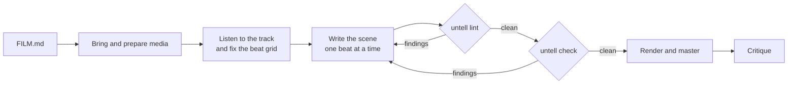

# Craft: build the film from `FILM.md`

Do this pass after shape. It turns `FILM.md` into a scene module that passes every check with no hand fix.



## Before you start

- `FILM.md` passes the gate in `shape.md`. If it does not, go back.
- Read `craft-floor.md` once.
- Read the system's `SYSTEM.md` block map. For each beat, write the block that draws it. If you plan a raw `rect`,
  `path` or `text` node, look again: a block almost always exists.

## 1. Media first

Media decides layout, so it comes before code.

1. Add each file from the media list: `untell media add <file> --as <name>`.
2. Prepare each picture for the system: `untell media prepare <name> --system <id>`. Read what it prints: the size,
   the gaps it opened in a cut-out, the grade.
3. Look at each prepared file at full size. Check the edge of a cut-out on a ground of the film's colour.
4. For each picture, compare its size with the box in the media list. If the upscale is over 1.25x, bring a larger
   file or make the box smaller. Do this now, not after the scene exists.

## 2. The track and the grid

1. `untell listen analyse <name>`. Read `listen.md`.
2. Place the music first in the scene, as the system's Mix line says (its entry rule): `music({ media, peakAt:
   <reveal time>, until: <film end> })` for a drop, `align` for a section start. With no `volume`, the block sets
   the bed's level for the system's mix target. Give `hit` and `typing` the music's nodes as `bed`.
3. Build the beat grid from the same entry: `beats()`. Each cut and each entrance in `FILM.md` moves to the nearest
   cut point of this grid: `G.onCut(t)` (the beats, or the bars for a bar cut). Write the new times back into
   `FILM.md`.
4. On a low-trust grid (`G.gridTrust` is "low", and `beats()` says so at build), cut on `G.cuts` all the same: there
   they are the track's strong onsets, measured in the sound, not the beats of a grid that may count another pulse.
   This rule wins over a system that cuts on beats: on a low-trust grid, a beat is a guess and an onset is not.
5. `peakAt` lands the drop's measured rise (the step in level in the sound), not its bar line, and the build says when
   the two differ. When a render shows the drop elsewhere, pin it once: `untell listen analyse <track> --drop <seconds>`
   (track time). Every command then reads that one time.

## 3. Write the scene, one beat at a time

Work down the beat sheet. For each row:

1. Call the block for the row with content, boxes and times. Colour, type and motion are roles of the system.
2. Place from `ctx.safe`. Measure each string with `ctx.measure` before you give it a box.
3. Use the block's `enter` and `exit` props. Leave them out to take the system's own entrance and exit.
4. Give the row's mover its motion. Give things that go with it the same start and curve.
5. Say where each thing goes when it leaves. Check that its path crosses nothing that stays.
6. Run the lint. Fix each finding before the next row.

Rules while you write:

- Never patch a block's nodes. If a block cannot do what the beat needs, add the prop to the block, with a test.
- A hold is a decision: mark it with `B.hold`. An unmarked still stretch is a stall.
- Text that must stay through a camera move is `pinned`.
- A label on a drawing uses `callout` or `dimension`. They place the label clear of the lines they know.
- Effects: `hit({ on: { nodes, id }, bed })` lands the sound on that block's picture change: the frame a callout's,
  a dimension's or a formula's label shows (the frame the hit check counts), else the frame the block has arrived; at a
  level set against the bed by the effect rule: the effect's peak plus the bed's peak stay at or under -1 dBTP, at volume 1 at most. Never raise an effect past that, and never set `volume` over 1: when
  the bed is too loud for the effect to be heard (the build says so), give `hit` `duck: true`, and it dips the bed
  under it.
- Two texts in one place take turns: a text block that starts where another still shows makes the old one leave by
  its first frame (the build says so). Say it on purpose with `replaces: "<id>"` (typed labels in one slot, a line that
  takes the place of the line before).
- The reveal is the largest thing on screen at its moment. In `kineticWords` mark it `reveal: true`, and let it win the
  system's way: it grows into the accent ground (`exit: "toGround"`), it sits on an accent ground, a picture fills the
  frame then, or its size wins (`size: "hero"` for a short word, `"bleed"` for a long one, cropped by the frame). No
  other phrase gets smaller for it: every phrase keeps filling the frame. The build names these ways when the reveal
  meets none of them.
- Times: a change at t shows on the first frame after t, in every block. A block given `until` is gone (or starts to
  leave) on the frame a block given that time as `at` shows. A block with `at` before 0 is at rest on frame 0.
- Height: stack under a block with `B.measure("<block>", props, ctx)`; never guess a block's height.
- A block that steps its type down to fit says so in a warning. Read it: shorten the text, or give the block room.
- Declare the reveal with `B.reveal({ at })` at the time `FILM.md` gives it. The checks read the film's hero moments
  (the hook, the reveal, the last frame) from it; without it they guess the reveal from the largest late entrance.
- End the way the system's Direction says (its Ends line: the kind, the hold, the bar). These blocks do it:

<!-- untell:ends (written by scripts/export_systems.ts from src/system/direction.ts; do not edit by hand) -->

| System | The end | Block | How |
| --- | --- | --- | --- |
| Studio | a held card, held 1.5 s, on a bar | `endCard` | `name`, `line`, `at` on the last strong beat |
| Spec | a last event on screen that holds, held 1.5 s, on a bar | `dimension` | the answer's dimension drawn last, a final tick from `hit({ on })`, then `hold` to the end |
| Manual | a last event on screen that holds, held 1.5 s, on a bar | `terminal` | the last command prints its result (`result: true`) on the last bar; the cursor blinks to the end |
| Ma | the ground: the last text dissolves, and the paper holds, held 1 s | `text` | the last line with `until` about 2 s before the end and its exit a fade (the vocabulary); the paper holds |
| Primary | a last event on screen that holds, held 1.5 s, on a bar | `shape` | the last shape lands on the last beat with the result set inside it (`text` over it) |
| Riso | a last event on screen that holds, held 1.5 s, on a bar | `shape` | the last ink layer stamps (`enter: "cut"`) on the bar; the full sheet holds |
| Cutout | a lockup (the subject or mark with the name on one axis), held 1.5 s, on a bar | `lockup` | `axis: "row"`, `at` on the bar, with a stamp from `hit` |
| Mark | a lockup (the subject or mark with the name on one axis), held 2 s, on a bar | `drawnMark` | `lockup: { name, line, at }` with `at` on the bar (the mark moves into place and the closing hold is marked), the one impact from `hit` |
| Raw | a last event on screen that holds, held 1.5 s | `typeOn` | the name types as a heading (`cursor: true`) after the button press |
| Pop | a lockup (the subject or mark with the name on one axis), held 1.5 s, on a bar | `lockup` | the character, the icon and the name, `at` on the bar |
| Keynote | a lockup (the subject or mark with the name on one axis), held 1.5 s, on a bar | `endCard` | `name`, `line`, `at` on the last strong beat, with the one low impact |
| Graphite | a last event on screen that holds, held 1.5 s, on a bar | `cursor` | the last click completes the action on the last bar; the window holds with the name above it |
| Console | a last event on screen that holds, held 1.5 s, on a bar | `terminal` | the last reply prints on the last bar; the cursor blinks to the end |
| Noir | a held card, held 1.5 s, on a bar | `title` | the title in the light on the last beat, held; `shadowBars` with `exit: "fade"` and `until` on the last beat fades the slats |
| Title | a held card, held 2 s | `text` | the release line in body, centred, held over room tone |
| Matte | a lockup (the subject or mark with the name on one axis), held 1.5 s, on a bar | `endCard` | `name`, `axis: "row"` (a column at 9:16), `at` on the last strong onset |
| Kinetic | a hard cut to the ground on a bar, no hold, on a bar | `ground` | `color: "ground"`, `enter: "cut"`, `at` on the bar after the last line: the hard cut to the ground, no hold |
| Courtside | the offer at full size, held 1.5 s, on a bar | `endCard` | the offer as `name` at full width in the volt, `line` the when and where, the one impact from `hit` on the cut |
| Schematic | a last event on screen that holds, held 1.5 s, on a bar | `dimension` | the answer's dimension drawn last on one of the loudest bars, its tick from `hit({ on })`, then `hold` to the end (the closing hold is exempt from the stillness rule) |
| Nocturne | a held card, held 2 s | `quote` | the last statement as the card, with the rule, name and role, held to the end |

<!-- /untell:ends -->

## 4. The check loop

Run after the last row, and after each fix:

```
untell check <scene>
```

- Run this picture check until it is clean. Render only after that.
- The first screen of `check` groups the findings by cause. Fix one cause, not each of its findings: one fix in the
  block or the plan clears all the findings that it causes.
- Fix errors first, in time order. An early fix often removes later findings.
- Each finding gives the time, the node, the measured value, the limit and the fix. Do what the fix says. If the
  fix is wrong for this film, change the film's plan in `FILM.md`, not the limit.
- `untell check --explain <id>` says what a check measures and why.
- An `align/*` finding names a snap id and the command that previews it. Run that command
  (`untell snap <scene> --at <s> --preview <ids>`), open the pages it prints (`preview-1.png`: before and after, `preview-2.png`: each miss and its hunk id), and look at them. Then apply
  only the hunks that are right: `untell snap <scene> --at <s> --apply <ids>`. Never apply a hunk that you did not
  preview. When snap says that many hunks share one cause, fix the cause in the block instead.
- A finding that the film means (a whip's blur in a system that whips, a loud impact the system asks for) is declared,
  not hidden: put `// untell-ignore <rule> [node]: <reason>` on the line before the block call that owns the node.
  The report lists each declared finding with its reason, and each comment that matched nothing. A declared finding
  never fails the film.
- A finding that is a false alarm is a bug in untell. Declare it the same way, with the reason, and report it.
- Do not delete content to pass a check. Text removed before a camera move, or a picture removed because it was
  soft, is a worse film. Fix the cause.

Stop when the check is clean. Then open the sheet and look at it: a clean check is needed, and it is not enough.

## 5. Render and master

1. `untell render <scene>`. It renders with the framework, masters the mix to the system's target and limits the
   true peak, and prints the final file. Never use the framework's own render command. If the master line says the
   limiter took more than 4 dB, lower the bed or the hits and render again.
2. `untell check <scene> --render <final file> --sheet`. The sound checks need the real, mastered render: a check on
   an unmastered mix gives loudness advice that the master removes.
3. `untell listen mix <final file>`: no effect is masked, and no effect is louder than the music's peak. When it says a
   hit is masked, do the fix it gives: a raise within the effect rule, or `duck: true`. It never asks for a volume over 1.

## Done

- `untell lint` and `untell check` are clean. Each declared finding (`// untell-ignore <rule> [node]: <reason>`) has
  its reason, and the report shows no comment that matched nothing.
- The mastered render meets the system's mix target, and `untell listen mix` shows no masked effect and no effect
  louder than the music's peak.
- The sheet shows what `FILM.md` planned: the hook, the reveal on the drop, the end.

Then go to critique.
