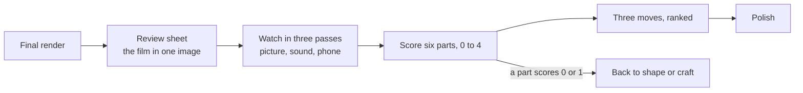

# Critique: judge the film as a director

A clean check means the film has no measured fault. It does not mean the film is good. This pass looks at the
whole film, scores it, and gives the few moves that would raise it one level.



## 1. Make the evidence

```
untell check <scene> --render <final file> --sheet
untell listen mix <final file>
```

Open the sheet image. Read `FILM.md` beside it. You judge the film against its own plan and its system.

If your harness can start a fresh agent, give this pass to one that did not build the film. An agent defends the film
it made. Give the reviewer the render, the sheet, `FILM.md` and this file, not your opinion.

If your harness cannot start a second agent, do the pass yourself, and do it cold: read only the sheet, the phone sheet and
`FILM.md`, not the scene code. Give each score from what the sheets show, before you open the code again. Write
the scores in `FILM.md`, as a fresh agent does.

## 2. Three passes

**Picture, no sound.** Go through the sheet in time order.

- First frame: is it a picture a viewer would stop for?
- By 2 s: do you know the subject?
- On each beat: where does the eye go first? Is that the thing the beat is about?
- Is the reveal the largest moment in the film? Could you point at it with the sound off?
- Does any frame look like a slide: centred text, nothing else?
- Does the last second look like an end?

**Sound, against the picture.** Read the waveform row, the beats and the mix report.

- Does the level rise into the film, or start at full?
- Do cuts sit on beats? Does the reveal sit on the drop?
- Does each effect have a cause on screen, and is it heard over the bed?
- Does the music end, or get cut?

**Phone.** Open the phone sheet at 100 %: `untell check --sheet` and `untell sheet` write it beside the review sheet
(`<sheet>.phone.jpg`, printed as `phone sheet: <path>`). It holds a frame from each shot at 390 px wide, the size a
phone shows it.

- Can you read every text without effort?
- Is the subject still clear?
- Does anything sit under where the platform draws its own controls?

## 3. Score

Score each part from 0 to 4. Give one sentence of evidence with a time for each score.

| Part | 0 | 2 | 4 |
| --- | --- | --- | --- |
| **Story** | A list of parts. No question, no reveal. | A clear idea, but the answer is typed, or the reveal is flat. | Hook, question, drawn answer, a reveal you remember, an end. |
| **Type** | Hard to read on a phone, or several texts compete. | Readable. Hierarchy is clear on most beats. | Each beat has one voice. Breaks, sizes and timing feel chosen. |
| **Layout** | Empty bands, near misses, a small subject. | Uses the frame. A few weak beats. | Each frame would stand as a poster in this system. |
| **Motion** | Everything fades, or everything moves at once. | Each beat has a mover. Some motion has no job. | Each motion has a job, lands on the music, and nothing crosses. |
| **Media** | Soft, generic, or the same shot again. | Sharp and graded. The shots are a little alike. | Distinct shots that match, in the system's own treatment. |
| **Sound** | Loudness only. Cuts miss beats. Effects are masked. | On the grid. The reveal is near the drop. | The film feels cut to the track. It rises, lands and ends. |

Then answer two questions in one sentence each:

- **System:** would a viewer who knows the 20 systems name this one from three frames? Which signature moves are on
  screen?
- **Tell:** is there any frame a viewer would call AI-made? Say which and why.

## 4. The verdict

- Any part at 0 or 1: the film goes back. A story problem goes back to shape. Other problems go back to craft.
- All parts at 2 or more: write the three moves that would raise the film most, ranked. Each move names the time, the
  change and the block or prop that does it. Prefer a move that makes the reveal stronger over a move that fixes
  a detail.
- Write what untell should have done by itself: a check that missed a fault, a block that lacked a prop, a rule
  that the docs did not state. Report these. They make the next film right on the first try.

Write the scores, the moves and the untell notes at the end of `FILM.md`.
