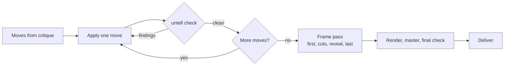

# Polish: the last pass before a film ships

Do this pass after critique, when no part of the film scores under 2. It applies the ranked moves, then goes through
the film once more at the level of single frames.



## 1. Apply the moves

- One move at a time. Run `untell check <scene>` after each: this check needs no render. A move that adds a finding is
  not done. Do not render between moves: render once, in the sound pass.
- Keep the plan true: when a move changes a beat, change `FILM.md` too.
- Stop when the three moves are in. Polish is not a second build.

## 2. The frame pass

Look at these frames at full size, not on the sheet:

1. **Frame 0.** It is the thumbnail. Nothing half-entered, nothing empty.
2. **One frame before and after each cut.** No empty frame, no frame that belongs to neither side, no thing that
   pops for one frame.
3. **The middle of each move.** Nothing crosses a thing that stays. No text is cut by an edge it does not leave through.
4. **The reveal frame.** It is the strongest frame of the film. If another frame is stronger, ask why.
5. **Each text at rest.** Breaks fall on sense. No one-word last line. Edges align or are clearly apart. Run
   `untell snap <scene> --at <s>` at this frame. Preview each hunk (`--preview <ids>`), look at the image, and apply
   only the hunks that are right (`--apply <ids>`). Never apply a hunk that you did not preview.
6. **Each cut-out at its largest.** The edge is clean on this ground: no rim, no patch of the old backdrop.
7. **The last frame.** It holds what the system's end asks for, and it would stand alone as a picture.

## 3. The system pass

Read the system's Never list and its Direction section once more against the film.

- Two signature moves are on screen and clear.
- No effect is used that the system does not allow.
- The stillness, the mix target and the end hold are the system's, not a habit from another system.

## 4. The sound pass

- `untell render <scene>` masters the mix: its master line shows the system's mix target met and the limiter took little.
- `untell listen mix <final file>`: no effect is masked, no effect is louder than the music's peak, the level
  rises into the film, the music ends on a bar.

## 5. Final check and delivery

```
untell check <scene> --render <final file> --sheet
```

The film is done when both are true:

- `untell check <scene> --render <final file> --sheet` is clean. Each declared finding (`// untell-ignore <rule> [node]: <reason>`
  on the line before the block call) has its reason; the report lists them, and each comment that matched nothing.
  The first screen groups the findings by cause: fix one cause, not each of its findings.
- `untell listen mix <final file>` shows no masked effect and no effect louder than the music's peak. The check's
  exit code does not cover these two facts yet, so read the mix report.
- Deliver the mastered file, the sheet and `FILM.md` with its scores.
- Say plainly what you did not check: a frame size you did not render, a platform you did not test, sound that no
  person has heard.
