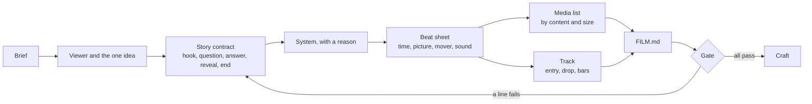

# Shape: plan the film before you write code

This playbook is for a finish: a film to publish. A draft does not use it: a draft plans in five lines in the chat
(the one idea, the system and why, the beats with their times) and goes to the scene.

Do this pass before the first line of scene code. It takes a brief and gives `FILM.md`: the story, the system, the
beats, the media and the sound. A film that fails here cannot be fixed by polish.



## 1. The viewer and the one idea

Write two sentences.

1. Who watches, and where (a phone feed, a launch page, a talk).
2. The one thing the viewer knows or wants at the end.

If you need "and" to say the idea, you have two films. Choose one.

A film is not its parts. "A title, three stats and a logo" is a list. "The battery lasts a week, and here is the
week" is an idea. Plan from the idea.

## 2. The story contract

Every film answers these five lines. Write each answer in `FILM.md`.

| Line | Rule |
| --- | --- |
| **Hook** | By 2 s the viewer sees the subject or the main line at full size, and something moves. Read the system's Direction section for its own hook. Never open on small text alone on an empty ground. |
| **Question** | What the hook makes the viewer want to know. One sentence. If the hook raises no question, change the hook. |
| **Answer** | The answer is drawn, not only typed: a bar that grows, a part that moves, a picture, a number that counts. Text names what the picture shows. |
| **Reveal** | The one moment the film exists for. It is the largest thing on screen at its time. With music, it lands where the system's entry rule puts the track's peak (the Mix line): on the drop in a clock system. |
| **End** | A last event, then the hold the system's Direction section gives. The viewer knows the film is over because something ended, not because it stopped. |

Three checks on the contract:

- Cover the text with your hand. The pictures alone still tell the order of events.
- Mute the sound. The reveal is still the clear high point.
- Read only the first 2 s and the last 2 s. They belong to one film.

## 3. The subject and the names

- Read the "Subjects to avoid" line in the system's Direction section. Do not use those subjects.
- Use facts a viewer can check: a computed value, physics, a count.
- For a product, person or place that does not exist, draw a new name at random for this film. Do not reuse a name
  from an example, a doc or an earlier film.

## 4. The system

Read `systems/README.md` and answer its three questions. Write the system id and one sentence of reason that names
the idea, not a taste ("Console: the film is a command and its result").

Then read all of `systems/<id>/SYSTEM.md`. From its Direction section, copy into `FILM.md`:

- the hook rule,
- two signature moves you will use, and at which beat,
- the block for each (the block map),
- the end and its hold,
- the longest time the frame can be still,
- the mix target and the entry rule (the Mix line).
- the Density limit. Code, terminal output, chart labels and data are not prose and do not count.

## 5. The beat sheet

One row for each beat. A beat is one change the viewer must notice.

| Time (s) | On screen | The one mover | Text (words) | Sound |
| --- | --- | --- | --- | --- |
| 0.0-1.6 | Hook: ... | ... | ... | bar 1 |

Rules for the sheet:

- **One mover for each beat.** Name the single thing the eye follows. Other things can move only with it (same
  start, same curve) or after it. Two things that move at different times in different directions split the eye.
- **Each beat changes the picture, not only the words.** If two rows differ only in text, merge them or draw the second.
- **No row is still for longer than the system allows**, except a hold you plan and mark.
- **Text has time.** Hold each text for the system's reading time (Density section). Count the words.
- **Nothing shares a path.** When a thing leaves, write where it goes. It must not cross a thing that stays.
- **Space is used.** For each row, say what fills each third of the frame. An empty third for more than a short
  beat needs a reason.
- **The last row is the end event** and its hold.

Take the times from the music when the system's mix says the music is the clock (section 7). Do not pick times first
and fit the track later.

## 6. The media list

Your list says what to bring. Use the files the user gives. When the brief gives none, find files that the brief's owner
may use, and record each file's source and licence when you add it (`untell media add --source --licence`). untell
records that text and does not check it. Describe each item by content and by size.

Choose subjects with care. Prefer pictures with no identifiable face: a back, hands, a silhouette, a crowd at a
distance. Never use a picture of an identifiable child.

For each picture or clip write:

- what it shows, and from where (angle, distance),
- the placement: its box on screen in px, and the largest scale it reaches,
- the smallest file size that placement needs: box size times the largest scale (the photo's own zoom and push, and
  the camera's zoom), with no more than 1.15x upscale. The softness check warns over 1.15x and fails over 1.25x, on
  the size the picture has on screen,
- the role: ground plate, subject cut-out, or framed picture,
- what must match the other pictures (the system's Shots line).

Rules:

- A film of 10 s or more with pictures needs the number of distinct shots in the Shots line. A new crop of one
  picture is not a new shot.
- A picture that carries text over it needs a calm area where the text sits. Say where.
- Run `untell media formats` for the formats and sizes that work.

## 7. The track

An agent cannot hear. Use the listening tools before you choose.

1. Listen to each candidate: `untell listen analyse <name>`. Read its `listen.md`: the sections, the drop, the energy
   of each bar, the verdict.
2. Compare candidates against the brief in words: `untell listen compare "<brief>"`.
3. Choose by structure, not by tempo alone: a build, one clear drop, and an entry that is not a quiet intro.
4. Write down: the track, the entry point, the time of the drop in film time, and the bars.
5. Enter the track the way the system's Mix line says (the Direction section of its `SYSTEM.md`, `direction.mix.entry`
   in tokens.json). That line is the one rule; this playbook does not repeat it. In short: a clock system (entry
   `drop`) puts the drop on the reveal with `music({ peakAt: <reveal time> })`; a swell (`swell`) puts the loudest bar
   on the reveal; a bed system (`section`) opens on a section start with `align` and need not land a drop; `start`
   enters at the track's start. Take every cut time from `beats()`.
   `peakAt` lands the drop's measured rise in the sound, not a bar line the grid guessed; the build says when the two
   differ. When the system's end rule (Kinetic: the last line on the loudest bar) and the drop on the reveal cannot
   both fit the window, the reveal wins: the end lands on the next strong bar after the reveal.
6. Effects: few, each with a cause on screen. Use `hit({ on })` so the sound lands when the thing lands.

If the verdict says the tempo grid is not sure, do not cut on that grid. Use the track as a bed.

## 8. `FILM.md`

Write this file beside the scene module.

```md
# <Film name>

- Viewer: ...
- The one idea: ...
- System: <id>, because ...
- Size and length: 1080 x 1920, <n> s

## Contract
- Hook (by 2 s): ...
- Question: ...
- Answer (drawn as): ...
- Reveal (time, what): ...
- End (event, hold): ...

## Signature moves
- <move> at <time>, with `<block>`

## Beats
| Time | On screen | Mover | Text | Sound |

## Media
| Name | Shows | Box and scale | Smallest size | Role |

## Sound
- Track: <name>, entry <s> (the system's entry rule), drop or section at film time <s>, the system's mix target
- Hits: <what> on <which event>
```

## 9. The gate

Go to craft only when each line is true.

- [ ] The idea is one sentence with no "and".
- [ ] The hook shows by 2 s at full size and something moves in the first second.
- [ ] The answer is drawn.
- [ ] The reveal has a time, and the track enters as the system's Mix line says. The scene declares it with
      `B.reveal({ at })`, so the checks read the same time.
- [ ] Each beat has one mover.
- [ ] No beat is still for longer than the system allows.
- [ ] Each text has its reading time.
- [ ] Each picture has a size that needs no more than 1.15x upscale, the camera's zoom included.
- [ ] The end is an event with the system's hold.
- [ ] Two signature moves of the system are in the beats.
- [ ] No name comes from an example or an earlier film.
